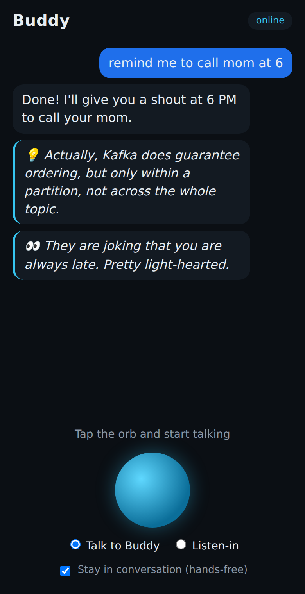

# Buddy: your AI best friend in your earbuds

Buddy is a personal voice assistant in the spirit of JARVIS. You talk to it through
your earbuds and it talks back. It remembers your life and speaks up when something
matters. In **Listen-in** mode it quietly whispers translations, warns you when
people talk about you, and corrects technical nonsense in the room.



## What works today (v0.2, phase 0)

| Feature | How |
|---|---|
| **Talk** | Tap the orb and talk. Replies stream sentence by sentence, so Buddy starts speaking in about a second. |
| **Hands-free conversation** | Buddy keeps listening between turns, so you don't need to tap again. |
| **Interrupt Buddy** | Just start talking over it. It stops and follows you. |
| **Personality** | Casual best friend: honest, funny, pushes you toward your goals (`backend/buddy/persona.py`). |
| **Memory** | Remembers facts you tell it ("I parked on level 3") and uses them later. |
| **Reminders** | "Remind me to call Mom at 6". At 6, Buddy chimes and says it in your ear. |
| **Goals & coaching** | "My goal is to finish the MVP this week". Buddy checks in on it. |
| **Morning briefing** | Spoken daily at `BUDDY_MORNING_BRIEF` (default 08:00). |
| **Web search** | News, weather, scores, facts (Claude's built-in web search). |
| **Listen-in mode** | 🌐 gives you the gist when people speak a language you don't know (anything outside `BUDDY_KNOWN_LANGUAGES`: English, Hindi, Malayalam, Marathi, Tamil by default), 👀 tells you when people are talking about or mocking you in that language, 💡 corrects wrong technical claims in any language. Say "Buddy, …" to ask it something without leaving the mode. 💭 When someone asks you something and you say **"let me think"**, Buddy whispers a ready-to-use answer within seconds. |

| **Research & analytics agent** | "Research the best eSIM for Brazil" or "Analyze these numbers": runs in the background, reads real pages or crunches data with code, and reports back with a spoken summary and a full report with sources (Reports in the apps). Per-job cost cap and daily limit. |
| **Background jobs** | Work continues while you do other things; jobs survive server restarts and results wait for you if your phone is offline. |
| **Specialist agents** | Buddy orchestrates agents that are MCP servers (`agents.yaml`). Example agent: `worldclock`. Each agent is the template for new ones (`backend/agents/worldclock`). |
| **Approvals** | Agent tools marked `approval_required` do nothing until you say yes in a later message; Claude cannot approve its own actions. |
| **Kill switch, limits, audit** | Pause any agent by voice or admin API; daily call limits per agent; every agent call logged with arguments masked. |
| **Privacy** | Cards, accounts, US SSN, South American IDs (CPF, RUT, CUIT, DNI, cédula), Aadhaar/PAN, passports, one-time codes and passwords are masked before anything reaches Claude. Database encrypted with SQLCipher. |
| **Travels with you** | Buddy follows your phone's time zone across the US, South America and India. |
| **Thrifty, with your approval** | Takes the cheapest good route (memory, then web search only for current facts, quick before deep research). Daily, Listen-in and monthly allowances; when one runs out, or an action costs over $0.50, Buddy asks first. Your yes is read in code, so the AI can't approve its own spending. Hard cap on top. Yesterday's cost in the morning briefing; "how much have you cost me?" works. |
| **Connectors** | One systematic way to plug in apps (`docs/CONNECTORS.md`): Calendar (private iCal link) and Email (read-only) today; bank, Airbnb, Takeout, Oura and more planned. Read-only, masked, encrypted, with health and a kill switch; app content is treated as information, never instructions. |
| **Organiser** | To-do lists by voice (shopping, work, home), due dates and priorities; the morning briefing says what's due, the evening wrap-up (9 pm) celebrates what got done and previews tomorrow. |
| **Money agent** | Reads charges, bills, payments and refunds from your bank and card emails; spending by category and currency, cash expenses by voice, bill reminders before the due date, monthly limits with warnings at 80% and 100%. |
| **Deals finder** | Background deal hunts for flights, hotels and shopping: many sellers compared on total price (fees, shipping, baggage), coupons, reviews and return rules, and whether to buy now or wait. Price watches keep checking and tell you when it drops to your target. |
| **Email manager** | Sorts new mail from all your accounts by priority and your rules, tells you about urgent mail right away, organises Gmail automatically (label, archive, mark read) after your one-time yes. |
| **Gmail agent** | Read, search, draft, send and clean up Gmail (archive, trash, mark read, label, unsubscribe links) with the same app password; sending and cleanup ask first, trash is recoverable for 30 days. |
| **Zapier agent** | Thousands of everyday apps (Notion, Todoist, Sheets, Slack...) through Zapier MCP (`docs/ZAPIER.md`). Changes need your yes; lookups don't; daily and monthly call limits; secrets in the server's settings file. |
| **FinOps** | What Buddy costs to run, all in (`docs/FINOPS.md`): Claude (split into chat, Listen-in, think, expert, research and web searches), the server (DigitalOcean's live bill, or any host's price), Zapier tasks and any other monthly cost, with month-to-date, end-of-month forecast and an all-in budget. Ask *"what do you cost to run?"* or `GET /admin/costs`. |
| **Smart escalation** | Buddy judges whether its answer is good enough and steps up one level at a time: memory, web search, the expert (Opus thinking harder, with web access, about 5–25¢), quick research, then a deep report only with your yes. A low-confidence research result comes with an offer to dig deeper. |
| **Economy mode** | Chat on Claude Sonnet 5.5, research on Opus 5.5, Listen-in screened by Haiku 5.5 first; every model is a setting. |

On your Galaxy, use the **Android app** ([`android/`](android/README.md)): it keeps
listening with the screen off, answers your earbud tap and pauses during calls.
The web app still works in any phone browser. Audio goes through whatever the
phone uses, so connect your earbuds and go.

## Architecture

```
 Earbuds ─BT─ Android phone (Buddy app: ears and mouth)
                │  Tailscale private network + HTTPS (no public ports)
                ▼
          Your private server (VPS, US East)
            Buddy orchestrator (Python, FastAPI) ──masked text──▶ Claude
            ├─ agent.py      conversation loop, streaming, interruption, approvals
            ├─ agents.py     agent registry: MCP clients, approvals, limits, audit, kill switch
            ├─ privacy.py    masking of sensitive numbers
            ├─ usage.py      Claude cost tracking and monthly budget
            ├─ ambient.py    Listen-in analysis
            ├─ proactive.py  reminders and morning briefing
            └─ memory.py     encrypted SQLite (SQLCipher): facts, reminders, goals, audit, usage
          Specialist agents (MCP servers): worldclock now; money, mail, tutor… next
```

## Put it on your private server

Follow [`docs/SETUP.md`](docs/SETUP.md): the complete step-by-step guide (about 90 minutes), with the monthly cost
breakdown (about $25–50 a month in total).

## Run it locally (development)

```bash
cd backend
python3 -m venv .venv && source .venv/bin/activate
pip install -r requirements-dev.txt
cp .env.example .env               # add ANTHROPIC_API_KEY and your name
cp agents.example.yaml agents.yaml
uvicorn buddy.server:app --port 8000
```

Tests: `cd backend && pytest`

## Listen-in mode: good to know

- Browser speech recognition handles one language at a time, so pick the **room
  language**: for example Kannada, Telugu, Arabic or Chinese to get the gist, or
  one of your own languages for technical corrections only. Automatic language
  detection comes with the cloud speech-to-text upgrade in the roadmap.
- Browser speech-to-text can't tell speakers apart. Buddy knows this and stays
  cautious ("I think they said…").
- Buddy analyses other people's speech live and keeps it only in a two-minute
  in-memory window. It is never written to disk.
- Laws on recording or processing conversations differ by country and state.
  Use it in conversations you are part of, and check the rules where you live.

## Roadmap

| Status | What |
|---|---|
| ✅ Done | Private server, encryption, masking, orchestrator and agent registry |
| ✅ Done | Background jobs, research agent, expert escalation, thrifty spending limits, FinOps cost report |
| ✅ Done | Connectors: calendar, email, phone notifications, phone and work calendars |
| ✅ Done | Agents: Gmail across all accounts (read, draft, send, cleanup), email manager (priorities, rules, auto-organise), Zapier |
| ✅ Done | Android app: screen-off listening, earbud button, call pause, voice picker, smart Listen-in, starts when earbuds connect, "Hey Buddy" |
| ✅ Done | Organiser (tasks, evening wrap-up) and money agent (spending, bills, limits) |
| ✅ Done | Approve/Decline buttons, in the app, the browser and on the notification |
| Later | Whisper speech-to-text on the server, English tutor, flights and travel, life log, Oura Ring, call co-pilot, learns your style, agent builder, Galaxy Watch |

The Android app's install guide is in [`android/README.md`](android/README.md).
