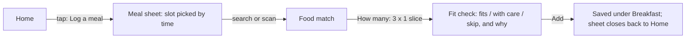
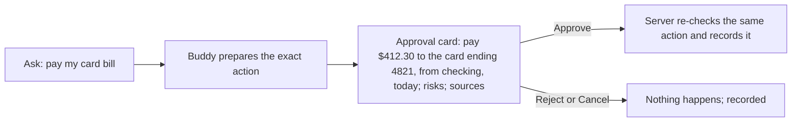

# Critical user journeys and tap counts

Status: **designed and prototyped**; the daily journeys (1 to 6) and the approval (14) are run automatically
against the prototype by `../08-quality/prototype.test.js` and their tap counts checked.

Taps are counted from a freshly opened app (Home › Conversation), not counting typing or speaking. "Today" is the
current app (Android 0.3.183), counted from its code.

| # | Journey | New path | New taps | Today's taps |
| --- | --- | --- | --- | --- |
| 1 | Open Buddy and start a conversation | Type or speak in the composer on Home | 0 | 0 |
| 2 | Speak to Buddy with earbuds | Earbud button, or the composer's mic | 0 to 1 | 1 |
| 3 | Add a meal | Home quick action "Log a meal" → sheet (search, scan, How many) | 1 | 2 to 4 |
| 4 | Log blood pressure | Home quick action "Log BP" → sheet | 1 | 2 to 3 + scroll |
| 5 | Check today's health | Bar: Health (opens on Today) | 1 | 2 to 3 |
| 6 | Scan a grocery product | Home quick action "Scan" → camera → verdict | 1 | 3 |
| 7 | Compare products | After two scans: verdict sheet → Compare | 2 | 4 |
| 8 | Review spending | Bar: Money → Spending | 2 | 1 |
| 9 | Review bills | Bar: Money (Overview shows bills due) | 1 | 1 |
| 10 | Research an investment | Ask in the conversation; or Money → Invest | 0 / 2 | 2 |
| 11 | Find a product deal | Ask in the conversation; or Explore → Deals | 0 / 2 | 2 |
| 12 | Read personalised news | Bar: Explore (For you) | 1 | 1 |
| 13 | Explore intelligence research | Explore → Research | 2 | 2 to 3 |
| 14 | Approve a financial action | The approval card in the conversation → Approve | 1 | 1 |
| 15 | Connect an outside service | Profile → Connections → the service | 3 | 2 |
| 16 | Configure an AI provider | Profile → AI → the provider | 3 | 3 |
| 17 | Manage privacy | Profile → Privacy | 2 | 3 to 4 (spread over pages) |
| 18 | Subscribe to Premium | Profile → Account → Compare plans → Upgrade | 3 (plus the store's own steps) | none today |
| 19 | Export data | Profile → Privacy → Export | 3 | none in one place |
| 20 | Delete personal data | Profile → Privacy → Delete → confirm twice | 4 (deliberate) | spread over pages |

Every daily task (1 to 6, 9, 12, 14) takes two taps or fewer. Spending moves from 1 to 2 taps because Money now opens
on a short Overview (balances, bills due, this month's spending) instead of the long Spending page.

## Journey: add a meal (3)

## Journey: approve a financial action (14)

The server, not the screen, enforces approval: it executes only the action whose details match the approved card,
once, and records who approved what and when (`../07-engineering/architecture.md`).
