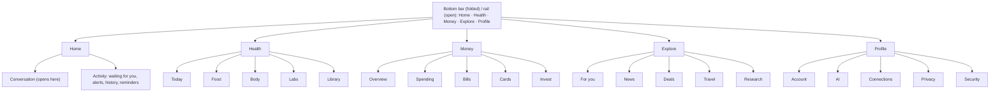

# Information architecture and navigation

Status: **designed and prototyped** (in `../05-prototype/`); not yet in the app.

## The rule

Two levels, no more: a **destination** (the bar or rail) and a **section** inside it (a segmented control under
the title). Everything deeper is a **sheet** on the folded phone or the **side panel** on the open Fold: it slides
over the section, is closed by Back, and never adds a third row of tabs. 22 sections replace about 63 tab views.

## Destinations and what each holds

| Destination | Sections (first = default) | Header actions | Sheets / side panel |
| --- | --- | --- | --- |
| **Home** | Conversation · Activity | Activity bell with count, profile avatar | Result details, comparisons, approvals, attachments |
| **Health** (isolated) | Today · Food · Body · Labs · Library | Log BP, Scan, Privacy and sources | Log a meal, food detail, product verdict, BP entry, lab report, goals, sources |
| **Money** | Overview · Spending · Bills · Cards · Invest | Search transactions | Transaction, bill, card, holding, approval |
| **Explore** | For you · News · Deals · Travel · Research | Search | Article, deal with price history, comparison, trip, report, library item |
| **Profile** | Account · AI · Connections · Privacy · Security | none | Provider, connection, export, delete, subscription |

## Navigation behaviour

- **Opening Buddy** lands on Home › Conversation with the composer focused-ready (not keyboard-up) and the mic one
  tap away. Returning to Home always returns to the conversation, scrolled to the latest message.
- **Each destination remembers its section** for the session; a cold start opens each destination on its default.
- **Back:** closes a sheet first; then returns to the destination's default section; then to Home; from Home it
  leaves the app. Never through sections in history order (that was confusing in the old Health page).
- **Voice from anywhere:** the mic is in the composer on Home and a floating button on the other four destinations
  (except Health, where it is replaced: the conversation doesn't take health, so Health shows "Log BP" and "Scan"
  instead, and the mic stays in the bar's Home item as a long-press shortcut).
- **Quick actions on Home** jump straight to the right sheet: Log a meal, Log BP, Scan food (Health); Spending,
  Bills (Money); Deals (Explore). Health quick actions open Health's own sheets; nothing health-related is sent to
  the conversation.
- **Folded:** five-item bottom bar, 72 dp, labels always shown. **Open (600 dp and wider):** an 80 dp rail on the
  left, the section control under the title, and a side panel (380 dp) on the right for details; Home shows the
  conversation in the middle and the result panel on the right.

## Why health has its own destination

The conversation never takes health information (no AI model, Claude included, sees it). Health therefore needs a
home one tap away, with its own quick entry points; it was four levels deep under More. Health's Today replaces the
old Today, Trends' summary and Plan's Progress; Body gathers blood pressure, weight, risk, sleep and readiness
trends; Food gathers meals, the scanner, groceries and menus; Labs gathers results, reports, portals and checkups;
Library gathers research, supplements, medicines and the guideline watch.

## Names

| Old | New | Why |
| --- | --- | --- |
| Buddy (place) | Home | It is home: the conversation lives there |
| Discover; Trips & Deals | Explore (News, Deals, Travel, Research) | One place to look outward |
| More | Profile | Account and control, not leftovers |
| Plan › Food / Groceries | Health › Food (Groceries inside) | Logging is not planning |
| Trends › Body & BP | Health › Body | Plain word |
| Learn | Health › Library | Research, supplements, medicines |
| Maestro | Profile › AI (titled "Buddy Maestro") | The brand name stays, the section says what it is |
| Connections | Profile › Connections (titled "Buddy Connect") | Same |
| Alerts | Home › Activity | Where things Buddy did or asks show up |
