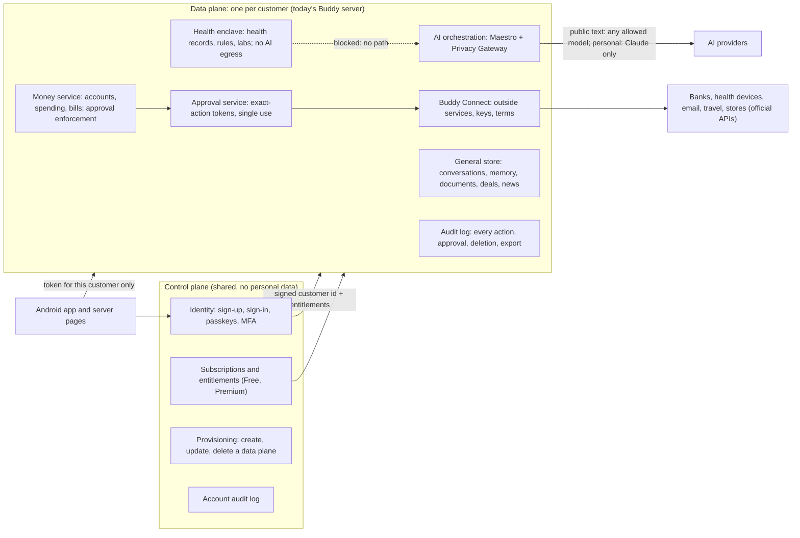

# Architecture: multi-user Buddy, data boundaries, approvals

Status: **designed** (documented here; not implemented). Builds on what exists: one Buddy server per customer
(`modules.py` already starts a new customer's server with "core"), the Privacy Gateway (`privacygate.py`), approvals
(`confirm_action`) and Buddy Connect (`gateway.py`).

## Decision: a shared control plane, one isolated data plane per customer

Three ways to serve many users were weighed:

| Option | Isolation | Cost per user | Fit with today |
| --- | --- | --- | --- |
| A. Pooled multi-tenant (one database, a tenant id on every row) | Logical only; one bug can leak across users | Lowest | Large rewrite of 207 modules that assume one owner |
| B. One server per customer, nothing shared (today) | Strongest | Highest; no shared sign-up or billing | Works today, doesn't scale commercially |
| **C. Shared control plane + one data plane per customer** | Strong: each customer's data, keys and health store are separate | Medium; data planes can be small containers | Keeps today's server as the data plane |

**Chosen: C.** It keeps the owner's decision (one server per customer) and adds what a commercial product needs:
accounts, subscriptions, entitlements and provisioning in a small shared service that never holds personal data.

## The boundaries, and how each is enforced (not by the UI alone)

| Boundary | Rule | Enforced by |
| --- | --- | --- |
| Customer from customer | No request reaches another customer's data | Separate data plane per customer: its own database file, encryption key (`BUDDY_DB_KEY`), secrets and token; the control plane signs a customer id that the data plane checks on every request |
| Health from AI | No AI model, Claude included, receives health information | Health enclave: health tables and services are only callable by the Health screens and rules code; `privacygate.authorize` refuses health content to every provider (exists today); a test fails if any AI tool returns health data; the health enclave has no network route to AI providers |
| Personal from non-Claude models | Personal details go to Claude only | Privacy Gateway classification before every model request (exists today) |
| Money actions need approval | Nothing pays, transfers, buys, sells, trades, books, cancels or submits without the owner's yes | Approval service: the action is described in full (amount, destination, source, time), hashed, and shown; Approve returns a single-use token bound to that hash; the executor runs only with a matching, unexpired, unused token and records it. The UI cannot execute anything by itself |
| Keys | Never in chat, logs or the app | Keys entered on the server (`deploy/set.sh`, hidden prompts) or through the control plane's sealed set-up; logs redact secrets (exists today) |
| Deletion and export | Always available, every plan | Data-plane endpoints: export (all tables, a signed archive) and delete (per source, per domain, everything; the control plane then destroys the data plane and its keys) |

## Approval service (detail)

1. A tool proposes an action: `{kind, amount, currency, to, from, when, details}`.
2. The service stores it with a hash of those fields and returns an approval card payload. Nothing runs.
3. The owner sees the exact action on the card. **Approve** sends the approval id; the server re-reads the stored
   action, checks the hash, marks the token used, and only then calls the executor (bank, store, calendar, phone).
4. Any change to the action (a different amount) is a new approval. Tokens expire after 15 minutes.
5. Every step writes the audit log: proposed, shown, approved or rejected (by whom, when, from which device),
   executed, result.

## Accounts, entitlements and limits

- **Accounts:** one account per person; one data plane per account. Family sharing is out of scope for v1.
- **Entitlements** (signed by the control plane, read by the data plane): `plan` (free/premium), monthly limits for
  AI requests, research jobs and paid search calls, integration count, report types. Today's caps (Maestro's monthly
  AI cap, Buddy Search daily allowances) become entitlement-driven instead of fixed settings.
- **Never gated:** privacy controls, security, data export, deletion, approvals, health isolation.
- **Pricing:** not set here (decided at launch).

## Consent and retention

- Each connection records its consent: what is read, why, and its terms (Buddy Connect already records terms).
- Retention is per domain and configurable within bounds; health data stays until the owner deletes it (the
  owner's current choice); search caches follow each provider's terms (exists today).
- The audit log keeps 400 days by default; the owner can export it.
