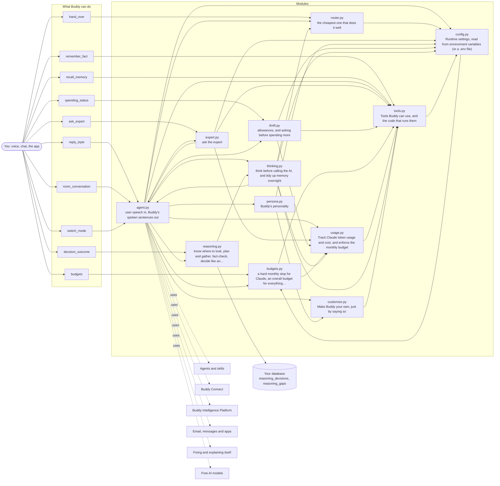

# Claude: the brain

Understands you, decides what to do, picks the cheapest Claude model that does the job well, thinks from memory before calling the AI, follows your standing instructions, and asks before spending more.

## Architecture



The diagram reads left to right: what you ask, the tools Buddy uses, the modules that do the work, and what they keep or call. Dashed arrows are other features this one relies on.

## What Buddy can do here

| Tool | What it is for | Actions | Module |
|---|---|---|---|
| `reply_style` | How replies come out: 'dual' = spoken in another language (e.g | dual, normal | agent.py |
| `room_conversation` | In Listen-in mode, what's been said around the user recently, as text (speech recognition, with how long ago and the language) | - | agent.py |
| `switch_mode` | Switch the Buddy app between Talk (everything the user says is for you) and Listen-in (you only answer wake words like 'Hey Buddy', 'Bro', 'Aliya'; the room is  | listen_in, talk | agent.py |
| `hand_over` | Pass this question to the main model when it needs more than a quick reply: several steps, careful reasoning, email, money, planning, places, writing, or anythi | - | router.py |
| `decision_outcome` | Record how a decision Buddy advised on turned out (the user's words), so future advice on similar decisions uses it | - | reasoning.py |
| `ask_expert` | Hand a question to a stronger model that thinks harder and can search and read web pages (about 5 to 25 cents, a few seconds) | - | expert.py |
| `spending_status` | How much Buddy has cost: today, yesterday, this month, against the allowances and budget | - | thrift.py |
| `budgets` | The user's monthly budgets: the Claude cutoff (Claude stops for the month when reached; default $20) and the overall budget, a switch for everything Buddy costs | status, predict, set | budgets.py |
| `remember_fact` | Save a fact about the user to long-term memory (people, preferences, plans, where things are) | - | tools.py |
| `recall_memory` | Search long-term memory for facts about the user | - | tools.py |
| `forget_fact` | Delete remembered facts, and lines of past chats, containing this text | - | tools.py |
| `set_reminder` | Schedule a spoken reminder | - | tools.py |
| `list_reminders` | List reminders that haven't gone off yet, with their ids. | - | tools.py |
| `cancel_reminder` | Cancel a pending reminder by id (get ids from list_reminders). | - | tools.py |
| `add_goal` | Record a goal the user wants to work toward, so you can guide and check in on it. | - | tools.py |
| `list_goals` | List the user's open goals with their ids. | - | tools.py |
| `complete_goal` | Mark a goal as achieved by id. | - | tools.py |
| `confirm_action` | Carry out an agent action that needed approval | - | tools.py |
| `list_agents` | List Buddy's specialist agents, whether each is on, and its tools. | - | tools.py |
| `pause_agent` | Switch an agent off immediately (kill switch) | - | tools.py |
| `customize_buddy` | The user changes how you work, in their own words | add, remove, set, list, reset | customize.py |

## Technical design, module by module

### agent.py

```text
The conversation loop: user speech in, Buddy's spoken sentences out.

Replies are streamed sentence by sentence so the phone can start speaking
before Claude has finished writing, which is what makes it feel live.
```

- Uses: advisor.py, agents.py, amazon.py, attention.py, bankfeed.py, benefits.py, bip.py, brain.py, browse.py, buddysearch.py, budgets.py, builder.py, calls.py, cards.py, cftc.py, checkin.py, claudefix.py, coach.py, codejob.py, commute.py, compliance.py, config.py, connect.py, connecthub.py, convolog.py, costwatch.py, credit.py, customize.py, datatools.py, dayplan.py, dealcollector.py, dealforecast.py, deals.py, dining.py, docedit.py, events.py, expert.py, finance.py, finops.py, flights.py, formfill.py, free_models.py, funds.py, gateway.py, glasslink.py, groceries.py, health.py, health_data.py, hoteldirect.py, insights.py, investors.py, jobs.py, journal.py, lenses.py, library.py, lifelog.py, lifemail.py, location.py, maestro.py, mailbrain.py, mailorganizer.py, makers.py, maps.py, market_school.py, markets.py, memory.py, merchants.py, messaging.py, model_advisor.py, modelscout.py, modules.py, money.py, morning_tutor.py, nest.py, organiser.py, oura.py, packages.py, paper.py, patterns.py, persona.py, plaid.py, pricebook.py, prices.py, privacy.py, privacygate.py, reasoning.py, recommend.py, review.py, reviews.py, rides.py, router.py, routine.py, routing.py, sandbox.py, scheduling.py, seasons.py, seats.py, securitywatch.py, selfcheck.py, selfcode.py, selfdeploy.py, shopper.py, signals.py, social.py, subcancel.py, taste.py, techradar.py, thinking.py, thrift.py, tools.py, transcripts.py, transit.py, travel.py, travelcall.py, trends.py, tutor.py, usage.py, vocabulary.py, voiceprint.py, weather.py, webread.py, whentobuy.py

### router.py

```text
Which Claude model answers each turn: the cheapest one that does it well.

  (free)      small talk on its own ("thanks", "good night", "tell me a joke"), with free models on
  Haiku 5.5   short chat, closers even mid-topic, reminders, tasks, quick facts (about 20x cheaper)
  Sonnet 5.5  everything else: email, money, places, planning, follow-ups to those
  Opus 5.5    hard questions, through the ask_expert step-up (unchanged)

Rules decide (no extra model call, no delay). Haiku gets a hand_over tool: when a
question turns out to need more, it passes it to Sonnet in the same turn.
```

- Uses: config.py, routing.py

### reasoning.py

```text
How Buddy thinks: know where to look, plan and gather, fact-check, decide like an advisor, learn from results.

1. Source map (SOURCES): every source Buddy has, what it answers, the tool that reads it, and whether it's set up.
   pick(question) ranks the ones that matter for a question, so Buddy looks in the right places first ("my flight"
   -> plans, flight_status, email) instead of saying "I don't know".
2. Plan, then gather: for an involved question (two or more sources, or a decision) the memory pack carries a short
   plan: which tools, called together in one step where they don't depend on each other.
3. Fact-check (verify): after a reply that used tools, the numbers and dates in it are checked against what the
   tools actually returned; any that aren't there go to Claude's quick model with the tool results, and a wrong
   one gets a "Fact check:" correction right after. Web facts need two sources or are labelled as one source.
4. Decide like an advisor: a question that asks for a decision gets a structure (2-3 real options, what matters to
   the user from their saved preferences, trade-offs, ONE recommendation and why, what would change it), plus past
   related decisions and how they turned out. High stakes: a second opinion (ask_expert) and never acting without
   the user's yes.
5. Learn from results: each recommendation is logged; a few days later Buddy asks once how it went, and the outcome
   (decision_outcome tool) is used the next time a similar decision comes up.

Adapting: a question in an area with no source connected (weather, packages, health data...) is a gap. In the
moment Buddy says what source would answer it (CATALOG: free/official ones first) and how to set it up; gaps are
counted, and once a week the most-asked missing areas become a suggestion. Areas the catalog doesn't know are
proposed by Claude's quick model from the gap topics.
```

- Tables: `reasoning_decisions`, `reasoning_gaps`
- Settings: `BUDDY_AEROAPI_KEY`, `BUDDY_AIRLABS_KEY`, `BUDDY_DUFFEL_TOKEN`, `BUDDY_SERPAPI_KEY`
- Uses: memory.py, thinking.py

### expert.py

```text
Step 3 of the escalation ladder: ask the expert.

Everyday chat runs on a quick, cheap model. When it judges its own answer
wouldn't be good enough (high stakes, hard reasoning, unsure, or the user
pushes back), it hands the question to a stronger model thinking harder,
with web search and page reading. The expert's answer comes back for Buddy
to say in its own voice. Each call is counted in the daily allowance, has a
daily limit, and asks first if it would ever cost more than the approval
threshold.
```

- Settings: `BUDDY_EXPERT_DAILY_LIMIT`
- Uses: agent.py, config.py, memory.py, privacy.py, social.py, tools.py, usage.py, webread.py

### persona.py

```text
Buddy's personality. Kept stable per session so the prompt prefix caches.
```

- Uses: config.py, customize.py, memory.py

### thrift.py

```text
Buddy's wallet: allowances, and asking before spending more.

Three allowances, all approved extensions included:
  - monthly budget   settings.monthly_budget_usd, never above settings.hard_cap_usd
  - daily allowance  the monthly budget spread over the month
  - Listen-in        settings.listen_daily_usd a day

When one runs out, or an action costs more than settings.approve_over_usd,
Buddy asks. The answer is read here, in code, from the user's own next
message: Claude can never approve spending, and a yes costs nothing.
```

- Settings: `BUDDY_HARD_CAP_USD`
- Uses: config.py, memory.py, tools.py, usage.py

### budgets.py

```text
Budgets: a hard monthly stop for Claude, an overall budget for everything Buddy costs, and alerts.

Claude cutoff (default $20 a month, BUDDY_CLAUDE_KILL_USD, or set from the app or by voice): once Claude's spend this
month reaches it, every Claude call is refused before it leaves the server: chat, briefings, scans, research,
everything. Free models and code-only work carry on. Only the user raises it, in their own words, read in code
("set my Claude budget to 30") or from the app's Insights screen; Claude can never raise it.

Overall budget, the whole-Buddy switch (BUDDY_ALLIN_BUDGET_USD, or set the same ways): everything Buddy costs. The
month's committed costs (the server, plans, per-bank prices, fixed costs: owed whatever Buddy does, so counted in full
from the 1st) plus what Buddy has spent on pay-per-use services (Claude, other AI models, web search, flight and travel
prices, FlightAware, Groq speech) must stay under it. When they reach it, every paid call stops until the 1st: Claude
(config.claude_client) and every paid outside service (an audit hook on urllib refuses PAID_HOSTS; Groq speech falls
back to the local Whisper). Free services, reminders, the bank feed and the screens keep working.

Alerts go out once each, per month, when spend passes 50%, 80% and 100% of either budget.

Where it's going (predict): the month's end from the last 3 days' pace (it reacts to a sudden storm of calls, where a
month average would hide it), the day a budget would be reached, and what's driving it. When a forecast passes a
budget, Buddy says so and holds: background paid work (briefings, scans, research, the brain's reading, paid searches)
waits for the user's approval; their own chat carries on. "Yes" approves this pace (asked again only if the forecast
grows another 20%); "no" keeps the hold (saver) for the month. The answer is read in code, or given in Insights.
```

- Settings: `BUDDY_ALLIN_BUDGET_USD`, `BUDDY_CLAUDE_KILL_USD`
- Uses: costwatch.py, memory.py, tools.py, usage.py

### usage.py

```text
Track Claude token usage and cost, and enforce the monthly budget.
```

- Uses: diagnostics.py, free_models.py, memory.py, modules.py, privacy.py, tools.py

### thinking.py

```text
Buddy's brain, phase 3: think before calling the AI, and tidy up memory overnight.

Before every reply (prepare):
  1. Understand  which people and things from memory the question names, and whether it's about
                 the user's own life ("my", "I", a known name)
  2. Recall      the brain's hybrid search (meaning + words) over documents and facts
  3. Answer?     a lookup ("when does my passport expire?") that one saved fact clearly answers is
                 answered straight from memory: no AI call
  4. Pack        otherwise a small "context pack" (best passages, facts, people, preferences, with
                 their sources) rides along with the question, and a lookup with a good pack goes to
                 the quick model instead of the main one

Every night (nightly, about 3 am):
  - duplicates merged: the same fact saved twice (word for word, or nearly)
  - conflicts found: two facts about the same thing that disagree ("two passport numbers") become a
    question for the user, asked once in the morning briefing; nothing is deleted without them
  - the day reviewed (quick Claude model, personal data never goes to a free model): a short
    summary for the life log, new things the user said about themselves, preferences they stated,
    and dates to act on found in new facts and documents
  - choices become preferences: the same pick three times or more (Lyft when it was cheaper) is
    saved as a learned preference, and the user hears about it once
  - dates to act on (expiries, renewals, warranties, bills due) get reminders ahead of time:
    passport 90, 30 and 7 days before, a bill 7 and 1 days before
```

- Uses: agent.py, brain.py, config.py, connect.py, lifelog.py, memory.py, privacy.py, router.py, tools.py, travel.py, usage.py

### tools.py

```text
Tools Buddy can use, and the code that runs them.
```

- Settings: `BUDDY_FETCH_MAX_TOKENS`, `BUDDY_SEARCH_LEVEL`
- Uses: config.py, convolog.py, memory.py

### config.py

```text
Runtime settings, read from environment variables (or a .env file).
```

- Settings: `BUDDY_AGENTS`, `BUDDY_ANNOUNCE_APPS`, `BUDDY_APPROVE_OVER_USD`, `BUDDY_CHAT_MODEL`, `BUDDY_DAILY_ALLOWANCE_USD`, `BUDDY_DEV`, `BUDDY_EFFORT`, `BUDDY_EVENING_WRAP`, `BUDDY_EXPERT_DAILY_LIMIT`, `BUDDY_EXPERT_EFFORT`, `BUDDY_EXPERT_MODEL`, `BUDDY_FAST_MODEL` and 25 more
- Uses: budgets.py, privacygate.py

### customize.py

```text
Make Buddy your own, just by saying so.

Two kinds of change:
  - standing instructions in the user's own words ("call me Aneesh", "I prefer Lyft over Uber",
    "always give prices in rupees too"): kept as a short list Buddy follows in every reply
  - settings that change how Buddy works:
      reply_length      short | normal | detailed
      bill_days         how many days before a bill is due the reminders start (1-14, default 3)
      briefing_topics   extra things in the morning briefing ("cricket scores", "weather in Kochi")
      briefing          on | off
They are stored on the server (kv: custom:*) and applied at once; the list is in Settings via
"what have I told you to change?".
```

- Uses: memory.py, tools.py

## How it connects

- Relies on: Agents and skills; Buddy Connect; Buddy Intelligence Platform; Email, messages and apps; Fixing and explaining itself; Free AI models (Groq, Gemini, Mistral, Cerebras, GitHub Models, OpenRouter); Going out: restaurants and events; Home and health; Insights and costs; Investing: signals, research and practice; Learning: the English and investing tutors; Making and doing things; Memory; Money; News, trends and research; Phone calls; Security and privacy; Shopping and deals; Speaking up on its own: briefing, reminders and alerts; The price book, pattern learning and trained models; The server and the app; Travel and getting around; Voice: Talk mode and Listen-in
- Relied on by: Agents and skills; Buddy Connect; Buddy Intelligence Platform; Email, messages and apps; Fixing and explaining itself; Free AI models (Groq, Gemini, Mistral, Cerebras, GitHub Models, OpenRouter); Going out: restaurants and events; Home and health; Insights and costs; Investing: signals, research and practice; Learning: the English and investing tutors; Making and doing things; Memory; Money; News, trends and research; Phone calls; Security and privacy; Shopping and deals; Speaking up on its own: briefing, reminders and alerts; The price book, pattern learning and trained models; The server and the app; Travel and getting around; Voice: Talk mode and Listen-in

