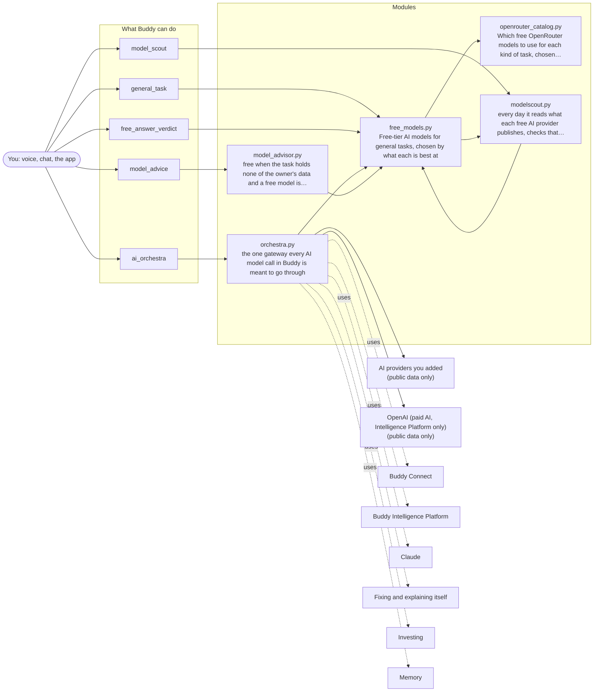

# Free AI models (Groq, Gemini, Mistral, Cerebras, GitHub Models, OpenRouter)

Do general work for free, never with your personal data: translating, summarising public text, brainstorming, general code questions.

## Architecture



The diagram reads left to right: what you ask, the tools Buddy uses, the modules that do the work, and what they keep or call. Dashed arrows are other features this one relies on.

## What Buddy can do here

| Tool | What it is for | Actions | Module |
|---|---|---|---|
| `ai_orchestra` | Buddy Orchestra: the AI providers Buddy can use and which one does each job | show, set_model, set_limit, test_model, add_provider, remove_provider | orchestra.py |
| `general_task` | Hand a GENERAL task to a free AI model chosen for the job, to save money: translate a public text, summarize a public article or web page, rewrite or polish gen | - | free_models.py |
| `free_answer_verdict` | After using a general_task answer, record your review of it, in the same response as your reply: used (good as it was), fixed (you corrected it), redone (you di | - | free_models.py |
| `model_scout` | Keeps the free AI models working | status, scan, use | modelscout.py |
| `model_advice` | Which model a task should use, and why: free when it holds none of the user's data and a free model is good enough; otherwise it says no free model is good for  | - | model_advisor.py |

## Technical design, module by module

### orchestra.py

```text
Buddy Orchestra: the one gateway every AI model call in Buddy is meant to go through.

Buddy uses several AI providers. This is the place that knows them all, decides which may see what, picks one
for each job, counts what it cost, and lets a new provider be added later without changing any code.

  Providers (PROVIDERS)
      Claude      the only provider that may see anything about the owner. Three tiers: cheap, mid, strongest.
      OpenAI      optional, paid; public records only. Off until the owner sets its key, model id and price.
      Mistral, Cerebras, Google, NVIDIA   the free pool for public work, tried in the order each is best at.
      OpenRouter  the fallback only: used when none of the pool answers.
      Ollama      a place kept for a local model on a machine the owner controls. Not set up.
      Groq        speech to text only; not used for text.
      Added       any provider that speaks the common chat format can be added from the page: a name, its
                  address, a model id and its price. Its key is entered with the hidden prompt, never in chat.
  The privacy rule (may_see, in one place)
      Anything about the owner goes to Claude and nowhere else. No fallback, no added provider and no setting
      changes that. If Claude cannot answer, a personal task waits; it is never sent elsewhere. Text that is
      meant to be public is checked for personal details before it leaves (free_models.check_general), and if
      it has any it goes to Claude instead.
  Jobs and choices
      Each job (JOBS) has its own model choice, so the cheapest model that does a job well can do it:
      the free pool, one named pool provider, a Claude tier, OpenAI, or an added provider.
  Limit     a monthly spending limit in dollars for the paid choices (CAP_KEY, $5 unless changed). At the limit
            a job goes back to the free pool until the month ends. Spending is counted per job.
  Test      a fixed set of headlines with the right label beside each (TEST). Any choice can be run on it to see
            how often it agrees, how long it took and what it cost, before a job is switched to it. The set was
            written for this purpose, not taken from the news, so treat a result as a guide.

No model id or price for OpenAI or an added provider is built in, because they change and Buddy cannot check
them: the owner enters them from the provider's own page.
```

- Outside services: AI providers you added, OpenAI (paid AI, Intelligence Platform only)
- Settings: `BUDDY_AI_`, `BUDDY_GROQ_KEY`, `BUDDY_OPENAI_ANALYSIS`, `BUDDY_OPENAI_CHEAP`, `BUDDY_OPENAI_KEY`
- Uses: agent.py, benefits.py, config.py, free_models.py, gateway.py, memory.py, themes.py, tools.py, usage.py

### free_models.py

```text
Free-tier AI models for general tasks, chosen by what each is best at.

Rule (checked in code, not left to a model): anything with the user's personal data
or privacy involved stays on Claude. Only general content goes to a free model:
translating a public text, summarizing a public article, rewording, brainstorming,
explaining a concept, a general-knowledge answer, a general coding question. A request
that contains masked numbers, email addresses, phone numbers, secrets (API keys,
tokens, passwords, private keys, .env lines), the user's server addresses or anything
from the user's memory is refused and done by Claude instead.

Providers (each needs its own free key; all speak the OpenAI-style chat API):
  Gemini (Google)   long context, multilingual: summaries, translation, explanations
  Groq              very fast open models: quick answers, rewording, classification
  Mistral           strong in European languages: translation, writing, rewording
  Cerebras          very fast open models: quick answers, brainstorming
  DeepSeek          strong, low-cost coding model, through OpenRouter's free models
                    (DeepSeek's own API keeps data in China, so it's not used)
  GitHub Models     OpenAI's GPT models on a free tier: careful writing and code
  OpenRouter        many free models: a general fallback
Free tiers may use prompts to improve their models and have rate limits, so: general
content only, and when a provider is at its limit or fails, the next best one is
tried, then Claude's cheap model. Model names change often: each provider's model is
a setting, checked against the provider's model list.
```

- Settings: `BUDDY_CEREBRAS_KEY`, `BUDDY_CEREBRAS_MODEL`, `BUDDY_DEEPSEEK_MODEL`, `BUDDY_FREE_MODELS`, `BUDDY_GEMINI_KEY`, `BUDDY_GEMINI_MODEL`, `BUDDY_GITHUB_MODEL`, `BUDDY_GITHUB_MODELS_KEY`, `BUDDY_GROQ_KEY`, `BUDDY_GROQ_MODEL`, `BUDDY_MISTRAL_KEY`, `BUDDY_MISTRAL_MODEL` and 4 more
- Uses: agent.py, budgets.py, config.py, gateway.py, modelscout.py, openrouter_catalog.py, privacy.py, tools.py, usage.py

### openrouter_catalog.py

```text
Which free OpenRouter models to use for each kind of task, chosen from OpenRouter's live list once a day.

Free models on OpenRouter come and go every few weeks, so model names aren't fixed in Buddy. Once a day:
  1. read the public model list (openrouter.ai/api/v1/models, no key needed)
  2. keep only free ones (an id ending in ":free" and a zero price) that take and give text
  3. score each for every task Buddy gives free models, from what the list says about it:
       code       coding models (coder, codestral, devstral, deepseek, north code, laguna...)
       long       long summaries of public pages: the biggest context
       reasoning  explanations: big models and reasoning ones (r1, think, nemotron ultra...)
       writing    rewording, ideas, decks, translation: big general chat models
       fast       quick answers, small talk, sorting: small and quick models
     plus how well each model has done for that task lately (answers Claude used or fixed, minus ones it redid or
     that failed the checks), so a model that keeps getting a task wrong drops down
  4. keep the best three per task (kv openrouter:picks); a model that errors (gone, no longer free) is set aside
     for three days and the next one is used.
A model name set by hand (BUDDY_OPENROUTER_MODEL, BUDDY_DEEPSEEK_MODEL) always wins. Turn on OpenRouter's privacy
setting that keeps prompts away from providers that train on them: requests to those then fail and the next
model is tried.
```

- Settings: `BUDDY_DEEPSEEK_MODEL`, `BUDDY_OPENROUTER_MODEL`
- Uses: markets.py

### modelscout.py

```text
The model scout: every day it reads what each free AI provider publishes, checks that the model Buddy uses
there still answers, and switches to a working one when it doesn't.

Free tiers change without notice: a model is retired, renamed, slowed down or cut off, and a provider that
worked yesterday times out today. Without this, Buddy kept calling the dead model, then rested the provider.

  Trusted sources   only each provider's own official model list, read with the key the owner gave Buddy for
                    that provider: Google (Gemini), Groq, Mistral, Cerebras and GitHub Models. No third-party
                    lists, no downloads, nothing run on the server. (OpenRouter's free models have their own
                    daily catalog, openrouter_catalog.py, built the same way from OpenRouter's own list.)
  Every day         for each provider with a key:
                      1. read its model list; note what is new and what is gone since yesterday
                      2. ask the model in use one tiny question ("reply with the word ready")
                      3. if it doesn't answer (an error, a timeout, an empty reply), try up to three other chat
                         models from that provider's list, best first, and switch to the first that answers
                    A provider that is only at its free limit is left alone: its model is fine, the quota is
                    not, and the other providers cover for it until it resets.
  Sooner            when a provider has just been rested for failing, the scout looks at it on the next check
                    instead of waiting for tomorrow.
  Choosing          "best first" is the provider's models ranked by: the ones Buddy prefers there, then the
                    family that suits a free helper (small and fast general chat models), stable before
                    preview, newer before older. Speech, image, embedding and safety models are never picked.
  By hand           a model the owner set (BUDDY_GEMINI_MODEL and the like) is checked but never changed;
                    "use <model> on <provider>" pins one from chat.

The test question contains nothing personal, and free models still only ever get general content. A switch is
told once; everything else is in the tool's status.
```

- Settings: `BUDDY_GEMINI_MODEL`
- Uses: budgets.py, free_models.py, gateway.py, memory.py, tools.py

### model_advisor.py

```text
Which model for a task: free when the task holds none of the owner's data and a free model is good enough for it,
otherwise a plainly-stated "no free model is good for this" and which Claude model to use, with its cost.

  1. Data: is any of the owner's data in it? Personal details in the request (free_models.check_general: emails,
     phone numbers, secrets, things from memory) or a repo/workspace that isn't known to be clean -> Claude, always.
     Buddy's own code holds none of the owner's data (keys and the database are never in the repo), so code tasks on
     it may go to a free model. Other clean repos: BUDDY_CLEAN_REPOS (comma-separated URLs).
  2. Size: free models are fine for a small, contained change (a rename, a label, a constant, a one-file fix) and
     unreliable for multi-step work across files (a refactor, a new feature, security, concurrency, the app).
  3. Which free model: the best one for code that can use tools (GitHub Models, Gemini, Mistral, Groq, OpenRouter's
     coding picks), ranked by free_models (suited, fast, reliable lately, Claude's verdicts on its answers), skipping
     ones resting after failures and ones whose recent code tasks mostly failed the tests.
  4. None good enough -> say why, and suggest Claude Haiku (small jobs, a few cents) or Sonnet (bigger, 50 cents to
     a few dollars). The owner's yes starts it.
After a free model's code task the tests decide (codejob): failing tests are reported as "the free model couldn't do
this" with the paid suggestion, never passed off as done.
```

- Settings: `BUDDY_CLEAN_REPOS`, `BUDDY_CODE_MODEL`, `BUDDY_FREE_MODELS`
- Uses: config.py, free_models.py, selfcode.py

## How it connects

- Relies on: Buddy Connect; Buddy Intelligence Platform; Claude: the brain; Fixing and explaining itself; Investing: signals, research and practice; Memory; Money; Security and privacy
- Relied on by: Buddy Connect; Buddy Intelligence Platform; Claude: the brain; Fixing and explaining itself; Insights and costs; Investing: signals, research and practice; Learning: the English and investing tutors; Making and doing things; Money; News, trends and research; Speaking up on its own: briefing, reminders and alerts; The server and the app; Voice: Talk mode and Listen-in

