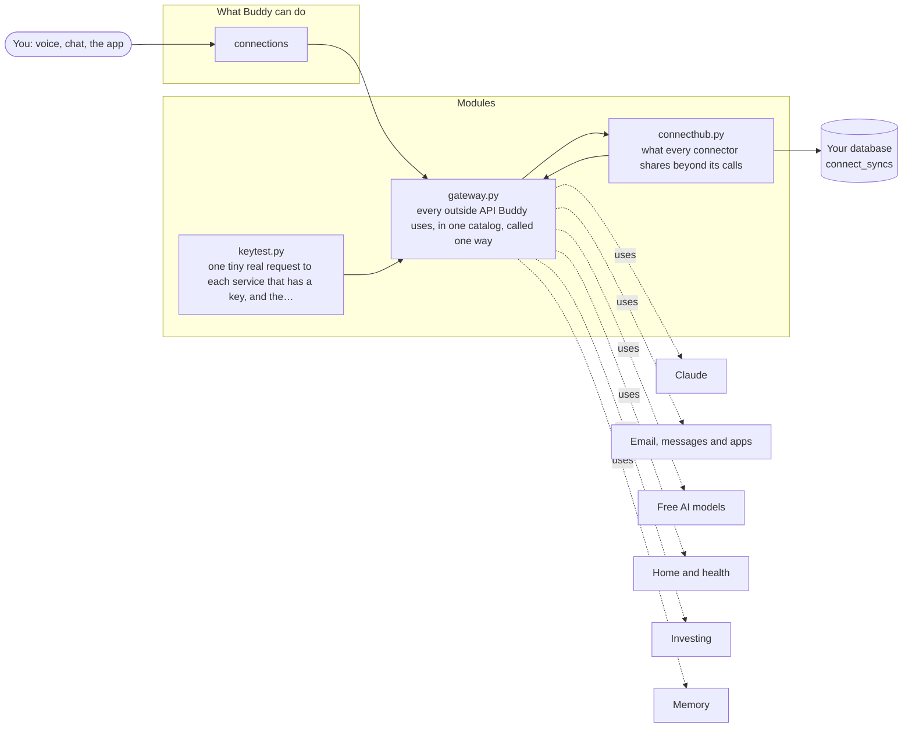

# Buddy Connect

One catalog and one way of calling every outside service: keys, backup hosts, rate limits, the personal-data check, logging and costs.

## Architecture



The diagram reads left to right: what you ask, the tools Buddy uses, the modules that do the work, and what they keep or call. Dashed arrows are other features this one relies on.

## What Buddy can do here

| Tool | What it is for | Actions | Module |
|---|---|---|---|
| `connections` | Buddy Connect: every outside service Buddy uses (search, transit feeds, markets, banks, flights, weather, free AI models...), whether it's set up, whether its l | find, list, test, link | gateway.py |

## Technical design, module by module

### gateway.py

```text
Buddy Connect: every outside API Buddy uses, in one catalog, called one way.

The catalog (CATALOG) says for each service: where it lives (with backup hosts), how it signs in (a key in a
header, or a username and password exchanged for a token), which settings hold its secrets, what a call costs,
how often it may be called, whether it may ever see the owner's personal data, and a small health check.

call() does the rest the same way for every service: adds the key or token (minting and reusing tokens), tries
the backup host when one can't be reached, retries once on a server hiccup, keeps to the rate limit, refuses
personal data for services that may not see it, logs every call (time, cost, error) for Insights, remembers the
last result for the Connections status, and turns failures into ConnectError with the service's own reason.

Services are grouped by area (GROUPS: travel and transit, finance and markets, shopping, search, news and trends, weather,
AI models) for the app and for find. Adding an API later: one CATALOG entry with its group; then call(memory, "name", "/path", ...). Stage 1 moved NJ Transit, MTA,
PATH and Serper here; stage 2 markets, trends and news, flights and weather. The free AI models keep their own
failover and report each result; Claude and Plaid keep their own clients and are listed for the status.
```

- Settings: `BUDDY_AIRLABS_KEY`, `BUDDY_ALPACA_KEY_ID`, `BUDDY_ALPACA_SECRET`, `BUDDY_ALPHAVANTAGE_KEY`, `BUDDY_BESTBUY_KEY`, `BUDDY_CEREBRAS_KEY`, `BUDDY_DEALS_EMAIL_ADDRESS`, `BUDDY_DEALS_EMAIL_APP_PASSWORD`, `BUDDY_DEEPGRAM_KEY`, `BUDDY_EBAY_CLIENT_ID`, `BUDDY_EBAY_CLIENT_SECRET`, `BUDDY_EIA_KEY` and 36 more
- Uses: connecthub.py, maestro.py, markets.py, tools.py, travel.py

### keytest.py

```text
Test Buddy's keys: one tiny real request to each service that has a key, and the provider's own answer when it
fails. Run on the server: sudo bash /opt/buddy/deploy/keys.sh  (never prints a key).

  Claude          lists models (free)
  Serper          one search (one credit)
  NJ Transit      signs in to the train API and the bus/light rail API (free; the token is never shown)
  free models     one 5-word chat with the model Buddy really uses there (Gemini, Mistral, Cerebras, NVIDIA,
                  OpenRouter, DeepSeek through OpenRouter). One that fails also shows what Buddy's own log says of
                  it. Groq is kept for speech only: its key is tested by reading its model list. GitHub Models is
                  not used any more and is not tested.
  everything else every other service in Buddy Connect's catalogue that needs a key: the same small test the
                  Connections page runs for it (services), then the mailboxes and the keys outside the catalogue
                  (extras). A key whose every request is charged is not tested; it says so.

report() puts it together and ends with the count: working, not working, no key, not tested. Run by Buddy itself
(keys.sh asks the running server, so sign-ins Buddy holds are used), or on its own when Buddy is not running.

A request that Buddy's own budget stopped says HOLD: the key was not tried, so it is neither working nor failing.
The owner's test counts as the owner's own request, so the pause on background work does not stop it; a budget
that is reached does. Either way the report ends by saying that paid work is paused and how the owner lifts it.
```

- Settings: `BUDDY_17TRACK_KEY`, `BUDDY_AEROAPI_KEY`, `BUDDY_ALPACA_SECRET`, `BUDDY_ANTHROPIC_ADMIN_KEY`, `BUDDY_DB_KEY`, `BUDDY_DO_TOKEN`, `BUDDY_DUFFEL_TOKEN`, `BUDDY_DUFFEL_VERSION`, `BUDDY_EMAIL_2_ADDRESS`, `BUDDY_EMAIL_2_APP_PASSWORD`, `BUDDY_EMAIL_ADDRESS`, `BUDDY_EMAIL_APP_PASSWORD` and 17 more
- Uses: budgets.py, email_accounts.py, free_models.py, gateway.py, maestro_usage.py, modelscout.py, openrouter_catalog.py, transit.py

### connecthub.py

```text
Buddy Connect's connector hub: what every connector shares beyond its calls. Its sync history, two more states,
the terms its data comes under, and syncing, deleting or disconnecting it on its own.

  sync history   each time a source brought the owner's data in (the Oura Ring, the phone's Health Connect, and
                 later lab results and other devices): when, what kind of sync (the first one, which reads the
                 history; a later one, which reads what's new; one the phone sent; one the owner asked for), how
                 many records came and how many were new, how far it reached, and the error if it failed. The last
                 50 per source, a year at most. No health value is in it: counts, dates and errors only.
  expired        the service no longer accepts Buddy's sign-in (a refresh refused): the owner connects it again.
                 Set by the source's own code; cleared when the sign-in works again.
  needs approval a service that opens its data only to developers it has approved (catalog "approval" says what
                 is needed), while it isn't set up. Never shown as connected.
  terms          what a source's data may be used for, where Buddy knows it (catalog "terms"); "" when unknown.
  sources        the connectors that bring the owner's own data in (SOURCES), each with its module's sync, delete
                 and disconnect. Deleting takes out what the source gave Buddy, its normalized health records and
                 its sync history; disconnecting also stops more coming.

A source module implements, as it can: sync_now(memory) -> str, forget(memory), disconnect(memory) -> str.
```

- Tables: `connect_syncs`
- Uses: gateway.py, healthrecords.py, memory.py

## How it connects

- Relies on: Claude: the brain; Email, messages and apps; Free AI models (Groq, Gemini, Mistral, Cerebras, GitHub Models, OpenRouter); Home and health; Investing: signals, research and practice; Memory; Travel and getting around
- Relied on by: Buddy Intelligence Platform; Claude: the brain; Fixing and explaining itself; Free AI models (Groq, Gemini, Mistral, Cerebras, GitHub Models, OpenRouter); Going out: restaurants and events; Home and health; Investing: signals, research and practice; Learning: the English and investing tutors; Money; News, trends and research; Phone calls; Security and privacy; Shopping and deals; The price book, pattern learning and trained models; The server and the app; Travel and getting around; Voice: Talk mode and Listen-in

