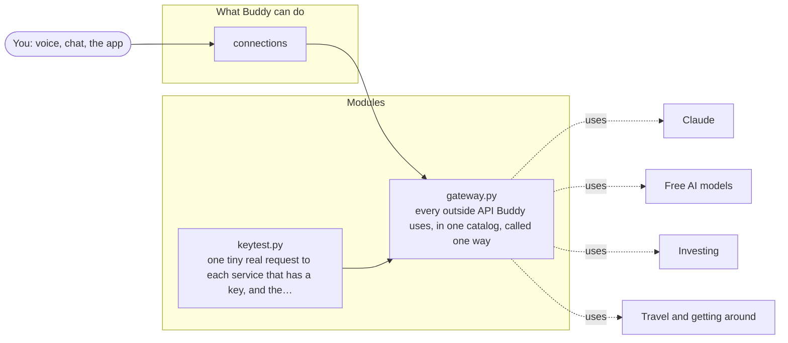

# Buddy Connect

One catalog and one way of calling every outside service: keys, backup hosts, rate limits, the personal-data check, logging and costs.

## Architecture



The diagram reads left to right: what you ask, the tools Buddy uses, the modules that do the work, and what they keep or call. Dashed arrows are other features this one relies on.

## What Buddy can do here

| Tool | What it is for | Actions | Module |
|---|---|---|---|
| `connections` | Buddy Connect: every outside service Buddy uses (search, transit feeds, markets, banks, flights, weather, free AI models...), whether it's set up, whether its l | find, list, test, link | gateway.py |

## Technical design, module by module

### gateway.py

```text
Buddy Connect: every outside API Buddy uses, in one catalog, called one way.

The catalog (CATALOG) says for each service: where it lives (with backup hosts), how it signs in (a key in a
header, or a username and password exchanged for a token), which settings hold its secrets, what a call costs,
how often it may be called, whether it may ever see the owner's personal data, and a small health check.

call() does the rest the same way for every service: adds the key or token (minting and reusing tokens), tries
the backup host when one can't be reached, retries once on a server hiccup, keeps to the rate limit, refuses
personal data for services that may not see it, logs every call (time, cost, error) for Insights, remembers the
last result for the Connections status, and turns failures into ConnectError with the service's own reason.

Services are grouped by area (GROUPS: travel and transit, finance and markets, shopping, search, news and trends, weather,
AI models) for the app and for find. Adding an API later: one CATALOG entry with its group; then call(memory, "name", "/path", ...). Stage 1 moved NJ Transit, MTA,
PATH and Serper here; stage 2 markets, trends and news, flights and weather. The free AI models keep their own
failover and report each result; Claude and Plaid keep their own clients and are listed for the status.
```

- Settings: `BUDDY_AIRLABS_KEY`, `BUDDY_ALPACA_KEY_ID`, `BUDDY_ALPACA_SECRET`, `BUDDY_ALPHAVANTAGE_KEY`, `BUDDY_BESTBUY_KEY`, `BUDDY_CEREBRAS_KEY`, `BUDDY_DEALS_EMAIL_ADDRESS`, `BUDDY_DEALS_EMAIL_APP_PASSWORD`, `BUDDY_DEEPGRAM_KEY`, `BUDDY_EBAY_CLIENT_ID`, `BUDDY_EBAY_CLIENT_SECRET`, `BUDDY_EIA_KEY` and 32 more
- Uses: maestro.py, markets.py, tools.py, travel.py

### keytest.py

```text
Test Buddy's keys: one tiny real request to each service that has a key, and the provider's own answer when it
fails. Run on the server: sudo bash /opt/buddy/deploy/keys.sh  (never prints a key).

  Claude          lists models (free)
  Serper          one search (one credit)
  NJ Transit      signs in to the train API and the bus/light rail API (free; the token is never shown)
  free models     one 5-word chat with the model Buddy is set to use (Groq, GitHub Models, Gemini, Mistral,
                  Cerebras, OpenRouter, DeepSeek through OpenRouter)
```

- Settings: `BUDDY_17TRACK_KEY`, `BUDDY_AEROAPI_KEY`, `BUDDY_ALPACA_SECRET`, `BUDDY_ANTHROPIC_ADMIN_KEY`, `BUDDY_DB_KEY`, `BUDDY_DO_TOKEN`, `BUDDY_DUFFEL_TOKEN`, `BUDDY_EMAIL_2_ADDRESS`, `BUDDY_EMAIL_2_APP_PASSWORD`, `BUDDY_EMAIL_ADDRESS`, `BUDDY_EMAIL_APP_PASSWORD`, `BUDDY_FREE_MODELS` and 14 more
- Uses: free_models.py, gateway.py, openrouter_catalog.py, transit.py

## How it connects

- Relies on: Claude: the brain; Free AI models (Groq, Gemini, Mistral, Cerebras, GitHub Models, OpenRouter); Investing: signals, research and practice; Travel and getting around
- Relied on by: Buddy Intelligence Platform; Claude: the brain; Fixing and explaining itself; Free AI models (Groq, Gemini, Mistral, Cerebras, GitHub Models, OpenRouter); Going out: restaurants and events; Home and health; Investing: signals, research and practice; Learning: the English and investing tutors; Money; News, trends and research; Phone calls; Security and privacy; Shopping and deals; The server and the app; Travel and getting around

