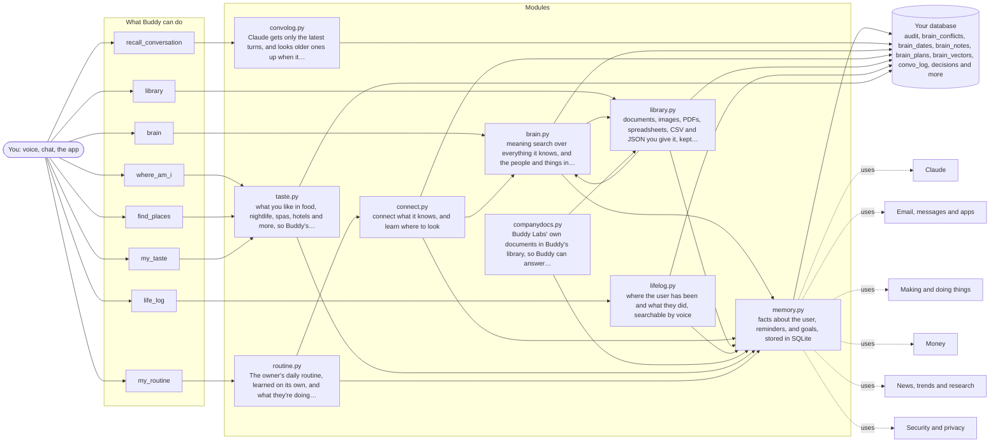

# Memory

What Buddy knows and remembers: facts, the conversation log and its search, the documents library, your taste and daily routine, and connecting what it knows.

## Architecture



The diagram reads left to right: what you ask, the tools Buddy uses, the modules that do the work, and what they keep or call. Dashed arrows are other features this one relies on.

## What Buddy can do here

| Tool | What it is for | Actions | Module |
|---|---|---|---|
| `recall_conversation` | Search what was said earlier in your chats with the user (their words, your replies, and reports or messages you sent on your own), beyond the few latest turns  | - | convolog.py |
| `brain` | Your memory of the user's life, searched by meaning and by words: library documents and saved facts | recall, person, people, note, status, prefer, preferences, forget_preference, decided, questions, resolve, dates, notes, forget_note | brain.py |
| `library` | The user's library: documents, photos, PDFs, spreadsheets, CSV and JSON they uploaded (Share -> Buddy, or the paperclip) | search, list, open, unlock, forget | library.py |
| `life_log` | Search the user's life log: places they've been (Google Maps Timeline), trips and stays (Airbnb and booking exports), past calendar events, and Buddy's own dail | place, trip, stay, event, day | lifelog.py |
| `where_am_i` | Where the user is, if they share their location from the app (fresh within the last few hours): street address, neighbourhood, city and country, shops/cafes/res | - | taste.py |
| `find_places` | Find places that suit the user: restaurants, cafes, bars, nightlife, spas, hotels, shops, activities | - | taste.py |
| `my_taste` | The user's taste per category (food, nightlife, spa, hotels, shopping, activities, travel, general): likes, dislikes and budget | - | taste.py |
| `my_routine` | The user's daily routine as Buddy has learned it from their location history (weekdays, Saturdays, Sundays: home, commute, office, regular places), what they've | show, relearn | routine.py |

## Technical design, module by module

### memory.py

```text
Long-term memory: facts about the user, reminders, and goals, stored in SQLite.
```

- Tables: `audit`, `facts`, `goals`, `health_reports`, `kv`, `model_calls`, `reminders`, `tool_calls`, `turns`, `usage`, `won`
- Uses: db.py

### convolog.py

```text
What was said earlier, searchable: Claude gets only the latest turns, and looks older ones up when it needs them.

Every plain message of the chat (the owner's words and Buddy's replies, and what Buddy said on its own) is kept here
on the server, in SQLite with a full-text index (FTS5, ranked with BM25: the same kind of word search Claude uses to
find its tools). Tool results are not kept: they can be fetched again from their tool. Nothing leaves the server
except the few lines a search returns, and those go only to Claude (never a free model). Kept 30 days.
```

- Tables: `convo_log`
- Uses: tools.py

### brain.py

```text
Buddy's brain, phase 2: meaning search over everything it knows, and the people and things in it.

  recall("car insurance")
    -> meaning search: a small embedding model on this server (BAAI/bge-small-en-v1.5, 384 numbers
       per passage, ~70 MB, nothing sent anywhere) finds "Geico auto policy GA-4471" too
    -> keyword search: SQLite FTS5 for exact names, numbers and rare words
    -> the two rankings fused (reciprocal rank fusion), across library passages and saved facts

  people and things: names pulled out of uploaded documents (and noted in conversation), each with
  its kind, relation to the user and notes, linked to the documents and facts that mention it.

Vectors live in the encrypted database (brain_vectors) and are searched in memory with numpy: at
personal scale (tens of thousands of passages) that's milliseconds, with no vector server to run.
Without the model (not installed, or BUDDY_MEANING_SEARCH=0) everything still works on keywords.
```

- Tables: `brain_conflicts`, `brain_dates`, `brain_notes`, `brain_vectors`, `decisions`, `entities`, `entity_links`, `preferences`
- Settings: `BUDDY_DIRECT_SCORE`, `BUDDY_EMBED_MODEL`, `BUDDY_MEANING_SEARCH`, `BUDDY_MODELS_DIR`
- Uses: config.py, library.py, memory.py

### connect.py

```text
Buddy's brain, phase 4: connect what it knows, and learn where to look.

Before, the brain searched uploaded documents and saved facts only. A flight in an email, or in an itinerary the
user uploaded, wasn't something Buddy "knew", so "what's my flight status?" got "I don't know". Now:

1. Plans: as emails, phone notifications and uploads arrive, travel-looking ones (an itinerary, a booking, a
   check-in, a reservation) are read once by Claude's quick model (personal data: never a free model) for the
   plans in them: flights, hotel stays, other reservations. They're kept in brain_plans, with where they came
   from. A flight in the next two weeks is tracked automatically (flights.py): Buddy watches it from 4 hours
   before take-off.
2. Recall across sources: before each personal question, the context pack now carries upcoming plans (for trip,
   flight, hotel questions) and the few recent emails and notifications that match the question's words.
3. Lessons from corrections: when Buddy said it didn't know or couldn't find something and the user answers "it's
   in my email" / "I uploaded it" / "I told you", that becomes a lesson ("for questions like '<question>': look in
   email") kept as a brain preference, so it's in the pack the next time a similar question comes.

So "what's my flight status?" -> the pack has "flight AA1234 MIA->LIM on Nov 10 (from an American email)" ->
Claude calls flight_status (no number needed: it uses the known flights) -> the answer.
```

- Tables: `brain_plans`
- Uses: brain.py, config.py, flights.py, location.py, maps.py, memory.py, money.py, packages.py, plaid.py, privacy.py, thinking.py, tools.py, transit.py, weather.py

### library.py

```text
Buddy's library: documents, images, PDFs, spreadsheets, CSV and JSON you give it, kept and understood.

  upload (phone: Share -> Buddy, or the paperclip in the chat)
    -> the original, encrypted on disk (AES-GCM, a key derived from the database key, so the
       backup recovery key covers it too)
    -> what's in it: text from PDFs / Word / text files on the server; photos and scanned PDFs
       read once by Claude; spreadsheets, CSV and JSON lists kept as tables (exact sums go through
       the sandbox's table-query on the original file)
    -> searchable passages (SQLite FTS5 in the encrypted database), a summary, and facts: the
       important ones (IDs, money, health, dates to act on) are confirmed with the user, the rest
       saved quietly with their source
    -> "sensitive" documents (passport, SSN, medical...) are vault items: Buddy asks before an AI
       reads them again

Phase 1 of the brain: library + recall. Meaning (vector) search, the people-and-facts graph and
brain-first answering come next.
```

- Tables: `library_chunks`, `library_items`
- Settings: `BUDDY_DB_KEY`, `BUDDY_LIBRARY_DIR`
- Uses: brain.py, config.py, memory.py, privacy.py, tools.py, usage.py, webread.py

### lifelog.py

```text
Life log: where the user has been and what they did, searchable by voice.

Fills from:
  - Google Maps Timeline: the phone's own export (Timeline.json) or Google Takeout's
    "Semantic Location History" monthly files (these carry place names)
  - calendar files (.ics) for past events
  - anything else (Airbnb or booking-site exports, airline histories, CSV, JSON,
    HTML, text): the cheap model reads it and pulls out trips, stays and events
  - Buddy itself: every evening wrap-up writes a short entry for the day
Upload files (or a .zip) from the Buddy page's Import button. Everything is masked
and stays in the encrypted database.
```

- Tables: `life_events`
- Uses: agent.py, config.py, memory.py, privacy.py, tools.py, usage.py

### companydocs.py

```text
Buddy Labs' own documents in Buddy's library, so Buddy can answer questions about them.

On startup (and after every update, which restarts Buddy) every Markdown file in docs/company/
(policies: privacy, information security program, biometric privacy, how Buddy is secured) and
docs/ (setup, security, access control, keys, money, sandbox...) is put in the library, searchable
like the owner's own documents. A changed file replaces its old copy; a removed file is dropped.
The newest SOC readiness report is kept there too (compliance.py publishes it).

They're indexed as they are: no AI reads them to file them, so syncing costs nothing.
```

- Settings: `BUDDY_DOCS_DIR`
- Uses: library.py, memory.py

### taste.py

```text
Your taste: what you like in food, nightlife, spas, hotels and more, so Buddy's
recommendations fit you instead of being the same list everyone gets.

Buddy learns it three ways:
  - what you tell it ("I love rooftop bars", "no loud clubs", "I'm vegetarian")
  - where you actually go: the places in your life log (Maps Timeline, trips, stays)
  - where you actually spend: restaurants and shops in your money records
find_places searches Google Maps (ratings, prices, opening hours), ranks places by a
review-count-aware score (a 4.6 from 5,000 people beats a 5.0 from 4), then checks
the best few across other channels: Reddit threads that mention them and review sites
(TripAdvisor, Yelp, Time Out, Eater...) through Google. Claude gets one compact
dossier per place plus your taste and history, picks, and explains why each suits you.
```

- Tables: `taste`
- Settings: `BUDDY_SERPER_KEY`
- Uses: cards.py, memory.py, privacy.py, tools.py

### routine.py

```text
The owner's daily routine, learned on its own, and what they're doing right now.

Learning (every night, from the last 6 weeks of the location history the app shares, maps.py): for weekdays,
Saturdays and Sundays, what the owner is usually doing in each half hour: at home, at the office, commuting, at a
place they've named (gym, Trader Joe's...), or out (errands). Half hours become blocks ("weekdays: commuting 7:40 to
8:30, at the office 8:30 to 5:30"). What the owner tells Buddy about their routine ("I go to the gym Tuesdays at 7")
is kept as facts and shown with it; their word beats the learned pattern. Half hours spent in a shop, cafe or
restaurant the phone was seen in (location.py's current_shop) are named after it ("Saturdays: at Trader Joe's
10 to 11"), for the owner's eyes only (describe(exact=True)); everyone else sees "out (errands)".

Right now (activity): the calendar first (a meeting, a doctor's appointment), then live location (driving, on the
move, at home, at the office, at a named place, out), then the learned routine. Each with until when, if known.
The exact place (street, shop) is added as "place" for the owner (my_routine), never in "what".
Phone calls use it: contacts hear what the owner is doing ("on the train, free around 6:15"); unknown callers only
that they're busy. Never an address or exact place.
```

- Uses: commute.py, connect.py, location.py, maps.py, memory.py, tools.py

## How it connects

- Relies on: Claude: the brain; Email, messages and apps; Making and doing things; Money; News, trends and research; Security and privacy; Speaking up on its own: briefing, reminders and alerts; Travel and getting around
- Relied on by: Agents and skills; Buddy Intelligence Platform; Claude: the brain; Email, messages and apps; Fixing and explaining itself; Free AI models (Groq, Gemini, Mistral, Cerebras, GitHub Models, OpenRouter); Going out: restaurants and events; Home and health; Insights and costs; Investing: signals, research and practice; Learning: the English and investing tutors; Making and doing things; Money; News, trends and research; Phone calls; Security and privacy; Shopping and deals; Speaking up on its own: briefing, reminders and alerts; The price book, pattern learning and trained models; The server and the app; Travel and getting around; Voice: Talk mode and Listen-in

