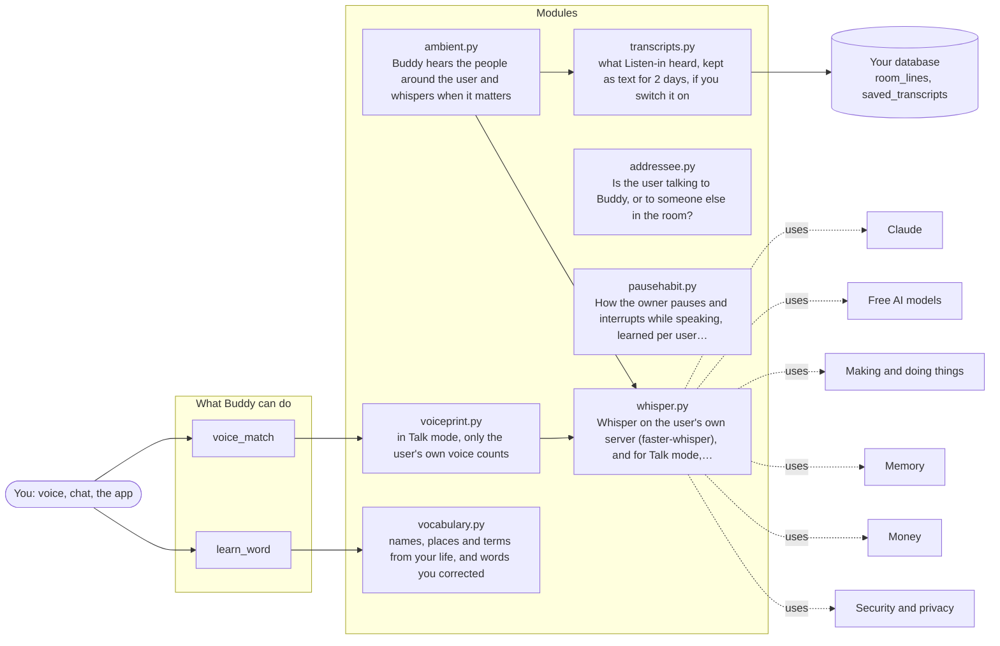

# Voice: Talk mode and Listen-in

Hearing you (Whisper on your server or Groq), knowing when you talk to Buddy, your voice match, how you pause, the words it should hear right, and Listen-in's whispers.

## Architecture



The diagram reads left to right: what you ask, the tools Buddy uses, the modules that do the work, and what they keep or call. Dashed arrows are other features this one relies on.

## What Buddy can do here

| Tool | What it is for | Actions | Module |
|---|---|---|---|
| `voice_match` | Voice match for Talk mode: Buddy only answers the user's own voice there | status, turn_on, turn_off, forget, that_was_me | voiceprint.py |
| `learn_word` | Speech recognition misheard a word (the user corrects you, or a name came out garbled and you worked out what they meant): save the right spelling so it's recog | - | vocabulary.py |

## Technical design, module by module

### whisper.py

```text
Speech-to-text: Whisper on the user's own server (faster-whisper), and for Talk mode,
Groq's hosted Whisper large-v3-turbo when BUDDY_GROQ_KEY is set: about 0.3-0.6 s instead of
1.5-3 s on a small server, and far better with Malayalam. Only what the user says to Buddy in
Talk mode goes to Groq; Listen-in (other people's speech) always stays on this server.
BUDDY_WHISPER_TALK=local keeps everything here. If Groq is down, slow, over its free limit or
hears a language outside "My languages", the local model does it instead.

The phone records short utterances and sends the raw audio (16 kHz, mono,
16-bit); this turns them into text and detects the language, so nothing is sent
to Google's recognizer. Optional: install it with deploy/whisper.sh. The model
size is BUDDY_WHISPER_MODEL ("base" suits a 2 GB server; "small" is more
accurate but needs about 4 GB and is slower).
```

- Settings: `BUDDY_GROQ_KEY`, `BUDDY_GROQ_PAID`, `BUDDY_GROQ_WHISPER_MODEL`, `BUDDY_KNOWN_LANGUAGES`, `BUDDY_TALK_DROP_LOGPROB`, `BUDDY_UNSURE_LOGPROB`, `BUDDY_WHISPER_BEAM`, `BUDDY_WHISPER_MODEL`, `BUDDY_WHISPER_TALK`
- Uses: budgets.py, config.py

### ambient.py

```text
Listen-in mode: Buddy hears the people around the user and whispers when it matters.

It whispers for three reasons:
  - translation: someone speaks a language the user doesn't understand (anything
    outside settings.known_languages); Buddy gives just the gist in English
  - about_you:   in such a language, people are talking about the user, mocking
    them, or planning something that concerns them
  - correction:  someone (in any language) states something technically wrong
    with confidence; Buddy says what is actually correct

Speech is analysed live and kept only in memory, in a short rolling window.
Nothing said by other people is written to disk.

To keep always-on listening affordable, speech is gathered into batches
(settings.listen_batch_seconds) and a cheap model (settings.listen_triage_model)
first decides whether a batch could need a whisper. Only then does the listen
model read it closely. In a room speaking your languages, most batches stop at
the cheap first pass.
```

- Settings: `BUDDY_ROOM_MEMORY_MINUTES`
- Uses: agent.py, benefits.py, config.py, free_models.py, memory.py, privacy.py, thrift.py, transcripts.py, usage.py, whisper.py

### addressee.py

```text
Is the user talking to Buddy, or to someone else in the room?

In Listen-in, "Hey Buddy" always works. Beyond that, Buddy judges like a person
would: a sentence that sounds like a question or request for an assistant, or a
reply soon after Buddy spoke, is checked by the cheap model against the context
(what Buddy just said, how long ago, what the room is talking about). Everything
else is room talk and costs nothing. Answers that start this way still can't
approve anything: that always needs the Approve button or Talk mode.
```

- Uses: agent.py, config.py, privacy.py, usage.py

### voiceprint.py

```text
Voice match: in Talk mode, only the user's own voice counts.

The user reads five short sentences once (Settings -> Teach Buddy my voice). Each is turned into a
voiceprint: 256 numbers that describe how a voice sounds (a speaker-embedding model, about 25 MB,
on this server; no audio is kept). Every Talk clip is compared with it before transcription:

  - sounds like the user          -> transcribed and answered as usual
  - doesn't, or Buddy isn't sure  -> ignored, never transcribed or sent to Groq (stay quiet when unsure)
  - too short to judge (< 1 s)    -> accepted only right after Buddy spoke to the user ("yes", "thanks")

Clips that match well nudge the voiceprint, so it follows how the user sounds over time; "Buddy, that
was me" adds the last ignored clip. Listen-in is unaffected. The voiceprint is biometric data: it stays
in Buddy's own (encrypted) database and "forget my voice" deletes it. Install: deploy/voice.sh.
```

- Settings: `BUDDY_VOICE_MODEL`, `BUDDY_VOICE_THRESHOLD`
- Uses: config.py, memory.py, whisper.py

### pausehabit.py

```text
How the owner pauses and interrupts while speaking, learned per user and kept as a setting.

A sentence cut off by a pause is held back for a moment so the rest can join it. How long to hold is learned:
each time the rest of a sentence arrives, the gap is folded into a running average; interrupting Buddy mid-reply
is counted too. Stored under the setting key "pause_habit" (JSON), so it can be read back and shown.
```

### transcripts.py

```text
Room transcripts: what Listen-in heard, kept as text for 2 days, if you switch it on.

OFF by default. Recording other people's conversations without their consent is illegal in many
places (several US states need everyone's consent; Brazil's LGPD and India's DPDP Act may apply),
so switching it on is your call: say "keep room transcripts" (or "stop keeping room transcripts").

  - Every line Listen-in hears is kept as text (never audio), masked and encrypted, for 2 days
    (BUDDY_ROOM_KEEP_DAYS), then deleted automatically.
  - "Save the conversation from 3 to 4pm" copies that stretch into saved transcripts, kept until
    you delete them, with a title.
  - Ask for a stretch any time ("the transcript from this morning", "yesterday 2 to 3pm"), or as
    a text file in the chat.
  - "Delete room transcripts" clears the log (saved ones stay unless you say so).

Speech recognition can't tell speakers apart and makes mistakes, and your own words are in it too.
```

- Tables: `room_lines`, `saved_transcripts`
- Settings: `BUDDY_ROOM_KEEP_DAYS`
- Uses: makers.py, memory.py, privacy.py, tools.py

### vocabulary.py

```text
Words Buddy should hear right: names, places and terms from your life, and words you corrected.

Speech recognition stumbles on names (Miraflores, Priya, Nubank) and on fast, accented or mixed
speech. This list primes it: Whisper on the server gets it as a prompt, and the phone's
recogniser as biasing words (Android 13+). It grows by itself: names in Buddy's memory, and
every time you correct a misheard word ("no, I said Barranco"), Claude records it with learn_word.
```

- Settings: `BUDDY_VOCABULARY`
- Uses: config.py, memory.py

## How it connects

- Relies on: Claude: the brain; Free AI models (Groq, Gemini, Mistral, Cerebras, GitHub Models, OpenRouter); Making and doing things; Memory; Money; Security and privacy
- Relied on by: Claude: the brain; Insights and costs; Learning: the English and investing tutors; Security and privacy; Speaking up on its own: briefing, reminders and alerts; The server and the app

