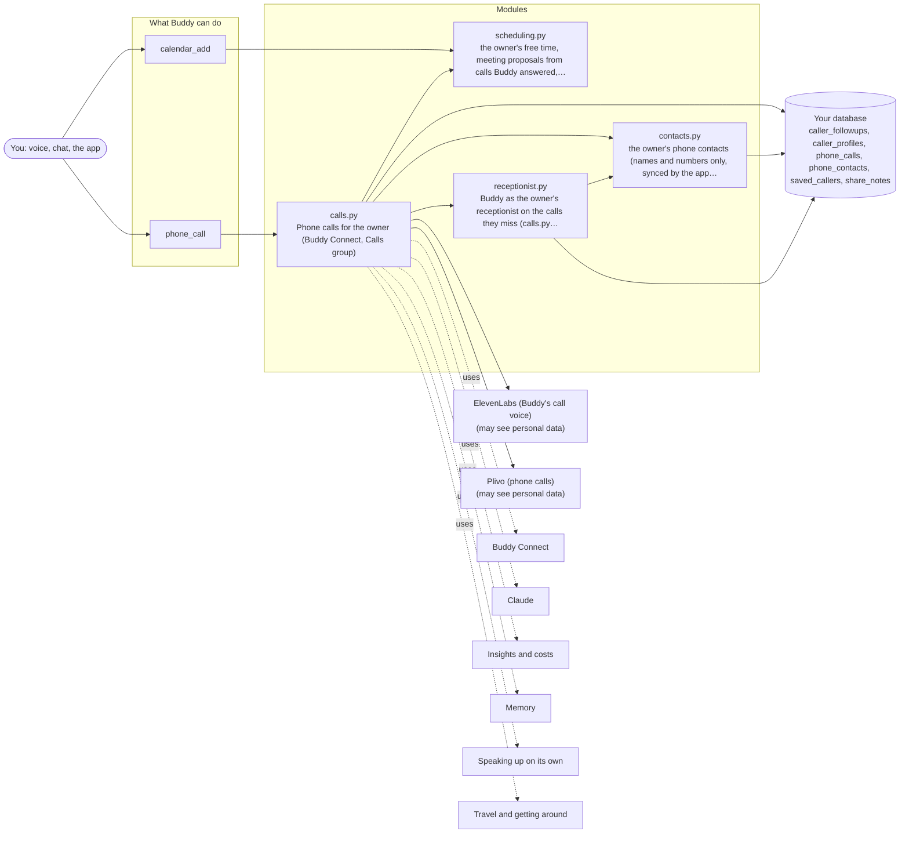

# Phone calls

Calls businesses for you after your yes and answers calls: Plivo, Pipecat on your server, Deepgram, Claude and ElevenLabs; your contacts and meeting proposals.

## Architecture



The diagram reads left to right: what you ask, the tools Buddy uses, the modules that do the work, and what they keep or call. Dashed arrows are other features this one relies on.

## What Buddy can do here

| Tool | What it is for | Actions | Module |
|---|---|---|---|
| `phone_call` | Call a business for the user, as their assistant (Buddy Connect: Plivo, with a natural voice) | call, status, forget_caller, contact, voices, set_voice, share, shared, unshare, relationship | calls.py |
| `calendar_add` | Add an event to the user's phone calendar, only after their yes (asked automatically) | proposal, event, free, decline | scheduling.py |

## Technical design, module by module

### calls.py

```text
Phone calls for the owner (Buddy Connect, Calls group).

Plivo places the call and streams its audio to this server. Pipecat runs the conversation here: Silero (on this
server) hears when someone is talking, Deepgram turns their words into text, Claude's quick model decides what to
say, and ElevenLabs says it in a natural female voice. Cost: audio goes to Deepgram only while someone is talking,
so a long hold costs little more than the phone line; Claude is asked only when a person (or a phone menu) has
finished speaking, and a recording heard before ("your call is important to us") isn't sent to Claude again.

Languages: a call starts in English and follows the other person into any of ten languages (CALL_LANGUAGES):
Deepgram's Flux Multilingual says which language each turn was in, Claude answers in it, and the voice speaks the
language Buddy's words are written in. The owner's summary is always in English.

Kinds of call:
  appointment   book (or move) an appointment, e.g. with a doctor, within the times the owner allowed, using
                their calendar to avoid clashes; Buddy may give name, callback number, date of birth and insurance.
  question      ask something simple (hours, whether they take an insurance) and report back.
  hold_connect  get through the phone menu, wait on hold, and when a real person answers, ring the owner and join
                them in (banks and card companies: only the account holder can be verified, never Buddy).

Rules, in code and in the call's instructions: every call is approved by the owner first (thrift.ask_action);
Buddy introduces itself truthfully as the owner's assistant, never claims to be the owner, and never denies being
an AI when asked; it shares only the allowed facts (never SSN, card numbers, passwords); it books only inside the
allowed times and never pays or agrees to fees; it cancels only a subscription the owner approved cancelling
(kind cancellation, started by subcancel.py); calls aren't recorded (only a written summary of the
outcome is kept, 180 days). At most CALLS_PER_DAY calls a day; 15 minutes each (90 for hold_connect).

Plivo reaches only /calls/* on the public address (Tailscale Funnel on port 8443, set up by deploy/calls.sh);
every request there carries the call's random token in its path, and Plivo's own requests its signature too.
```

- Tables: `phone_calls`
- Outside services: ElevenLabs (Buddy's call voice), Plivo (phone calls)
- Settings: `BUDDY_CALLS_PER_DAY`, `BUDDY_CALLS_PUBLIC_URL`, `BUDDY_CALL_BRAIN`, `BUDDY_CALL_DEBUG`, `BUDDY_CALL_LANGUAGES`, `BUDDY_CALL_LANGUAGE_HINTS`, `BUDDY_CALL_PRICE_LINE_MIN`, `BUDDY_CALL_PRICE_LISTEN_MIN`, `BUDDY_CALL_PRICE_VOICE_1K`, `BUDDY_CALL_PRICE_VOICE_1K_FULL`, `BUDDY_CALL_SHOW_MY_NUMBER`, `BUDDY_CALL_STT` and 11 more
- Uses: config.py, contacts.py, gateway.py, memory.py, modules.py, receptionist.py, scheduling.py, tools.py, travel.py, usage.py

### contacts.py

```text
Who's calling: the owner's phone contacts (names and numbers only, synced by the app with the owner's permission),
and callers Buddy saved itself after an important call from a number that wasn't in the contacts.

Kept only on this server and never sent to free models or written to the logs. A sync replaces the whole contact
list (so a contact the owner deleted on the phone goes here too); saved callers stay until forgotten ("forget the
caller 201..."). Turning "Share contacts" off in the app deletes the synced list here (forget_all).

Lookups: by number (name_for: who's calling) and by name (find: "reply to Priya", "what's Priya's number").
```

- Tables: `phone_contacts`, `saved_callers`
- Uses: memory.py

### scheduling.py

```text
Scheduling: the owner's free time, meeting proposals from calls Buddy answered, and adding events to the phone's
calendar after the owner's yes.

Free time: weekdays within working hours (BUDDY_MEETING_HOURS, default 09:00-18:00), the next 7 days, minus calendar
events and the learned commute, from 30 minutes from now. On a call Buddy answers, a caller who wants to meet is
offered two of these times; the one they pick is only pencilled in ("I'll confirm with Aneesh"). The owner is told
and asked; on their yes (thrift.ask_action), the event goes into the phone's calendar (the app writes it, with the
Calendar permission). Buddy never commits the owner's time by itself.
```

- Settings: `BUDDY_MEETING_HOURS`
- Uses: connect.py, memory.py, routine.py, tools.py

### receptionist.py

```text
Buddy as the owner's receptionist on the calls they miss (calls.py answers them): who the caller is to the owner,
what that caller may be told, what Buddy remembers about them, and what follows the call.

What a caller may hear is decided here, in code, before Claude sees anything (the owner's choices):
- The calendar, by who's calling. Family (a phone contact the owner told Buddy is family) hears what's on and until
  when, with its name; other phone contacts hear what kind of thing it is ("a meeting", "an appointment") and until
  when; anyone else only when the owner is busy and when free. Never where, who with, or the name of a health, money
  or legal appointment.
- Travel (flights, hotels, trips) shows only as busy, and the owner's email is never read for a call, until the
  owner says what may be shared: "callers can know I'm in India from Dec 3 to Dec 14" keeps a sharing note, for
  everyone, contacts or family, until a date (share_note). Callers can't change any of this.
- The caller's own history: their past calls Buddy answered, follow-ups still open, how they like to be reached.
  The relationship comes only from the owner's own data (what they told Buddy), never from what a caller says.
- A caller ID the carrier marked as not verified is treated as an unknown caller (it may be spoofed).

After a real message: a follow-up task in the owner's tasks ("Call Priya back: school pickup", due today when
urgent, else tomorrow) and the caller's profile updated. Transfer: only urgent calls from phone contacts, never between
10 pm and 7 am unless family. Kept on this server; no AI model but Claude (on the call itself) sees any of it.
```

- Tables: `caller_followups`, `caller_profiles`, `share_notes`
- Uses: contacts.py, memory.py, organiser.py, tools.py

## How it connects

- Relies on: Buddy Connect; Claude: the brain; Insights and costs; Memory; Speaking up on its own: briefing, reminders and alerts; Travel and getting around
- Relied on by: Claude: the brain; Email, messages and apps; Insights and costs; Money; The server and the app; Voice: Talk mode and Listen-in

