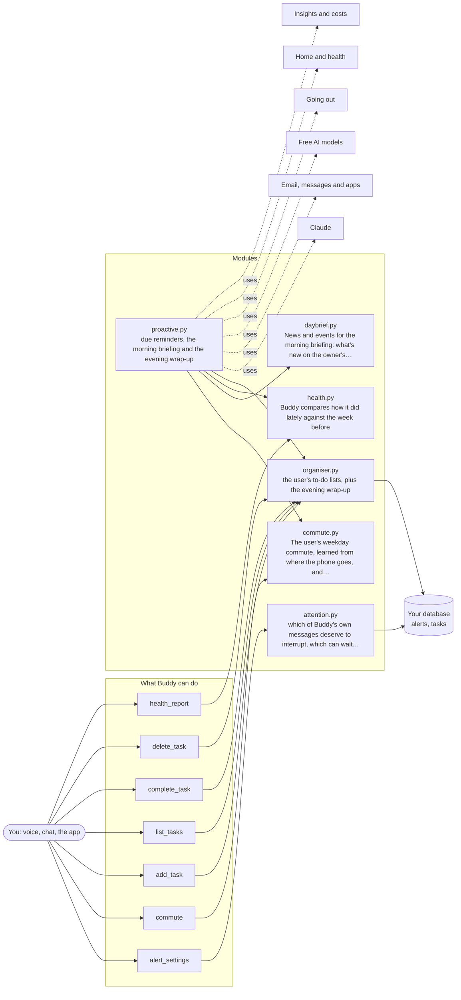

# Speaking up on its own: briefing, reminders and alerts

The morning briefing with news, finance and events that follows what you talk about; reminders; and alerts whose loudness is learned from your thumbs.

## Architecture



The diagram reads left to right: what you ask, the tools Buddy uses, the modules that do the work, and what they keep or call. Dashed arrows are other features this one relies on.

## What Buddy can do here

| Tool | What it is for | Actions | Module |
|---|---|---|---|
| `alert_settings` | How loud each kind of message Buddy sends on its own is, and what it has learned from the owner's thumbs | show, set | attention.py |
| `commute` | The user's weekday commute, learned from where their phone goes: when they usually leave home and reach work, leave work and get home, and the transit they ride | show, relearn, off, on | commute.py |
| `add_task` | Add a to-do | high, normal, low | organiser.py |
| `list_tasks` | Open to-dos, most important first, with ids | - | organiser.py |
| `complete_task` | Tick off a task, by id or by words in it ('milk') | - | organiser.py |
| `delete_task` | Remove a task that's no longer needed (not done), by id or words. | - | organiser.py |
| `health_report` | Buddy's own daily health check: how fast, accurate, reliable and costly it has been lately compared with the week before, and what to fix | - | health.py |

## Technical design, module by module

### proactive.py

```text
Buddy speaking up on its own: due reminders, the morning briefing and the evening wrap-up.
```

- Settings: `BUDDY_CARD_LOOKUP`, `BUDDY_CREDIT_DEALS`, `BUDDY_DAILY_DEALS`, `BUDDY_MARKET_SCAN`, `BUDDY_MARKET_SCHOOL`, `BUDDY_OPENROUTER_KEY`, `BUDDY_SEC_CONTACT`, `BUDDY_SOC_MONTHLY`, `BUDDY_TRENDS`
- Uses: advisor.py, agent.py, benefits.py, brain.py, budgets.py, cancelling.py, coach.py, commute.py, compliance.py, config.py, connect.py, credit.py, customize.py, daybrief.py, dealcollector.py, dealforecast.py, dealmail.py, dealnotif.py, finance.py, flights.py, funds.py, health.py, lifelog.py, lifemail.py, livewatch.py, mailbrain.py, mailorganizer.py, maps.py, market_school.py, markets.py, memory.py, modelscout.py, modeltrain.py, money.py, morning_tutor.py, nest.py, openrouter_catalog.py, organiser.py, oura.py, packages.py, patterns.py, pricebook.py, reasoning.py, recommend.py, review.py, routine.py, seasons.py, securitywatch.py, shopper.py, signals.py, subcancel.py, thinking.py, thrift.py, tools.py, transit.py, travel.py, travel_saved.py, trends.py, usage.py, voiceprint.py, weather.py, whentobuy.py

### attention.py

```text
Attention: which of Buddy's own messages deserve to interrupt, which can wait quietly, and which are noise,
learned from the owner's thumbs.

Every message Buddy sends on its own (an alert, a reminder, a signal, a digest) has a topic ("investing:live",
"deals:watched", "reminder"...), a category for grouping (Investing, Deals, Travel, Email, Reminders, Health...),
and one of four levels:

  alert   pops up and is spoken               (something to act on now)
  notify  a silent notification, not spoken   (worth knowing today)
  quiet   in the chat and the Alerts page only, no notification
  muted   kept in the Alerts page only        (the owner has shown they don't want it)

Each topic starts at a sensible level. The owner's thumbs on a message move its topic: mostly thumbs-down moves
it one level quieter (two when it's nearly all down), mostly thumbs-up one level louder. It takes three ratings
on a topic in the last 90 days before anything changes, so one tap never silences a topic. The owner can also
set a level outright ("make fund filings quiet"), which wins over what was learned.

Some things are never quietened below a silent notification, whatever the thumbs say, because missing one costs
more than seeing one: reminders, approvals, rides, urgent email, bills, security and calls.

Everything sent (or held back) is kept 60 days for the Alerts page. It's the owner's own record: on their server.
```

- Tables: `alerts`
- Uses: memory.py, tools.py

### daybrief.py

```text
News and events for the morning briefing: what's new on the owner's interests, the main finance headlines, and
events that have newly appeared near them for those interests. Facts gathered in code; the briefing's writer may
only use these (it never invents news).

  Interests   the topics the owner follows on the News page (trends.py): the latest saved digest for each, when
              it is no more than two days old: its headline and top stories, with links
  Finance     last night's market headlines (Finnhub, from signals.py) and the symbols getting unusual attention
  Events      Ticketmaster, searched by each interest in the owner's city once a day; only events not shown
              before are listed, so the briefing says what is new, not the same concert every morning

  Learning    the briefing follows what the owner talks about. Each morning Buddy counts, in their own sentences
              to it over the last 14 days, the stock symbols and the subjects they brought up (from a list of
              everyday subjects: sports, films, music, AI, property, travel deals and so on). A symbol asked
              about on two or more days gets its own headlines in the finance part. A subject raised on three or
              more days that isn't followed yet is added to the news (one new subject a week, three at most),
              and the briefing says so. A subject Buddy added that hasn't come up for 30 days is dropped, also
              said. Subjects the owner added themselves are never touched. The part of the briefing they talk
              about most comes first. The counting is done in code on the owner's server: nothing is sent out.

Only the interest words and the owner's city go to Ticketmaster, never their position.
```

- Uses: events.py, finnhub.py, memory.py, pricebook.py, signals.py, tools.py, trends.py, tutor.py

### commute.py

```text
The user's weekday commute, learned from where the phone goes, and heads-ups before they leave.

From the 30-day location history (maps.py, only while location sharing is on): when they usually leave home and reach
work, when they leave work and get home, and which transit they ride (PATH stations and light rail stops the phone
passes on the way). It's saved as a fact in memory ("what's my commute?"), the lines are watched during those times
(transit.py tells them when a delay starts or clears), and about 15 minutes before they usually leave Buddy says the
next trains and any alerts. Everything stays on Buddy's server; nothing here is sent anywhere but the transit feeds
(which see no personal data). Learned again once a day; "stop commute alerts" turns it off.
```

- Uses: maps.py, memory.py, tools.py, transit.py

### organiser.py

```text
Organiser: the user's to-do lists, plus the evening wrap-up.

Tasks live in lists ("today", "shopping", "work"...), can have a due date and a
priority, and are ticked off by voice. The morning briefing mentions what's due;
the evening wrap-up (settings.evening_wrap_at) goes over what got done, what's
still open and what's tomorrow.
```

- Tables: `tasks`
- Uses: memory.py, tools.py

### health.py

```text
The daily health check: Buddy compares how it did lately against the week before.

Every morning (before the briefing) it looks at the last day and the last 7 days against
the 7 days before, and writes down what got worse and what to do about it:

  speed         time to the first word and the whole reply, the filler, slow tools
  reliability   failed replies, too many steps, models failing or at their free limit
  accuracy      free answers Claude had to fix or redo, your thumbs down, hand-overs
  cost          cost per reply, cache reuse, the month's forecast against the budget
  reconciliation  the per-request log agrees with the money tally (nothing unlogged)

Reports are kept (GET /admin/health) so trends show over months, and the findings say
which setting or part of the code to look at. Some fixes happen on their own: a free
model Claude keeps correcting is tried later for that kind of task (free_models.order).
```

- Settings: `BUDDY_HEALTH_DIGEST`, `BUDDY_HEALTH_DIGEST_AT`, `BUDDY_SEARCH_LEVEL`, `BUDDY_SECURITY_REPORT`
- Uses: agent.py, config.py, free_models.py, insights.py, memory.py, persona.py, tools.py, usage.py

## How it connects

- Relies on: Claude: the brain; Email, messages and apps; Free AI models (Groq, Gemini, Mistral, Cerebras, GitHub Models, OpenRouter); Going out: restaurants and events; Home and health; Insights and costs; Investing: signals, research and practice; Learning: the English and investing tutors; Memory; Money; News, trends and research; Security and privacy; Shopping and deals; The price book, pattern learning and trained models; Travel and getting around; Voice: Talk mode and Listen-in
- Relied on by: Claude: the brain; Home and health; Memory; Phone calls; Security and privacy; The server and the app; Travel and getting around

