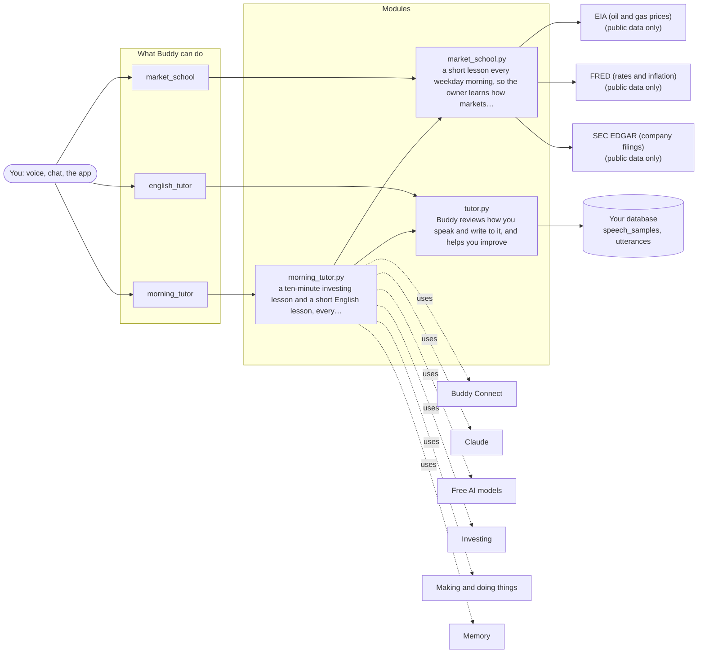

# Learning: the English and investing tutors

The morning investing lesson, the morning English lesson, the evening English review and live tips, and Market school.

## Architecture



The diagram reads left to right: what you ask, the tools Buddy uses, the modules that do the work, and what they keep or call. Dashed arrows are other features this one relies on.

## What Buddy can do here

| Tool | What it is for | Actions | Module |
|---|---|---|---|
| `morning_tutor` | The owner's two morning lessons | now, on, off, time, status | morning_tutor.py |
| `english_tutor` | The user's English tutor | review, tips_on, tips_off, coach_on, coach_off, status | tutor.py |
| `market_school` | Teach the owner investing from real data (education, never buy or sell advice; Buddy never trades) | today, themes, macro, company, concept, on, off | market_school.py |

## Technical design, module by module

### morning_tutor.py

```text
The morning tutors: a ten-minute investing lesson and a short English lesson, every morning.

  Investing (about ten minutes read aloud, every day)
    1. Today's markets: what moved and the likely reason (Market school's numbers; weekends recap the week)
    2. The idea of the day: one concept, explained simply and tied to the numbers
    3. What Buddy did and how: yesterday's signals with their reasons, the paper trades it opened and closed,
       walked through step by step with the arithmetic (how the stop was set, how the position was sized, what
       the result means), and what the results have taught it so far
    4. A lesson from the masters: one principle from the investor library and the question it makes you ask
    5. Check yourself: two questions with their answers
    Written from Buddy's own numbers only (public market data and its practice book: nothing personal), so a
    free model writes it when one is set up, else Claude's quick model; with neither (or the budget paused) the
    lesson is assembled from the numbers in code, shorter but complete. Kept in Reports.

  English (about five minutes, every day)
    From the owner's own sentences to Buddy in the last two days and what the speech engine struggled to hear:
    three corrections (what you said, better, why), one grammar point they illustrate, three words to practise
    saying (how to say each), one phrase to upgrade, and a sentence to say aloud. Their own words are personal,
    so only Claude reads them (never a free model). With too few sentences, or no model, a general tip from a
    built-in list and the words the speech engine misheard. The evening review (tutor.py) stays as it is.

Each arrives as a short spoken line with the full lesson on screen; "Listen" under it reads it aloud. Say "turn
off the English lesson", "investing lesson at 7", or "give me today's investing lesson".
```

- Settings: `BUDDY_MORNING_TUTOR_AT`
- Uses: agent.py, config.py, finance.py, free_models.py, investors.py, jobs.py, market_school.py, memory.py, modeltrain.py, pricebook.py, recommend.py, simbook.py, tools.py, tutor.py, usage.py

### tutor.py

```text
English tutor: Buddy reviews how you speak and write to it, and helps you improve.

  - Every sentence you say or type to Buddy is kept for 30 days (in Buddy's encrypted database;
    it stays on Claude, never a free model).
  - Each evening (BUDDY_TUTOR_AT, default 20:00) when you've said enough that day, a review
    arrives in Reports with a notification: corrections (what you said, better, why), the
    patterns behind them, useful words, tips and a short practice. Ask any time: "how was my
    English today / this week?".
  - Live tips (say "turn on English tips"): after an answer, one short tip when a sentence of
    yours had a clear mistake.

Pronunciation and pace: when the server's speech engine (Whisper) hears you in Talk mode, it
scores how sure it was of each word and how fast you spoke. Only those numbers and the words it
struggled with are kept (never audio). Words it keeps struggling with point to pronunciation
worth practising; the review covers them, your pace and your tone. The phone's own recogniser
doesn't share audio, so this builds up with the "Server" or "Automatic" speech engine.

Speech recognition makes its own mistakes (missing words, odd spellings, run-together words when
you talk fast): the tutor ignores those and looks only at real grammar, word choice and phrasing.
```

- Tables: `speech_samples`, `utterances`
- Settings: `BUDDY_TUTOR`, `BUDDY_TUTOR_AT`
- Uses: agent.py, config.py, jobs.py, memory.py, privacy.py, tools.py, voiceprint.py

### market_school.py

```text
Market school: a short lesson every weekday morning, so the owner learns how markets work from what is
actually happening, plus the free official data that explains it.

  The lesson (weekdays from 8 AM New York time, before the US open; or when asked):
    what moved  the big indexes, the sectors, commodities (gold, silver, oil, gas, copper, farm goods) and bonds,
                yesterday and over the week, from the daily prices Buddy already reads (markets.Data)
    why         rates and inflation (FRED), oil and gas (EIA)
    one idea    a concept explained simply, picked for today (oil moved a lot: how oil funds work; the yield
                curve flipped: what that means) or the next one not yet taught
    a theme     how the themes worth learning about did this week and month (AI chips, power and the grid,
                copper, defence, reshoring, gold, energy, cash-like Treasuries...)
  -> spoken as a short message, kept in Reports. A free model writes it when one is set up (public numbers only),
     else Claude's cheap model; without either, plain words from the numbers.

  Data (only series names and ticker symbols go out, never anything personal):
    FRED  (St. Louis Fed; free key, BUDDY_FRED_KEY)   Fed funds rate, 2- and 10-year Treasury yields, CPI, jobs
    EIA   (US Energy Information Administration; free key, BUDDY_EIA_KEY)   WTI oil and Henry Hub natural gas
    SEC   (EDGAR; free, no key)   a company's yearly revenue, profit, EPS, cash and debt from its filings. SEC asks
          every app to name a contact in its requests: BUDDY_SEC_CONTACT (an email the owner picks for this).

Education, not advice: Buddy explains and shows numbers; it never trades and never tells the owner what to buy.
```

- Outside services: EIA (oil and gas prices), FRED (rates and inflation), SEC EDGAR (company filings)
- Settings: `BUDDY_EIA_KEY`, `BUDDY_FRED_KEY`, `BUDDY_SEC_CONTACT`
- Uses: benefits.py, finance.py, free_models.py, gateway.py, jobs.py, markets.py, memory.py, tools.py

## How it connects

- Relies on: Buddy Connect; Claude: the brain; Free AI models (Groq, Gemini, Mistral, Cerebras, GitHub Models, OpenRouter); Investing: signals, research and practice; Making and doing things; Memory; Money; Security and privacy; The price book, pattern learning and trained models; Voice: Talk mode and Listen-in
- Relied on by: Claude: the brain; Investing: signals, research and practice; Security and privacy; Shopping and deals; Speaking up on its own: briefing, reminders and alerts; The server and the app

