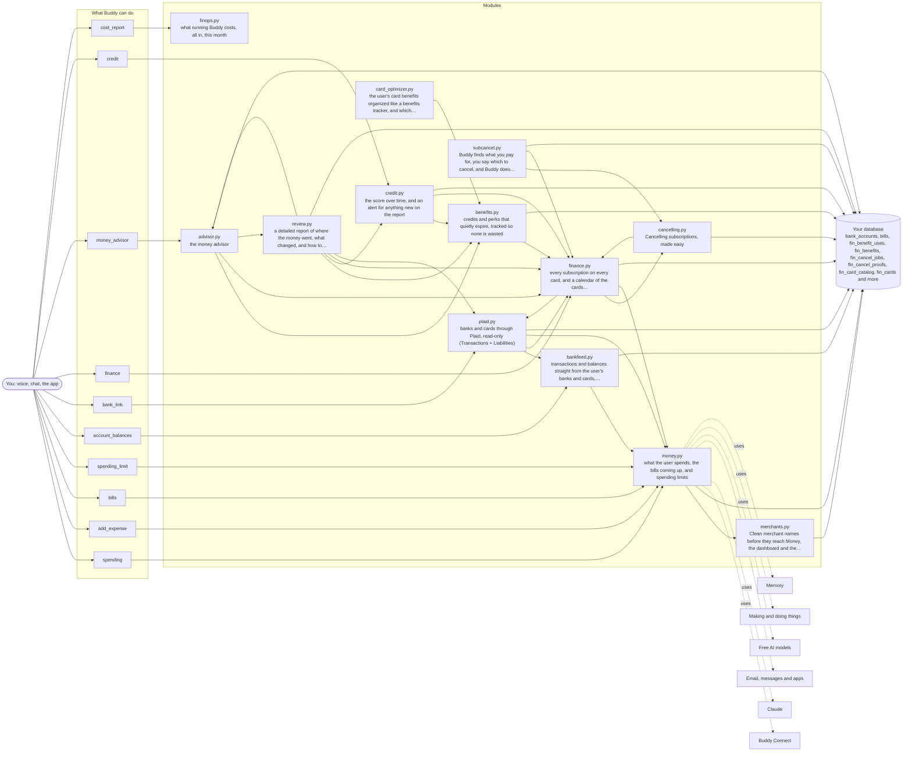

# Money

Bank and card feeds (read-only), bills, the money advisor and review, card choices and benefits, cancelling subscriptions; never moves money.

## Architecture



The diagram reads left to right: what you ask, the tools Buddy uses, the modules that do the work, and what they keep or call. Dashed arrows are other features this one relies on.

## What Buddy can do here

| Tool | What it is for | Actions | Module |
|---|---|---|---|
| `spending` | What the user spent, from bank and card emails plus expenses added by voice: totals per currency and category, top merchants | today, this_week, this_month, last_month | money.py |
| `add_expense` | Record something the user paid for (cash, or anything the bank emails won't show) | - | money.py |
| `bills` | Bills coming up (from statement emails, or added here), oldest due first | - | money.py |
| `spending_limit` | Monthly spending limits per category (or 'total'): list them with what's spent and left, or set one (amount 0 removes it) | - | money.py |
| `account_balances` | Balances of the user's bank accounts and credit cards from the bank feed (SimpleFIN), with when each was updated, plus the feed's status | - | bankfeed.py |
| `bank_link` | accounts: every connected account grouped (cash, cards owed, mortgages and loans with rate and next payment, brokerage value) with net worth; use for 'show all  | link, status, sync, unlink, accounts | plaid.py |
| `finance` | The user's subscriptions and credit cards, worked out on the server from their transactions (emails, bank feed, uploaded statements) | subscriptions, decide, cancel_help, cancel_email, dispute_help, trials, keep_trial, cards, card, import_statement, report, refresh, forget, weekly, credit_use, loans | finance.py |
| `money_advisor` | Advice from the user's own numbers (worked out on the server; you word it, briefly, and never move money) | advice, best_card, rewards, set_reward, confirm_rewards, payoff, payday, income, autopay, goal_add, goal_update, goal_remove, goals, monthly, review, label_transfer | advisor.py |
| `credit` | The user's credit score and credit report changes | overview, read_screen, full_report, add_score, add_event, it_was_me, not_me, forget | credit.py |
| `cost_report` | What running Buddy costs this month, all in, service by service: Claude, the server (DigitalOcean), Zapier, Plaid (banks connected and calls), speech to text an | - | finops.py |
| `card_benefits` | The user's credit card credits and perks that expire (store, travel, dining, streaming credits...) and their wish list | add, list, used, remove, wish_add, wishes, wish_remove, plan, lookup, lookup_all, setup, add_from_catalog, deals, cards, name_card | benefits.py |
| `cancel_subscription` | The subscription cancel service | review, start, status, check | subcancel.py |
| `merchants` | Clean shop names in Money and the dashboard: banks spell one place many ways ("SQ *SON CUBANO", "SON CUBANO RESTAURANT ON THE HUDSON"), and Buddy groups them | list, merge, rename | merchants.py |

## Technical design, module by module

### money.py

```text
Money agent: what the user spends, the bills coming up, and spending limits.

Charges, bills, payments and refunds are read from bank and card emails by the
email manager (the same cheap sorting call, no extra cost) and can be added by
voice. With a bank feed (bankfeed.py, SimpleFIN), transactions and balances come
straight from the banks instead, and emails are used only for bills. Bills due within BILL_WARN_DAYS get a reminder once a day until paid;
a payment email for the same biller marks the bill paid. Monthly limits per
category warn at 80% and again at 100%. Amounts stay in their own currency
(US dollars, soles, reais, rupees...); nothing is converted or guessed.
```

- Tables: `bills`, `spending_limits`, `transactions`
- Settings: `BUDDY_CARD_ALERT_AMOUNT`
- Uses: cards.py, customize.py, memory.py, merchants.py, tools.py

### bankfeed.py

```text
Bank feed: transactions and balances straight from the user's banks and cards,
read-only, through SimpleFIN Bridge (bridge.simplefin.org, about $15 a year).

SimpleFIN connects to thousands of US banks and card issuers (through MX); Buddy
never sees bank passwords. The user links their banks on the Bridge site, gets a
one-time setup token, and deploy/bank.sh swaps it for a read-only access URL
(BUDDY_SIMPLEFIN_URL). Buddy fetches every SYNC_HOURS (the Bridge allows 24
requests a day), sorts new merchants into categories with the cheap model (each
merchant once, remembered), and skips card payments and transfers between the
user's own accounts so nothing is counted twice. Once the feed works, the email
manager stops adding charges from emails and keeps only bills.
```

- Tables: `bank_accounts`
- Settings: `BUDDY_SIMPLEFIN_URL`
- Uses: agent.py, config.py, memory.py, money.py, tools.py, usage.py

### plaid.py

```text
Finance, phase D: banks and cards through Plaid, read-only (Transactions + Liabilities).

  linking   Buddy makes a Plaid Link token and a one-time page on this server
            (https://<your server>/plaid/link?state=...). The user opens it on the phone, picks the bank
            and signs in inside Plaid's own window: Buddy never sees bank passwords. Plaid hands back a
            public token, swapped here for an access token kept in the encrypted database.
  every 6 h transactions (/transactions/sync, with a cursor: only what changed) -> spending, card
            payments and transfers between the user's own accounts left out; balances -> bank_accounts
  every day liabilities (/liabilities/get): for each credit card the statement date and balance, the
            due date, the minimum, the purchase APR and the limit -> the card calendar and a bill to remind
  unlinking /item/remove revokes the token at Plaid, then the bank's accounts, transactions and cards
            are deleted here

Settings (hidden prompts: sudo bash /opt/buddy/deploy/set.sh NAME): BUDDY_PLAID_CLIENT_ID,
BUDDY_PLAID_SECRET, BUDDY_PLAID_ENV (sandbox | production), and for banks that sign in through their
own site (Chase, Capital One...) BUDDY_PLAID_REDIRECT_URI = https://<your server>/plaid/oauth, the
same address added under Allowed redirect URIs in the Plaid dashboard.
```

- Tables: `fin_income`, `fin_loans`, `fin_transfers`, `plaid_accounts`, `plaid_items`
- Settings: `BUDDY_PLAID_CLIENT_ID`, `BUDDY_PLAID_COST_PER_BALANCE_CALL_USD`, `BUDDY_PLAID_ENV`, `BUDDY_PLAID_REDIRECT_URI`, `BUDDY_PLAID_SECRET`
- Uses: bankfeed.py, finance.py, gateway.py, memory.py, money.py, tools.py, travel.py

### finance.py

```text
Finance, phase A: every subscription on every card, and a calendar of the cards themselves.

Subscriptions are found in code, on the server, from the transactions Buddy already has (card and
bank emails, the bank feed, uploaded statements): the same merchant charged again and again at a
steady rhythm (weekly, monthly, quarterly, yearly) with a similar amount. No AI reads the
transactions; Claude only ever sees the finished list. For each one: amount, how often, card, next
charge, yearly cost, and flags (new, price went up, on two cards, a free trial that turned paid).
The user marks each keep / cancel / not sure; cancel opens the service's cancel page on the phone
and then watches that no charge comes after. Cancelling for the owner, after their yes for each one, is
subcancel.py (an email from their address, or a phone call by the call agent).

Cards: closing day, due day, statement balance, minimum due, limit and APR, from card statement
emails and from statements uploaded to the library (read once when filed, card numbers masked to
the last four). Each statement becomes a bill, so the existing bill reminders run until a payment
email marks it paid; a heads-up also comes five days before.

Alerts (spoken, written in code, outside quiet hours): a new subscription, a price increase, a
yearly renewal in two weeks, a charge after the user cancelled, a card due in five days.
```

- Tables: `fin_cards`, `fin_subscriptions`
- Settings: `BUDDY_MONEY_WEEKLY`
- Uses: agent.py, cancelling.py, config.py, jobs.py, library.py, memory.py, money.py, plaid.py, privacy.py, tools.py, usage.py

### advisor.py

```text
Finance, phase C: the money advisor. Every number is worked out here, on the server; Claude only
puts the finished numbers into words. Advice only: Buddy never moves money, pays, or opens accounts.

  best card    each card's reward rates (told by the user, or a preset for well-known cards that the
               user confirms) -> the best card for each kind of spending, and what the last 90 days
               would have earned on the best card instead ("$34 more a quarter on groceries")
  payoff       cards carrying a balance: interest each month, and a plan for a monthly amount, highest
               APR first (avalanche) vs smallest balance first (snowball): months and total interest
  payday       due dates checked against paydays (due at least 3 days after one), autopay for the full
               statement balance on every card
  goals        emergency fund (months of spending), paying off a card, saving for something: progress
               from the bank feed or from what the user says
  monthly      on the 1st, a check-in report: last month's spending vs income, goals, rewards missed,
               interest paid, subscriptions, and the few things to do
```

- Tables: `fin_goals`, `fin_rewards`
- Settings: `BUDDY_MONEY_MONTHLY`
- Uses: benefits.py, finance.py, jobs.py, memory.py, review.py, taste.py, tools.py

### credit.py

```text
Credit score and credit history watch: the score over time, and an alert for anything new on the report.

Where the facts come from (there is no consumer API to the credit bureaus, so Buddy reads what the free
monitoring services already send the user, and adds what it can see itself):
  - credit monitoring emails and phone notifications (the Credit Karma app's "your score changed" or "new
    inquiry" pushes, read by the phone's notification access): a score update or an alert from Experian, TransUnion, Equifax, Credit Karma,
    Chase Credit Journey, Amex MyCredit Guide, Capital One CreditWise, Discover Scorecard, myFICO and similar.
    Each one found in the synced email (CREDIT_EMAIL) is read once by Claude, which returns the score (bureau,
    model, date) and any events: hard inquiries, new accounts, late payments, collections, public records,
    address or name changes, closed accounts, limit changes, a fraud alert or freeze.
  - the user telling Buddy ("my Experian FICO is 782") or a screenshot of their credit app (add)
  - the connected cards (Plaid): a credit card that appears at a bank already connected is a new account; how
    much of the limits is used (finance.credit_use), the biggest thing they control
Alerts (proactive loop): a new hard inquiry, new account, late payment, collection, public record, address
change or fraud alert, each once, asking "was this you?", with the official freeze and dispute links if not;
and a score drop of DROP_ALERT points or more. Buddy never freezes, disputes or applies for anything itself.
Kept: fin_credit_scores, fin_credit_events (the email's record id, never the whole email).
```

- Tables: `fin_credit_events`, `fin_credit_scores`
- Uses: agent.py, benefits.py, config.py, finance.py, formfill.py, jobs.py, library.py, memory.py, tools.py, usage.py

### card_optimizer.py

```text
Card optimizer: the user's card benefits organized like a benefits tracker, and which card to use for what.

  browse      every published credit and perk across the cards, by category (Travel, Food & dining, Retail &
              shopping, Protection & assistance, Entertainment, Other) and subcategory (Hotel perks, Airline perks,
              Restaurant...), each with how many benefits from how many cards, the value a year and how many are
              running out soon (tracked credits with money left that end within a month)
  coming_up   tracked credits with money left, by the date they reset or expire
  earn_guide  the best card for each kind of spending (groceries, gas, dining, travel, transit, streaming,
              drugstores, everything else) from each card's published earn rates; points and miles valued at
              BUDDY_POINT_CENTS (1 cent by default); offers limited to a portal or one merchant shown as "up to"
  missed      purchases in the last 30 days where another of the user's cards would have earned more, and what
              that adds up to a year
All numbers by code from the issuer lookups and the bank feed; nothing is invented.
```

- Settings: `BUDDY_POINT_CENTS`
- Uses: benefits.py, tools.py

### finops.py

```text
FinOps: what running Buddy costs, all in, this month.

Each provider is one cost line with a month-to-date figure, an end-of-month
forecast and where the number came from:

  Claude        Buddy's own meter of every call (always), or Anthropic's cost
                report when an Admin API key is set (organizations only)
  Server        DigitalOcean's live month-to-date bill (read-only API token), or the
                monthly price of whatever host you use; no line if neither is set
  Zapier        the plan price, plus Buddy's own count of Zapier calls against the
                plan's task allowance (Zapier has no billing API)
  Plaid         production banks connected x your per-bank monthly price, plus priced
                per-call products (Plaid has no billing API); sandbox is free
  AI models     speech to text (Groq) and the free-tier models (Gemini, OpenRouter, GitHub
                Models...): Buddy's meter of every call
  Outside APIs  web search (Serper), flight and hotel prices (SerpApi, Duffel, Travelpayouts):
                every call logged with its price
  Free services the ones Buddy uses at no charge (Tailscale, Cloudflare, GitHub, OpenStreetMap, Hacker News,
                arXiv, StockTwits, Reddit, Alpaca's free data, Gemini and OpenRouter free models), listed so the
                picture is complete
  Not set       a service that costs money but whose price Buddy can't see (server, Plaid, the domain) shows
                "price not set" with the one setting that fills it in
  Fixed costs   anything else you pay monthly (BUDDY_FIXED_COSTS)

Network answers are cached for 30 minutes; the providers ask not to be polled hard.
```

- Settings: `BUDDY_ALLIN_BUDGET_USD`, `BUDDY_ANTHROPIC_ADMIN_KEY`, `BUDDY_COST_SERVER_USD`, `BUDDY_DO_TOKEN`, `BUDDY_FIXED_COSTS`, `BUDDY_PLAID_COST_PER_BANK_USD`, `BUDDY_SERVER_PROVIDER`, `BUDDY_ZAPIER_PLAN_USD`, `BUDDY_ZAPIER_TASKS_PER_MONTH`
- Uses: budgets.py, gateway.py, memory.py, tools.py, usage.py

### benefits.py

```text
Card benefits: credits and perks that quietly expire, tracked so none is wasted. Advice only.

  "My Platinum has a $50 Saks credit every six months"   -> add (card, name, amount, period, merchant)
  "how much is left on my card credits?"                  -> list: this period's used, left and days left
  "I want the Lululemon Define jacket but it's pricey"    -> wish_add (item, merchant, price)
  "what should I use my credits on?"                      -> plan: credits running out, matched to wishes

How "used" is known: the card's own statement. Money back on the card the credit belongs to (its connected
last 4) that says credit or reimbursement goes to the tracked credit on that card it names best ("PLATINUM UBER
ONE CREDIT" -> the Uber One credit, not Uber Cash); lines whose wording names none ("AMEX PLATINUM BENEFIT") are
sorted by Claude once a day (link_credits). Plaid often labels these credits income or a transfer in: plaid.py
keeps them with the card's charges. Purchases at that merchant this period are shown too, since a credit can
take weeks to post. Reminders say what the statement shows ("no statement credit through Oct 2"), and several
due the same morning are one message.
The user can also say "I used my Saks credit" (used).

Reminders (once a day, from the proactive loop): when a credit still has money left, at 60, 30, 14, 7
and 2 days before it resets or expires, each said once. From 60 days out, wishes at that merchant are
matched ("with the credit you'd pay $23") and Buddy offers a price watch, which asks before it costs
anything. Buddy never buys anything; issuers change benefits, so the user's card terms win.

The public catalog ("look up my Platinum's benefits"): Claude searches only the issuers' own websites
(ISSUER_DOMAINS) and returns the card's published credits, annual fee and earn rates as facts in Buddy's
own words, each with its source page; anything not from an issuer page is dropped. Set up once
for every card in the background (setup: a Card benefits report in Reports and one message), kept in
fin_card_catalog and refreshed every REFRESH_DAYS (a year); a new card is looked up when it first appears.
Nothing is tracked until the user confirms (add_from_catalog, or card "all"). At the yearly refresh,
changes to tracked credits are reported.
Personal offers (Amex Offers, Chase Offers) and points balances aren't public: email or screenshots.
```

- Tables: `fin_benefit_uses`, `fin_benefits`, `fin_card_catalog`, `fin_credit_deals`, `fin_wishes`
- Settings: `BUDDY_CARD_REFRESH_DAYS`, `BUDDY_SERPER_KEY`
- Uses: agent.py, config.py, finance.py, free_models.py, jobs.py, memory.py, social.py, taste.py, tools.py, usage.py, webread.py

### cancelling.py

```text
Cancelling subscriptions, made easy. Buddy helps with every step; the user taps the final button.

1. Guided cancel: the cancel page opens on the phone and Buddy reads it through the form helper
   (fill_form read), saying what to tap and pointing out the traps (offers, "pause instead",
   "are you sure?"). Buddy never presses the final Cancel or Confirm: the user does.
2. A discount first: before cancelling, a short script to ask for a retention offer.
3. By email: for services without an online cancel, Buddy writes the cancellation email; it is saved
   as a Gmail draft or sent from the user's Gmail after their yes (the Gmail agent asks first).
4. Proof: a "your cancellation is confirmed" email is saved against the subscription, with its date.
5. If they keep charging: a dispute letter for the card issuer with the cancellation date and the
   proof, and where to file it in the issuer's app.
6. Free trials: a signup email that says when the trial ends is noted, and the user is reminded two
   days before it starts charging.
```

- Tables: `fin_cancel_proofs`, `fin_trials`
- Uses: config.py, finance.py, memory.py, tools.py

### subcancel.py

```text
The subscription cancel service: Buddy finds what you pay for, you say which to cancel, and Buddy does the
cancelling and then checks it really stopped.

  1. Review    once a month (and on request): every subscription found in the card and bank charges, what it
               costs a month and a year, and what changed (new, price went up, charged on two cards, marked to
               cancel but still charging). Buddy can't see whether you use a service, so it doesn't guess.
  2. One yes   each cancellation is asked for on its own: the service, the price, the route and exactly what
               will be sent or said. Nothing is cancelled without that yes.
  3. Cancel    by the route that works for that service:
                 email    Buddy sends the cancellation email from your own address (the account's SMTP)
                 phone    Buddy's phone agent calls the service as your assistant, asks to cancel, turns down
                          offers to stay unless you set one you'd accept, and asks for a confirmation number
                          and the date it ends. It is honest about being an AI, gives only your name, callback
                          number and the account's email, never a card number, password or SSN, and never agrees
                          to a fee. Many services will only cancel for the account holder: then it says so and
                          you get the number to call.
                 guided   services that cancel only inside your signed-in account: the cancel page opens on the
                          phone and Buddy walks you through it; you tap the last button. Buddy never signs in
                          to your accounts and never holds their passwords.
  4. Check     the confirmation email is saved as proof (cancelling.py); the call's outcome is kept; then the
               charges are watched: if the next one doesn't come, it's reported as stopped; if a charge does
               come after the cancellation, Buddy says so and offers the dispute letter for the card issuer.

The phone number or email address to cancel with comes from the service's own official help page (looked up at
the time), never from memory. Everything here stays in the encrypted database.
```

- Tables: `fin_cancel_jobs`
- Uses: calls.py, cancelling.py, config.py, email_accounts.py, finance.py, memory.py, tools.py

### merchants.py

```text
Clean merchant names before they reach Money, the dashboard and the reviews.

Banks name the same business many ways: "SQ *SON CUBANO", "SON CUBANO RESTAURANT ON THE HUDSON",
"Son Cubano"; "AMZN Mktp US*2K4", "Amazon.com*RT5". Every transaction keeps the bank's own text in
transactions.merchant_raw; transactions.merchant is the clean name everything else groups by.

How a name is resolved, first match wins:
  1. Plaid's merchant_entity_id: the same business id is always the same merchant
  2. the user's own corrections (merge, rename), remembered as aliases
  3. known brands (Amazon, Uber vs Uber Eats, Apple, Google, Starbucks...)
  4. cleaning: payment-processor prefixes (SQ *, TST*, PAYPAL *), store numbers, phone numbers,
     web addresses, "INC/LLC", and the city/state the card network adds at the end
  5. a merchant already seen whose name starts the same (two or more words): "Son Cubano Restaurant
     On The Hudson" joins "Son Cubano"
Every raw name seen is remembered (merchant_aliases) with how it was resolved, so the result is stable
and the user's corrections win. reclean() applies the rules to every stored transaction again.
```

- Tables: `merchant_aliases`, `merchants`
- Uses: memory.py, tools.py

### review.py

```text
The money review: a detailed report of where the money went, what changed, and how to save.

  "Give me a full money report" / "how can I save money?" -> money_advisor review (period: last_month,
  this_month, last_3_months, last_6_months, this_year, last_12_months). Saved in Reports; Buddy says the
  headline and the top savings.

Every number is worked out here from the user's own data (Plaid transactions and income, cards, subscriptions,
reward rates, card credits); nothing leaves the server to make it, and Claude only words the result. Amounts
are in USD (other currencies are counted separately and mentioned). Suggestions only: Buddy never moves money.

Sections: headline (in, out, left, savings rate) · needs / wants / fees split · categories against your usual,
with the bank's finer labels and top shops · six-month trend · biggest and unusual charges · subscriptions ·
fees and interest · cards · rewards missed and card credits running out · savings opportunities, each with a
yearly dollar amount · a suggested monthly budget · the few things to do first.
```

- Tables: `fin_transfer_labels`
- Uses: advisor.py, agent.py, benefits.py, config.py, credit.py, finance.py, jobs.py, memory.py, plaid.py, tools.py, usage.py

## How it connects

- Relies on: Buddy Connect; Claude: the brain; Email, messages and apps; Free AI models (Groq, Gemini, Mistral, Cerebras, GitHub Models, OpenRouter); Making and doing things; Memory; News, trends and research; Phone calls; Security and privacy; Travel and getting around
- Relied on by: Buddy Intelligence Platform; Claude: the brain; Email, messages and apps; Investing: signals, research and practice; Learning: the English and investing tutors; Memory; News, trends and research; Security and privacy; Shopping and deals; Speaking up on its own: briefing, reminders and alerts; The server and the app; Travel and getting around; Voice: Talk mode and Listen-in

