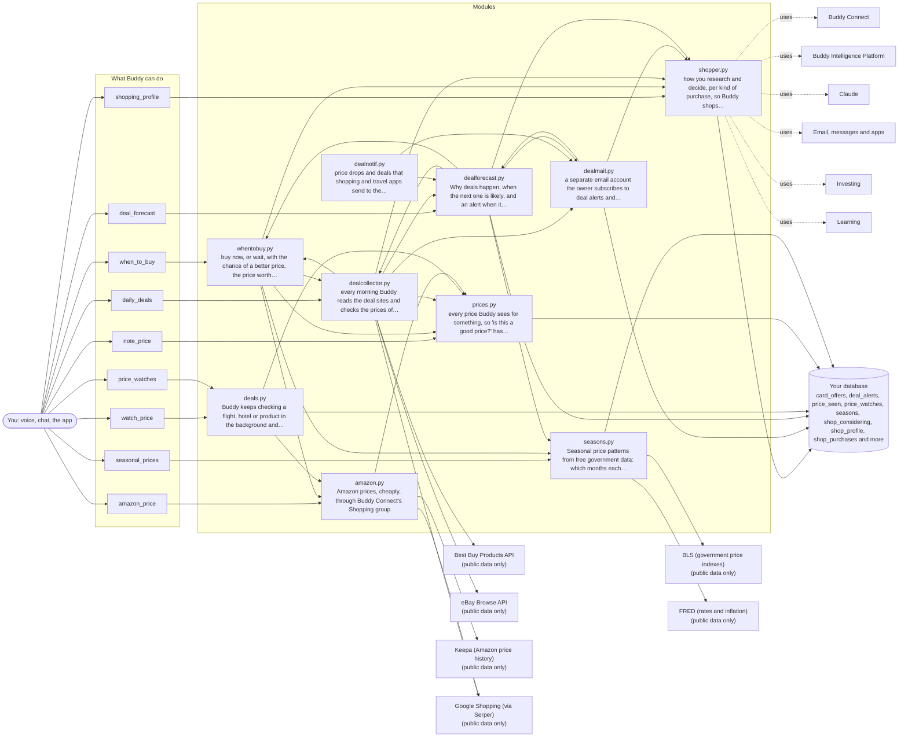

# Shopping and deals

Your shopping profile, buy now or wait, the daily deals collector, the deals inbox, deal forecasts and watches, price history, Amazon prices and seasonal prices; never buys.

## Architecture



The diagram reads left to right: what you ask, the tools Buddy uses, the modules that do the work, and what they keep or call. Dashed arrows are other features this one relies on.

## What Buddy can do here

| Tool | What it is for | Actions | Module |
|---|---|---|---|
| `shopping_profile` | The owner's way of buying, per kind (general, electronics, home, travel, clothing): how they research, trusted sources and brands, brands to avoid, patience and | show, interview, save, considering, learn, forget, review | shopper.py |
| `when_to_buy` | Buy now or wait, for a product at today's price (not flights or hotels: the travel tools do those) | advise, track_record, calendar, note_launch, lifecycle | whentobuy.py |
| `daily_deals` | Buddy's daily deals collector: every morning it reads deal sites (Slickdeals, DealNews, deal subreddits and any feed the owner adds), checks today's prices for  | today, search, feeds, add_feed, remove_feed, status, on, off, read_inbox, card_offers | dealcollector.py |
| `deal_forecast` | Why deals happen and when the next one is likely, with alerts | forecast, why, watch, alerts, stop, upcoming, company, predictions | dealforecast.py |
| `watch_price` | Keep checking a flight, hotel or product in the background and tell the user when it drops to `target` (or by 10% or more) | - | deals.py |
| `price_watches` | List the price watches with the latest and lowest prices seen, or stop one with stop_id. | - | deals.py |
| `note_price` | Write down a price you just found (a flight, hotel, product) in Buddy's price history, so later 'is this a good price?' can be answered with process_data price- | - | prices.py |
| `amazon_price` | Amazon's price for a product right now (a link, an ASIN, or a name), from Buddy Connect's Shopping services: Keepa (with the 90-day average) or Google Shopping | - | amazon.py |
| `seasonal_prices` | Which months a kind of thing is usually cheapest, from about ten years of free US government price data (BLS consumer price index by category, through FRED): te | show, list, refresh | seasons.py |

## Technical design, module by module

### shopper.py

```text
Your way of buying: how you research and decide, per kind of purchase, so Buddy shops like you would.

Buddy learns it two ways:
  The interview   a short spoken conversation (a few questions at a time, any time: "let's do my shopping
                  interview"): what you check first, who you trust, the brands you like and avoid, how long you'll
                  wait for a deal and what makes you buy now, your must-haves and budgets, what you regretted.
                  Asked per kind of purchase (electronics, home, travel, clothing), since most people decide each
                  differently.
  Your purchases  every order and return email Buddy reads (shop, item, price, whether it was on sale) is kept in
                  your purchase history (email itself is only kept 30 days), plus the bank feed's shopping and
                  travel charges: which shops you use, what you usually spend, how often you buy on sale, returns.
                  And when you tell Buddy you're thinking of buying something, it notes the day, so when the order
                  arrives it learns how long you take to decide.

It's read code-only (no AI): order emails are recognised by their subject words. All of it stays on your server and
is used only by Claude when it advises you on a purchase. Buddy still never buys or pays.
```

- Tables: `shop_considering`, `shop_profile`, `shop_purchases`, `shop_reviews`
- Uses: memory.py, tools.py

### whentobuy.py

```text
When to buy: buy now, or wait, with the chance of a better price, the price worth waiting for and roughly when.

Worked out in code (no AI) from:
  the price history   every price Buddy has seen for the item (price watches, note_price, Keepa's 90-day average
                      or the lowest price when Claude passes them in)
  the sales calendar  the US sales that matter for this kind of thing (Black Friday and Cyber Monday, Prime Day and
                      Prime Big Deal Days, Presidents', Memorial, July 4th and Labor Day for appliances and mattresses,
                      back to school for laptops, end-of-season clearance for clothes, the Super Bowl for TVs...),
                      with the rough discount each usually brings. These ranges are rules of thumb from past years,
                      not promises: the track record below shows how well they hold for this owner.
  product cycles      a new model due soon usually pushes the old one down
  the owner's profile how long they'll wait and the discount that makes them buy (shopping_profile)

Every call is kept as a prediction. When its date passes, Buddy checks what really happened (the prices it saw
afterwards, or what the owner paid in the order email) and keeps a track record: how often "wait" found a better
price, and how often "buy now" was right. Flights and hotels are left to the travel tools, which know the route's
own patterns.
```

- Settings: `BUDDY_SERPER_KEY`
- Uses: amazon.py, dealcollector.py, factors.py, gateway.py, memory.py, modeltrain.py, patterns.py, pricebook.py, prices.py, seasons.py, shopper.py, tools.py, travel.py

### dealcollector.py

```text
The daily deals collector: every morning Buddy reads the deal sites and checks the prices of what the owner
wants, keeps every price it sees (so real price history builds up), and tells them about the deals that fit them.

  1. Deal feeds (RSS / Atom, published by the sites for readers): Slickdeals front page and popular deals,
     DealNews, and deal subreddits (r/buildapcsales, r/deals, r/frugalmalefashion). The owner can add any other
     deal site's feed ("add the feed https://..."). Each site's robots.txt is checked first and a feed it disallows
     is skipped (and shown as skipped). Read in the morning run and again every few hours through the day
     (READ_EVERY_HOURS): a feed holds only its newest items, and in a sale week those turn over many times a day,
     so one read a day sees a small part of them. The later reads only keep the deals and their prices; the price
     checks below stay once a day. A feed is a product feed or a travel feed:
     from a travel feed only fares and hotel rates priced in dollars are kept, filed as flights (by route and
     airline) and hotels (by place and chain). A feed added from the Deals page is read once first, and added
     only if it answers with a feed (try_feed); SUGGESTED_FEEDS are offered there and never added by themselves.
  2. The owner's wanted things: what they said they're thinking of buying (shopping_profile), their price watches
     and their wish list get a daily price check from official sources: Google Shopping through Serper (every
     store), the Best Buy Products API (free key: the regular price and whether it's on sale) and the eBay Browse
     API (free developer account; new items only). Every price goes into Buddy's price history.
  3. What fits the owner: a deal that names something they want is a match (told the same morning, up to three a
     day, outside quiet hours); deals in the kinds and brands they like (their shopping profile, never brands they
     avoid) go into the day's "Deals for you" report. A wanted thing at its lowest price yet, or at the discount
     they wait for, is told too.

Store pages themselves are never scraped (Amazon, Walmart, Target, Costco and Best Buy's own site forbid it).
Only feed addresses and product names go out; the owner's profile never does. Buddy never buys.
```

- Outside services: Best Buy Products API, eBay Browse API, Google Shopping (via Serper)
- Settings: `BUDDY_BESTBUY_KEY`, `BUDDY_CATALOG_DAILY`, `BUDDY_CATALOG_SIZE`, `BUDDY_DEAL_FEEDS_EVERY_HOURS`, `BUDDY_EBAY_CLIENT_ID`, `BUDDY_EBAY_CLIENT_SECRET`, `BUDDY_SERPER_KEY`
- Uses: budgets.py, dealforecast.py, dealmail.py, finance.py, gateway.py, jobs.py, memory.py, pricebook.py, prices.py, productid.py, shopper.py, tools.py, travel.py, whentobuy.py

### dealmail.py

```text
The deals inbox: a separate email account the owner subscribes to deal alerts and store, airline and hotel
newsletters. Every night Buddy reads the new emails there (code only, no AI), pulls each deal out
(product, flight or hotel; price, regular price, store, link, when it ends) and keeps it in the price book, so the
deals feed the Deals page (web/deals.html) and the nightly pattern learning.

Once read, newsletters older than two days are moved to Trash so the inbox stays clean (clean(): bulk mail only,
never a personal email; BUDDY_DEALS_EMAIL_CLEAN_DAYS, 0 to keep everything).

Why a separate inbox: newsletters don't bury real mail or go through the AI email sorting (which costs money per
email), and nothing personal is in it. Setup: a new free email account (2-step verification on, an app password),
then sudo bash /opt/buddy/deploy/set.sh BUDDY_DEALS_EMAIL_ADDRESS and ... BUDDY_DEALS_EMAIL_APP_PASSWORD.

All the owner's email, for deals only (on unless BUDDY_DEALS_FROM_ALL_EMAIL=0): each night Buddy also looks through
the owner's regular email accounts for marketing email, and only that. It first reads just the headers of each new
message; a message is opened only if it is bulk mail (it carries an unsubscribe header, or says it is bulk), so a
personal email's body is never downloaded for this. From the bulk mail it takes the same deals into the price
book, and from card issuers' emails (American Express, Chase, Citi, Capital One...) the card offers: "spend $250
or more, get $50 back at Best Buy, by 12/31". Card offers are about the owner's own cards, so they are kept in
Buddy's encrypted database, not the price book. Regular accounts are only ever read: nothing is marked read, moved
or deleted there (the tidy-up is for the deals inbox alone). All of it is code on the owner's server: no AI reads
these emails, and nothing is sent anywhere.

The price is taken from the email itself; store pages are never opened by Buddy (their terms forbid automated
visits). The owner opens a deal's link in their own browser from the Deals page.
```

- Tables: `card_offers`
- Settings: `BUDDY_DEALS_EMAIL_ADDRESS`, `BUDDY_DEALS_EMAIL_APP_PASSWORD`, `BUDDY_DEALS_EMAIL_CLEAN_DAYS`, `BUDDY_DEALS_EMAIL_IMAP_HOST`, `BUDDY_DEALS_FROM_ALL_EMAIL`
- Uses: dealforecast.py, email_accounts.py, gateway.py, memory.py, pricebook.py, productid.py, shopper.py, tools.py

### dealnotif.py

```text
Deal notifications: price drops and deals that shopping and travel apps send to the owner's phone, read into
the price book like the deals inbox's emails.

The Buddy app already passes the phone's notifications to the server (only with Notification access on). Every
hour this reads the new ones from shopping and travel apps only (Amazon, Best Buy, Target, Walmart, Costco, eBay,
Google Shopping price tracking, Slickdeals, Hopper, Google Flights, Kayak, Skyscanner, airlines, Booking, Expedia,
Hotels.com, Marriott, Hilton, Hyatt...), by text rules (no AI). A notification counts as a deal when it has a
price and isn't about an order, delivery, payment or account. Each deal gets its reason, goes into the price book
and is checked against the "watch for it" alerts.

Notifications from every other app (chats, banks, mail...) are never looked at here, and nothing personal goes
into the price book: only the item, price, app and date. Turn this source off with BUDDY_DEAL_NOTIFICATIONS=0. The phone only receives what the apps send it: nothing
is browsed or scraped.
```

- Settings: `BUDDY_DEAL_NOTIFICATIONS`
- Uses: dealforecast.py, dealmail.py, memory.py

### dealforecast.py

```text
Why deals happen, when the next one is likely, and an alert when it comes.

  why       every deal gets a reason from its own words, its date and what Buddy knows (code, no AI): a holiday
            sale (Black Friday, Prime Day...), clearance or end of season, a new model coming or just out,
            a flash or limited-time deal, a coupon or promo code, a member or loyalty sale, the store's regular
            weekly sale, or just a price drop
  rhythm    the nightly learning in the sandbox (sandbox_jobs/price_patterns.py) finds, from the deals and prices:
            per item, the dates and depths of its deals (so "every ~45 days, usually 20% off" survives the 90-day
            deletion of raw data); per store and kind, how often deals come, on which weekday, how deep, and why
  forecast  the next likely deal for an item: its own rhythm (next = last deal + its usual gap), the store's
            rhythm for that kind, the coming sales (with the discounts really seen in past years) and its life
            cycle (a successor due, end of season); each with a date window, the expected price and the reason
  watch     "watch for it": an alert at a target price (the expected deal price unless the owner names one). The
            deals collector (mornings), the deals inbox (nights) and the daily price checks look for it; a match
            is told in the morning, outside quiet hours, with the reason and how it compares with the lowest seen
  weekly    on Monday mornings: the deals worth watching for in the next month, for what the owner wants and
            the kinds they like, with one line each on why

Buddy never buys: an alert says the deal is there, the owner decides.
```

- Tables: `deal_alerts`
- Uses: dealcollector.py, dealmail.py, memory.py, patterns.py, pricebook.py, recommend.py, seasons.py, shopper.py, tools.py, whentobuy.py

### deals.py

```text
Price watches: Buddy keeps checking a flight, hotel or product in the background
and tells the user when the price drops to their target (or by 10% or more).

Each check is one short web search by the chat model (a few cents), so watches
are capped (MAX_WATCHES), checked at most every few hours, and expire after
their days run out. Creating one asks first, with the monthly cost in words.
```

- Tables: `price_watches`
- Uses: agent.py, amazon.py, cards.py, config.py, memory.py, prices.py, thrift.py, tools.py, usage.py

### prices.py

```text
Price history: every price Buddy sees for something, so "is this a good price?" has data behind it.

Rows come from price watches (each check) and from the note_price tool (a price found while
searching or read off a page). The price-history data tool turns them into lowest, typical,
trend and a buy-or-wait signal.
```

- Tables: `price_seen`
- Uses: memory.py, pricebook.py

### amazon.py

```text
Amazon prices, cheaply, through Buddy Connect's Shopping group.

1. Keepa (optional, paid; BUDDY_KEEPA_KEY): Amazon's own price and the 90-day average for a product, by its ASIN.
2. Google Shopping through Serper (the search key Buddy already has): the Amazon listing's price, about $0.001.
3. Neither found it: None, and the caller falls back to its web search (deals.py: a few cents).

Amazon's own pages are never scraped (their terms forbid it and they block bots). Only the product's name or ID is
sent: public words, never the owner's data.
```

- Outside services: Keepa (Amazon price history), Google Shopping (via Serper)
- Settings: `BUDDY_KEEPA_KEY`, `BUDDY_SERPER_KEY`
- Uses: gateway.py, prices.py, tools.py

### seasons.py

```text
Seasonal price patterns from free government data: which months each kind of thing is cheapest.

The US Bureau of Labor Statistics publishes a monthly consumer price index for narrow categories (televisions,
computers, major appliances, furniture, tools, clothing, footwear, airline fares, hotels, car rental...), going
back decades, not seasonally adjusted. FRED (the St. Louis Fed, the free key Market school already uses) serves
some; the rest come straight from the Bureau's own public API, which needs no key. For each category Buddy takes the last ten years and works out, per calendar month, how far prices usually
sit above or below that year's trend (the index against its centred 12-month average; the median across years).
So "TVs are usually about 4% under their yearly trend in December" is from data, not a rule of thumb.

What it is and isn't: a category's national average price level by month. It says nothing about one product or one
store, and a category index moves less than a single item's sale price does; it shows the season, and Buddy's own
price book shows the item. Refreshed once a month (code only; no AI, no cost). Only series names go to FRED and the BLS.
```

- Tables: `seasons`
- Outside services: BLS (government price indexes), FRED (rates and inflation)
- Settings: `BUDDY_FRED_KEY`
- Uses: gateway.py, market_school.py, memory.py, pricebook.py, tools.py

## How it connects

- Relies on: Buddy Connect; Buddy Intelligence Platform; Claude: the brain; Email, messages and apps; Investing: signals, research and practice; Learning: the English and investing tutors; Making and doing things; Memory; Money; The price book, pattern learning and trained models; Travel and getting around
- Relied on by: Buddy Intelligence Platform; Claude: the brain; Email, messages and apps; Investing: signals, research and practice; Making and doing things; Speaking up on its own: briefing, reminders and alerts; The price book, pattern learning and trained models; The server and the app; Travel and getting around

