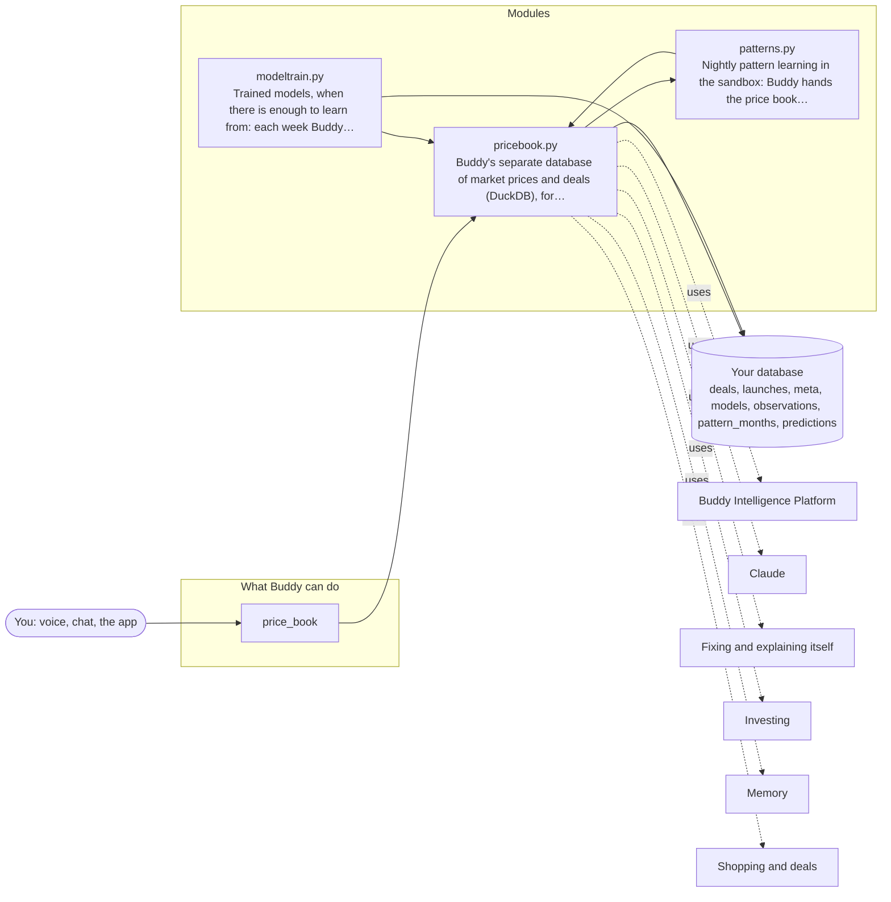

# The price book, pattern learning and trained models

A separate market-price database, nightly pattern learning in the sandbox, and models trained on judged calls once there is enough data.

## Architecture



The diagram reads left to right: what you ask, the tools Buddy uses, the modules that do the work, and what they keep or call. Dashed arrows are other features this one relies on.

## What Buddy can do here

| Tool | What it is for | Actions | Module |
|---|---|---|---|
| `price_book` | Buddy's separate price database (market data only: products, flights, hotels, deals, and the buy-or-wait calls with outcomes) | stats, history, export, patterns, learn | pricebook.py |

## Technical design, module by module

### pricebook.py

```text
The price book: Buddy's separate database of market prices and deals (DuckDB), for history and predictions.

Raw prices and deals are kept a year, then deleted once the nightly learning in the sandbox (patterns.py) has
learned from them; the learned patterns (pattern_months), launches and predictions are kept for good.

What's in it (no personal data: products, routes, hotels, prices and dates):
  observations  every price Buddy sees: products (store, regular price, on sale), flights (route, travel date,
                airline, stops) and hotels (city or hotel, check-in, nights), with when and where it was seen
  deals         every deal read from the deal feeds (title, price, store, link, when)
  predictions   Buddy's buy-now-or-wait calls (the item, its price, the price worth waiting for, the date) and how
                each turned out, to measure and improve the calls

What stays in Buddy's encrypted personal database: what the owner wants, considers, bought and thinks of it, their
profile and price watches. Those only point into the price book by the item's name.

One file next to Buddy's database (pricebook.duckdb, or BUDDY_PRICEBOOK), not encrypted: it holds only market data,
so it can be copied, exported (CSV or Parquet) and analysed with any tool. Note that the routes, dates and hotels
Buddy looked up do show which trips were searched. DuckDB is a columnar file built for fast history queries; it is
kept small in memory (256 MB cap, one thread) for Buddy's server. The nightly backup includes it.

Older history from Buddy's personal database (price_seen, deals, buy_predictions, travel_prices) is copied in once.
```

- Tables: `deals`, `launches`, `meta`, `observations`, `pattern_months`, `predictions`
- Settings: `BUDDY_PRICEBOOK`
- Uses: patterns.py, tools.py

### patterns.py

```text
Nightly pattern learning in the sandbox: Buddy hands the price book to the sandbox, which learns price patterns
(sandbox_jobs/price_patterns.py, offline, in a throwaway container) and Buddy keeps what it learned in the price book.

  export   the price book's prices, products' kinds, launches, predictions and the sale windows, as gzipped CSV
           (market data only: products, routes, hotels, prices, dates; never anything personal)
  learn    in the sandbox workspace "price-patterns", with no network: sale discounts per kind, the odds of a 10%
           drop, price against age since launch, flight fares against days before departure, hotel weekday and
           month patterns, and how Buddy's own buy-or-wait calls turned out
  keep     output/patterns.json goes into the price book's patterns table; when_to_buy reads it and prefers what
           was learned (with how many items stand behind it) over its rules of thumb

Raw prices are kept a year; the patterns are kept for good. Each month's learning is saved (the latest run of
the month wins) and merge() combines the months, weighting each by how many items or prices stood behind it; a
sale's discounts are kept per sale and year, so Black Friday 2026 is still known long after its raw prices are
gone, and Black Friday 2027 adds to it. Prices older than a year are deleted only once a successful run has
learned from them, so nothing is thrown away unlearned (without the sandbox, raw prices simply wait).

Runs once a night (02:30, before the backup) when the sandbox is set up (deploy/sandbox.sh); without it, the
patterns simply wait, and buy-or-wait keeps using its rules of thumb.
```

- Settings: `BUDDY_KEEP_RAW_DAYS`
- Uses: memory.py, pricebook.py, sandbox.py, shopper.py, tools.py, whentobuy.py

### modeltrain.py

```text
Trained models, when there is enough to learn from: each week Buddy counts its judged calls; once a domain has
enough, it trains a small model in the sandbox, tests it on calls the model never saw, and uses it only if it
earned its place. Until then, and whenever a model fails its test, the simple learned weights stay in charge.

  Domains     investing (the practice book's closed paper trades: did the trade win?), theme (the Intelligence
              Platform's evidence events: did the basket beat the market over the next 90 days?), product, flight, hotel
              (the judged buy-or-wait and book-or-wait calls: did the price then come down 8% or more?)
  Enough      200 judged rows with at least 30 of each outcome. A retrain needs 50 new rows.
  Training    sandbox_jobs/train_model.py, offline, in the sandbox: a logistic regression on the reasons and
              figures kept with each call; learns from the oldest 70%, is tested on the newest 30%.
  Promotion   only if, on the unseen calls, its odds beat always saying the average AND the calls it liked were
              right at least 5 points more often than calls overall. The test results are kept with every run.
  Use         a promoted investing model adds its odds to each signal and turns a buy it gives under 45% into a
              caution; a promoted shopping or travel model is averaged with the rule-based chance. If the latest
              run for a domain was rejected, no model is used for it (an old model that no longer passes is
              retired).

The owner is told the first time a domain has enough data, and after every training: what was tested, on how
many calls, and whether it is now in use. A model is one more opinion with a track record; Buddy never trades.
```

- Tables: `models`
- Uses: memory.py, pricebook.py, sandbox.py, simbook.py, stratlab.py, themes.py, tools.py, whentobuy.py

## How it connects

- Relies on: Buddy Intelligence Platform; Claude: the brain; Fixing and explaining itself; Investing: signals, research and practice; Memory; Shopping and deals
- Relied on by: Buddy Intelligence Platform; Claude: the brain; Investing: signals, research and practice; Learning: the English and investing tutors; Shopping and deals; Speaking up on its own: briefing, reminders and alerts; The server and the app; Travel and getting around

