# Investing: signals, research and practice

Chart setups and trade ideas, Reddit and news signals, buy and sell signals with a track record, live triggers, investor checklists, fund holdings, the committee and journal, a paper portfolio and Buddy's own practice book; never trades.

## Architecture

```mermaid
flowchart LR
    you(["You: voice, chat, the app"])
    subgraph Tools["What Buddy can do"]
        t_recommendations["recommendations"]
        t_community_signals["community_signals"]
        t_markets["markets"]
        t_investor_checks["investor_checks"]
        t_fund_holdings["fund_holdings"]
        t_investment_journal["investment_journal"]
        t_paper_portfolio["paper_portfolio"]
        t_investor_library["investor_library"]
    end
    subgraph Modules["Modules"]
        recommend_py["recommend.py<br/>Buy and sell signals by category, each with its reasons and Buddy's…"]
        signals_py["signals.py<br/>what people are saying on Reddit about deals, travel, products and…"]
        simbook_py["simbook.py<br/>every signal Buddy makes is paper-traded automatically, by fixed…"]
        stratlab_py["stratlab.py<br/>well-known trading rules, each paper-traded every weekday, to see…"]
        stratrules_py["stratrules.py<br/>a document that describes a trading strategy becomes a rule the…"]
        strategy_seeds_py["strategy_seeds.py<br/>Strategies read from research papers the owner supplied, shipped as…"]
        researchdesk_py["researchdesk.py<br/>finds strategy research Buddy is allowed to fetch, queues it, and…"]
        benchmarks_py["benchmarks.py<br/>Benchmarks and symbol lists for the strategy lab: academic factor…"]
        newssent_py["newssent.py<br/>how the news on a company reads, as a number, from two services that…"]
        docread_py["docread.py<br/>Reading a file Buddy was given or downloaded: the text is taken out…"]
        fundamentals_py["fundamentals.py<br/>the latest earnings surprise and a few basic financial ratios"]
        labsetup_py["labsetup.py<br/>Loading the trading engine's data in one go, and saying plainly what…"]
        crossmarket_py["crossmarket.py<br/>The Practice tab of the Investments page: Buddy's paper trades (what…"]
        markets_py["markets.py<br/>Buddy scans for chart setups, finds entry and exit levels, reads what…"]
        livewatch_py["livewatch.py<br/>during US market hours Buddy checks the price of each symbol being…"]
        lenses_py["lenses.py<br/>what each school of investing would check about a company, computed…"]
        funds_py["funds.py<br/>what well-known investors' funds reported owning, from their…"]
        journal_py["journal.py<br/>The investment journal and the committee: write a thesis down before…"]
        paper_py["paper.py<br/>pretend money, real prices, so the owner can test ideas before…"]
        investors_py["investors.py<br/>principles from the classic investors and books, each tagged with the…"]
        finnhub_py["finnhub.py<br/>company and market headlines, the earnings calendar, insider buying…"]
        invest_py["invest.py<br/>trade strategy, market trends, the Plaid investment accounts and the…"]
    end
    you --> t_recommendations
    t_recommendations --> recommend_py
    you --> t_community_signals
    t_community_signals --> signals_py
    you --> t_markets
    t_markets --> markets_py
    you --> t_investor_checks
    t_investor_checks --> lenses_py
    you --> t_fund_holdings
    t_fund_holdings --> funds_py
    you --> t_investment_journal
    t_investment_journal --> journal_py
    you --> t_paper_portfolio
    t_paper_portfolio --> paper_py
    you --> t_investor_library
    t_investor_library --> investors_py
    recommend_py --> finnhub_py
    recommend_py --> investors_py
    recommend_py --> lenses_py
    recommend_py --> livewatch_py
    recommend_py --> markets_py
    recommend_py --> signals_py
    recommend_py --> simbook_py
    signals_py --> finnhub_py
    signals_py --> markets_py
    simbook_py --> markets_py
    stratlab_py --> benchmarks_py
    stratlab_py --> finnhub_py
    stratlab_py --> fundamentals_py
    stratlab_py --> markets_py
    stratlab_py --> strategy_seeds_py
    stratlab_py --> stratrules_py
    stratrules_py --> strategy_seeds_py
    researchdesk_py --> docread_py
    researchdesk_py --> stratrules_py
    benchmarks_py --> docread_py
    fundamentals_py --> finnhub_py
    labsetup_py --> benchmarks_py
    labsetup_py --> fundamentals_py
    labsetup_py --> newssent_py
    labsetup_py --> researchdesk_py
    labsetup_py --> stratlab_py
    crossmarket_py --> markets_py
    crossmarket_py --> simbook_py
    crossmarket_py --> stratlab_py
    livewatch_py --> finnhub_py
    livewatch_py --> markets_py
    livewatch_py --> recommend_py
    livewatch_py --> signals_py
    lenses_py --> markets_py
    journal_py --> finnhub_py
    journal_py --> funds_py
    journal_py --> investors_py
    journal_py --> lenses_py
    journal_py --> markets_py
    journal_py --> signals_py
    paper_py --> finnhub_py
    paper_py --> markets_py
    invest_py --> markets_py
    db[("Your database<br/>api_calls, factor_returns, fund_filings, fund_holdings, fundamentals, inv_journal, lab_rules, lab_trades and more")]
    recommend_py --> db
    signals_py --> db
    simbook_py --> db
    stratlab_py --> db
    stratrules_py --> db
    researchdesk_py --> db
    benchmarks_py --> db
    newssent_py --> db
    fundamentals_py --> db
    markets_py --> db
    livewatch_py --> db
    lenses_py --> db
    funds_py --> db
    journal_py --> db
    paper_py --> db
    s_alphavantage["Alpha Vantage (news sentiment)<br/>(public data only)"]
    newssent_py --> s_alphavantage
    s_arxiv["arXiv (papers)<br/>(public data only)"]
    researchdesk_py --> s_arxiv
    s_finnhub["Finnhub (news, earnings, insiders)<br/>(public data only)"]
    finnhub_py --> s_finnhub
    s_french_data["Kenneth French data library (factor returns)<br/>(public data only)"]
    benchmarks_py --> s_french_data
    s_fund_holdings["Fund holdings files (stock lists)<br/>(public data only)"]
    benchmarks_py --> s_fund_holdings
    s_github["GitHub (trending projects)<br/>(public data only)"]
    researchdesk_py --> s_github
    s_marketaux["Marketaux (news sentiment)<br/>(public data only)"]
    newssent_py --> s_marketaux
    s_reddit["Reddit<br/>(public data only)"]
    signals_py --> s_reddit
    markets_py --> s_reddit
    o_0["Buddy Connect"]
    recommend_py -. uses .-> o_0
    o_1["Buddy Intelligence Platform"]
    recommend_py -. uses .-> o_1
    o_2["Claude"]
    recommend_py -. uses .-> o_2
    o_3["Fixing and explaining itself"]
    recommend_py -. uses .-> o_3
    o_4["Free AI models"]
    recommend_py -. uses .-> o_4
    o_5["Learning"]
    recommend_py -. uses .-> o_5
```



The diagram reads left to right: what you ask, the tools Buddy uses, the modules that do the work, and what they keep or call. Dashed arrows are other features this one relies on.

## What Buddy can do here

| Tool | What it is for | Actions | Module |
|---|---|---|---|
| `recommendations` | Buy and sell signals by category, with reasons and Buddy's own record | show, settings, switch, record, run, live, paper, scorecard, model | recommend.py |
| `community_signals` | What people are saying on Reddit about deals, travel, products and markets, read once a night from the communities the owner follows, tagged (ticker, product, c | status, test, run, trending, about, add, remove, switch | signals.py |
| `markets` | Trade ideas from chart patterns, with entries, stops and targets, and what Reddit, StockTwits and the news say; ideas only, you never trade | scan, ideas, analyze, watch, unwatch, bought, sold, settings, test | markets.py |
| `investor_checks` | Run the classic investors' checklists on a US company from its own SEC filings and today's price: Graham (defensive investor's tests), Quality (the Buffett and  | - | lenses.py |
| `fund_holdings` | What well-known funds reported owning in their quarterly SEC 13F filings (Berkshire Hathaway, Bridgewater, Pershing Square, Scion, Renaissance, Appaloosa, Green | show, who_holds, status, refresh, follow, unfollow | funds.py |
| `investment_journal` | The owner's investment journal and research committee | committee, thesis, note, review, list | journal.py |
| `paper_portfolio` | A pretend portfolio for testing ideas with no real money: $100,000 of paper cash, real prices | buy, sell, show, trades, reset | paper.py |
| `investor_library` | Principles from the classic investors and books (Graham, Buffett, Munger, Fisher, Lynch, Klarman, Marks, Greenblatt, Dalio, Soros, Taleb, Malkiel, Lefèvre, Thor | search, list | investors.py |

## Technical design, module by module

### recommend.py

```text
Buy and sell signals by category, each with its reasons and Buddy's own record, switched on per category.

  Categories (each on or off): electronics, home, tools, clothing, games, flights, hotels (shopping and travel:
  the deal alerts and buy-or-wait calls Buddy already makes), and etfs, stocks, commodities, options (investing).

  Investing signals, each weekday morning, from everything Buddy has on a symbol:
    attention  it got unusual attention on Reddit last night (signals.py: times its own usual), and the tone
    trend      the price against its 50-day average, and RSI (stretched or not), from daily prices
    value      the investor checklists from the company's own SEC filings (lenses.py): a buy that the checklists
               call expensive, or that has no profits, becomes a caution; a strong, cheap business being sold
               off is not called a sell
    facts      Finnhub, when its key is set: earnings coming, insiders buying or selling, analysts' ratings
    evidence   a company on Buddy's recommended watchlist or your own, with no Reddit spike: what the Intelligence
               evidence says (filings and patterns growing, news read as good or bad) stands in for the crowd, so
               signals and paper trades do not depend on Reddit alone
  -> buy (attention up, tone and trend agree), sell or avoid (they agree the other way), caution (a crowd piling
     into something already stretched: usually late), or nothing. Code only: no AI decides a signal.

  Every signal is written down with the price that day and scored a week later (right: moved 2% or more the
  signal's way; wrong: 2% or more against). Until a category has 20 scored signals it says "unproven", with the
  count so far. Reddit attention is opinion, often late or wrong, and is never the only reason.

Signals only: Buddy never places, changes or cancels a trade, and this is not financial advice.
```

- Tables: `recs`
- Uses: factors.py, finnhub.py, investors.py, lenses.py, livewatch.py, markets.py, memory.py, modeltrain.py, pricebook.py, shopper.py, signals.py, simbook.py, tools.py, watchpicks.py, whentobuy.py

### signals.py

```text
Signals: what people are saying on Reddit about deals, travel, products and markets (and the day's market
headlines from Finnhub, when its key is set), read once a night, tagged and counted, so Buddy's predictions can use attention and mood next to prices.

  Nightly: each community that's on (deals, travel, reviews, investing) -> its posts of the day
    -> tagged in code: the tickers, the product, the category (electronics, tools, flights, stocks, options...)
       and a rough tone from the words; deal posts with a price also go into the price book as deals
    -> the investing and review posts are read by a free AI model for a better tone and a theme (public posts
       only: never the owner's watch list, holdings or purchases; no free model set up -> the code's tags stay)
    -> counted per day and per ticker / product / theme in `signal_days`, which is kept for good
  Raw posts are deleted after a year; the daily counts stay.

Reading Reddit: with the owner's own Reddit app (BUDDY_REDDIT_CLIENT_ID / BUDDY_REDDIT_SECRET) it uses Reddit's
official API, the route Reddit's rules provide for. Without one it reads each community's public feed, once a
night, about 25 requests, under an honest name. Reddit's robots.txt asks automated crawlers to stay away and its
feeds are published for feed readers; whether a nightly reader like this is welcome is Reddit's call, not ours,
so this can be turned off (BUDDY_REDDIT_FEEDS=0) and Reddit may block it. 'test' says which route works.
All of it is public market chatter: opinion, often late or wrong. It is a signal of attention, never advice.
```

- Tables: `signal_days`, `signals`
- Outside services: Reddit
- Settings: `BUDDY_KEEP_RAW_DAYS`, `BUDDY_REDDIT_CLIENT_ID`, `BUDDY_REDDIT_FEEDS`, `BUDDY_REDDIT_SECRET`
- Uses: benefits.py, dealcollector.py, dealforecast.py, dealmail.py, finnhub.py, free_models.py, gateway.py, markets.py, memory.py, pricebook.py, shopper.py, tools.py, watchpicks.py

### simbook.py

```text
Buddy's practice book: every signal Buddy makes is paper-traded automatically, by fixed rules, so there is an
honest record of what following the signals would have done, and the signal engine can learn from it.

This is Buddy's own test of its own signals, separate from the owner's paper portfolio (paper.py). No real
money, no real orders.

  A buy signal        opens a paper position at that day's close, sized by risk (see Money management), with a
                      stop below, a target twice as far above, closed after 28 days if neither is reached, or
                      when Buddy signals sell on it
  A sell or caution   is scored as an "avoid": right if the price then falls 7%, wrong if it rises 7%, else
                      judged by where it stands after 28 days
  Every close         keeps the result, the S&P 500 fund's move over the same days (the honest comparison), and
                      the reasons the signal was made on (tone, trend, insiders, analysts, the checklists' read)

  Money management, the same rules a careful trader would write down first:
    the book          starts at $100,000 of pretend money; its value is that plus the closed trades' results
    the stop          twice the stock's average daily range below the entry (a calm stock gets a tight stop, a
                      jumpy one a wide stop), never under 4% or over 12%; 7% when the range isn't known
    risk per trade    1% of the book: the position is sized so that being stopped out loses that much, so a
                      wide stop means a smaller position
    position cap      no position over 20% of the book, and never more than the cash left
    total risk cap    all open positions together may not risk more than 6% of the book; a signal that would
                      break it is written down as skipped, not traded
  The results show the book's value, its worst fall from a peak (drawdown), and each trade's result in units of
  the amount risked (R), which is how the rules are judged.

  Learning: for each reason, how often trades won when that reason pointed the trade's way. Once a reason has
  15 closed trades behind it, its weight in the signal score moves between 0.5 and 1.5 (a reason that keeps
  being right counts for more, one that keeps being wrong for less). The weights and the counts behind them are
  kept and shown; nothing is learned from fewer trades than that.

Daily prices decide stops and targets (the day's low and high), so a real fill could differ; costs and taxes are
not taken off. A few dozen trades prove little: results say so until there are enough.
```

- Tables: `sim_trades`
- Uses: markets.py, memory.py, pricebook.py, tools.py

### stratlab.py

```text
Strategy lab: well-known trading rules, each paper-traded every weekday, to see which hold up and to collect
the data a model needs.

The Signals book (simbook.py) waits for a Reddit spike or Intelligence evidence. The lab does not wait for
anything: each weekday it reads the daily prices of about a hundred large US stocks and funds and lets each
rule below open paper trades by itself. No AI decides a trade, and no real order is ever placed.

  trend       Trend following: the price is above its 50-day average, that is above the 200-day average, and
              today's close is the highest of the last 20 days.
  momentum    Momentum: the three strongest of the list over the last six months (leaving out the last week),
              each still above its 200-day average.
  dip         Buy the dip: a stock in a long-term rise (above its 200-day average) that has fallen hard in the
              short term (14-day RSI under 30). Held 10 days at most.
  breakout    Breakout: a new one-year high on at least one and a half times the usual volume.
  sectors     Sector rotation: the three strongest of the eleven sector funds over three months.
  insiders    Insider buying: a company on the recommended watchlist or yours whose insiders have been net
              buyers for three months, with the price above its 50-day average (needs the Finnhub key).

  Every trade   is $1,000 of pretend money, bought at that day's close. The stop is twice the average daily range
                below (never under 4% or over 12%), the target twice as far above, and it is sold after the
                rule's time limit if neither is reached. A rule opens at most three new trades a day and holds a
                symbol once at a time.
  Every close   keeps the result, the S&P 500 fund's move over the same days, and the figures the trade was
                opened on (RSI, distance from the averages, recent returns, volume, daily range), so a model can
                later learn which conditions went with the wins.

  History      so that a rule does not need months of live trades to be judged, every rule is also replayed over
               the past years of daily prices, day by day, seeing only what was known on each day. Those trades
               are kept apart and marked as history. One caution the page states: the list of companies is
               today's (those that failed or shrank are missing, which flatters the past).
  Your rules   a strategy document you upload becomes a rule here once you approve it (stratrules.py).

  Costs        every result shown has 0.2% taken off for buying and selling.
  The splits   a rule's history is also shown by the market when the trade opened (rising or falling), for the
               earlier 70% of the period against the latest 30%, and year by year, so one good stretch cannot
               carry it.
  The model    closed lab trades, live and replayed, are rows for the shared learning core (modeltrain.py, domain
               "lab"): did the trade make money after costs, given the figures it was opened on, the rule, and
               the market then. A model is used only if it passes the core's tests; then each new trade shows
               its odds. The rules keep trading either way, so the data keeps coming.

Daily prices decide stops and targets, so a real fill could differ; taxes are not taken off. A rule is called
unproven until 30 of its trades have closed.
```

- Tables: `lab_trades`
- Uses: benchmarks.py, finnhub.py, fundamentals.py, market_school.py, markets.py, memory.py, modeltrain.py, pricebook.py, strategy_seeds.py, stratrules.py, tools.py, watchpicks.py

### stratrules.py

```text
Strategies you add: a document that describes a trading strategy becomes a rule the strategy lab can test.

  upload      a PDF, Word file, web page or text you give Buddy from the Trading tab (or pasted text)
  read        the text is taken out on the server, and one model call writes the strategy as a rule in the fixed
              form below. A strategy document is public material; if the text holds anything personal (an email
              address is enough) it goes to Claude only, like everything personal.
  proposed    the rule is saved as proposed, with what could not be translated. Nothing trades yet.
  approved    after your yes it joins the strategy lab (stratlab.py): it is replayed over past prices straight
              away and paper-trades every weekday from then on, with its own record against the market.

The rule form is a short list of conditions on figures Buddy already measures from daily prices (FIELDS). A
document cannot add code: anything outside this form is dropped at validation, and what the strategy needs
that Buddy cannot measure (options, intraday prices, earnings estimates) is listed back to you instead.

  {"name": ..., "summary": ..., "universe": "all" | "stocks" | "sectors" | "indexes" | ["AAPL", ...],
   "buy": [{"field": ..., "op": ">" | "<" | ">=" | "<=", "value": number}, ...],     all must hold
   "rank": {"field": ..., "order": "high" | "low", "top": 1-10},                     optional
   "sell": [conditions],                                                              optional, all must hold
   "hold_days": 5-120, "needs": ["what could not be translated", ...]}

Every trade also keeps the lab's own stop, target and time limit. No real order is ever placed.
```

- Tables: `lab_rules`
- Uses: library.py, maestro.py, market_school.py, memory.py, pricebook.py, strategy_seeds.py, tools.py

### strategy_seeds.py

```text
Strategies read from research papers the owner supplied, shipped as proposed rules.

On 16 November 2026 the owner uploaded eleven SSRN papers. Each was read for the trading rule it tests, and the
rule was written in the lab's fixed form (stratrules.py) using only figures Buddy measures. They load once as
PROPOSED: nothing trades until the owner approves each one in the Trading tab, and a removed one stays removed.

What these are and are not:
  - The papers themselves are not stored here, only a rule in Buddy's own words and a link to each paper.
  - Each rule holds part of its paper, never all of it: the papers test long-and-short portfolios, re-formed
    monthly, often outside the US, and several report that the strategy did NOT work in their market. What was
    left out is listed on every rule, and the paper's own finding is in its summary.
  - A paper's result is not Buddy's result. The replay over past prices and the paper trades are the test.
Two of the eleven gave no rule of their own and are listed in NOT_RULES with the reason. Papers that test
the same idea share one rule, so eleven papers give seven rules.
```

### researchdesk.py

```text
Research desk: finds strategy research Buddy is allowed to fetch, queues it, and reads what you pick.

Only two kinds of source are fetched by program, because they are the ones that offer it:

  arXiv        the quantitative finance sections, through arXiv's own API (export.arxiv.org). Once a week Buddy
               lists new papers whose title or abstract looks like a testable trading strategy.
  GitHub       a public file or folder you point to (for example an open-source strategy library). Buddy reads
               the repository's licence first and will not take a file from a repository that states none.

SSRN, journal sites, strategy catalogues, blogs and books are not fetched: their terms allow a person to read
or download, not a program. Download those yourself and upload them in the Trading tab.

  queue    every find is a candidate with its title, link, date and source. Nothing is read by a model yet.
  read     when you pick one: the file is fetched, its text is taken out in the sandbox (docread.py), and the
           strategy is written as a proposed rule (stratrules.py) carrying its source link and licence.
  approve  as for any added strategy: your yes, then the replay over past prices and daily paper trading.
```

- Tables: `research_queue`
- Outside services: arXiv (papers), GitHub (trending projects)
- Uses: docread.py, gateway.py, memory.py, pricebook.py, stratrules.py, tools.py

### benchmarks.py

```text
Benchmarks and symbol lists for the strategy lab: academic factor returns, and fund holdings as stock lists.

  Factor returns   the Kenneth French data library publishes, as files meant for download, what the US market
                   and the classic styles returned each month since 1926: the market above cash, small against
                   large companies, cheap against expensive ones, and past winners against past losers. Buddy
                   fetches the two files once a month and keeps the monthly numbers. They are a yardstick, not
                   something to trade: a rule that looks good should be compared with what plain momentum or
                   the market itself returned over the same time.
  Symbol lists     what a fund holds is a list of stocks with a date. Buddy can fetch a fund's published holdings
                   file (off until you switch it on: its provider's terms were not checked from here), or you
                   upload one. Each list is kept with its date and never overwritten, so past membership builds
                   up from the day you start. One list can be chosen as the lab's stock universe.

Files are opened in the sandbox (docread.py). Only file names and fund names go out; nothing about you.
```

- Tables: `factor_returns`, `symbol_lists`
- Outside services: Kenneth French data library (factor returns), Fund holdings files (stock lists)
- Uses: docread.py, gateway.py, memory.py, pricebook.py, tools.py

### newssent.py

```text
News sentiment: how the news on a company reads, as a number, from two services that publish it.

  Alpha Vantage   news with a sentiment score per company (free key: BUDDY_ALPHAVANTAGE_KEY, about 25 requests
                  a day on the free plan)
  Marketaux       company-tagged news with a sentiment score (free key: BUDDY_MARKETAUX_KEY, about 100 a day)

Each weekday Buddy asks for the companies it is already judging (the recommended watchlist and your own US
symbols, at most 12 from each service) and keeps one number per company, service and day: the average score
from -1 (bad) to +1 (good) and how many articles it rests on. Only ticker symbols go out. The scores are the
services' own automatic reading of headlines, so they are sometimes wrong; Buddy keeps them as one more figure
with each paper trade (f_sentiment_7) and shows them, and no trade is decided on them alone.
```

- Tables: `news_sentiment`
- Outside services: Alpha Vantage (news sentiment), Marketaux (news sentiment)
- Settings: `BUDDY_ALPHAVANTAGE_KEY`, `BUDDY_MARKETAUX_KEY`
- Uses: gateway.py, memory.py, pricebook.py, tools.py, watchpicks.py

### docread.py

```text
Reading a file Buddy was given or downloaded: the text is taken out in the sandbox, not in Buddy itself.

A PDF, spreadsheet or zip from the internet is the kind of file that can be built to attack whatever opens it.
So the file is handed to the sandbox (a throwaway container with no network), a small script there takes the
text out (sandbox_jobs/read_document.py), and only that text comes back. When the sandbox is not set up, the
same script runs inside Buddy as a fallback, and the result says so.

  read(name, data) -> {"text": ..., "where": "sandbox" | "buddy", "error": ""}
```

- Uses: sandbox.py, tools.py

### fundamentals.py

```text
Company figures for the strategy lab: the latest earnings surprise and a few basic financial ratios.

Some well-known strategies cannot be written from prices alone: buying after an earnings surprise, or buying
quality companies (profitable, not deep in debt). Finnhub, whose key Buddy already uses, publishes these per
company. Once a week Buddy asks for the lab's companies and keeps one value per company, figure and day:

  earnings_surprise   the latest reported quarter's profit against what analysts expected, as a fraction
  roe                 return on equity over the last twelve months, as a fraction
  gross_margin        gross margin over the last twelve months, as a fraction
  eps_growth          profit per share against a year before, as a fraction
  pe, pb              price against profits, and against book value
  debt_to_equity      total debt against shareholders' equity

Only ticker symbols go out. These are today's values: there is no past record of them here, so a rule that
uses one can be paper-traded from now on but cannot be replayed over past prices, and the page says so.
```

- Tables: `fundamentals`
- Uses: finnhub.py, memory.py, pricebook.py, tools.py

### labsetup.py

```text
Loading the trading engine's data in one go, and saying plainly what is loaded and what is not.

The strategy lab rests on several sources that each refresh on their own schedule. After a first install, or
when something looks empty, "Load everything" runs them one after another in the background:

  1  the recommended watchlist     from the Intelligence evidence
  2  today's lab trades            each rule's picks from daily prices
  3  the replay over past prices   every rule's record on about five years of history
  4  factor returns                the yardsticks from the Kenneth French data library
  5  the research queue            new papers from arXiv
  6  news sentiment                when one of its two keys is set
  7  company figures               earnings surprise and ratios (the slow one: a few minutes)
  8  a first model                 trained in the sandbox when there are enough judged trades

Each step's result is kept: when it ran, whether it worked, and what it said, in the source's own words when
it failed. The status panel reads what is actually held (counts and dates), not what a step claimed, so an
empty source shows as empty even after a step that reported success.
```

- Settings: `BUDDY_ALPHAVANTAGE_KEY`, `BUDDY_MARKETAUX_KEY`
- Uses: benchmarks.py, fundamentals.py, memory.py, modeltrain.py, newssent.py, pricebook.py, researchdesk.py, sandbox.py, stratlab.py, tools.py, watchpicks.py

### crossmarket.py

```text
The Practice tab of the Investments page: Buddy's paper trades (what was bought and sold, and why) beside the
day's activity across markets, and how crypto and the other markets have been moving together.

  the practice book   from simbook.py: the book's value, open positions marked to the latest close, closed trades
                      with the reasons each was opened on and why it was closed, skipped signals, a day-by-day
                      log, and what the learning has made of them (the reason weights, the trained model's state)
  across markets      the day, week and month moves of stock indexes, sectors, commodity funds, bond funds and
                      the main cryptocurrencies, from daily prices
  moving together     for bitcoin and ether against stocks, tech stocks, gold, oil and long bonds: how closely
                      their daily moves have matched over about 30 and 90 trading days (correlation, -1 to 1),
                      and whether one side's move tended to show up in the other the next day

Correlation says two things moved together, not that one caused the other; the reading says so. Paper trades are
US stocks and funds only (the signals come from tickers people discuss): crypto appears in the market activity
and the links, not in the trades. Market prices are public data; nothing here is personal. Cached for 30 minutes.
```

- Uses: market_school.py, markets.py, memory.py, modeltrain.py, pricebook.py, simbook.py, stratlab.py, themes.py, tools.py

### markets.py

```text
Markets: Buddy scans for chart setups, finds entry and exit levels, reads what Reddit and the news say, and
tracks each idea until it triggers, fails or expires. Ideas only: Buddy never places, changes or cancels a trade.

  Daily (after the US close, weekdays): scan every market that's on (US stocks and ETFs, crypto, Indian stocks)
    -> daily bars for the universe (a liquid default list per market, plus the user's watchlist)
    -> patterns found by code: breakout, base near the high (tight range under a pivot), bull flag, pullback to a
       rising 50-day average, oversold bounce in an uptrend, golden cross
    -> each with an entry, a stop (under the base or ATR-based), targets at 2R and 3R, risk in %, and a score
       (pattern, trend, strength against the market's benchmark, volume, tightness)
    -> for the best few: Reddit (r/wallstreetbets, r/stocks, r/options, r/CryptoCurrency, r/IndianStockMarket...),
       StockTwits and the news; a free model (else Claude's cheap model) reads those and writes a short take and
       the risks per idea (numbers stay the code's); for US stocks with options on, a call about 30-60 days out near 0.6 delta
    -> a "Market scan" report in Reports and one message with the top ideas
  Market hours (every 15 minutes): the ideas being watched are checked against the latest price: broke above the
  entry (alert once, with the plan), ran too far to chase, or failed (fell under the stop). Trades the user says
  they took are watched for the stop, target 1, target 2 and a close under the 20-day EMA after target 1.

Data: Alpaca (a free account; stocks on the IEX feed, crypto, indicative option prices, news) when its key is set,
else free daily data (Stooq for US stocks, Coinbase for crypto); Indian stocks from Yahoo's public chart data,
which is unofficial and may stop working. Only ticker symbols go to these services.
```

- Tables: `api_calls`, `mkt_positions`, `mkt_setups`, `mkt_watch`
- Outside services: Reddit, Serper (Google search, news, places)
- Settings: `BUDDY_ALPACA_KEY_ID`, `BUDDY_ALPACA_SECRET`, `BUDDY_REDDIT_CLIENT_ID`, `BUDDY_REDDIT_SECRET`, `BUDDY_SERPER_KEY`
- Uses: agent.py, benefits.py, config.py, finance.py, free_models.py, gateway.py, jobs.py, memory.py, tools.py, usage.py

### livewatch.py

```text
Live triggers: during US market hours Buddy checks the price of each symbol being followed once a minute and
says when something happens. Triggers, not predictions; code only, so they cost nothing.

  Followed (20 at most): the US watch list, the symbols with an open signal this week (recommend.py) and the
  trade ideas being watched (markets.py), in categories whose alerts are on.
  Prices: Finnhub quotes when its key is set (one small request per symbol a minute), else Alpaca's latest
  prices in one request. The free feeds cover part of the market's trading, so a price can lag a busy tape by a
  little. Option prices are NOT live on free data (15 minutes late): a trigger on the stock is the signal, and
  the message says to check the live option chain.
  Triggers, each said once a day per symbol:
    breakout / breakdown   through the high / low of the last 20 trading days
    big day                up or down 3% (then 6%) from yesterday's close; funds at 1.5% and 3%
    fast move              1.5% in five minutes (funds 0.8%)
  Every trigger is kept in the price book (`live_events`, a year), so the pattern learner can see what followed.

Off with BUDDY_LIVE_SIGNALS=0. Buddy never trades; a trigger is not advice.
```

- Tables: `live_events`
- Settings: `BUDDY_ALPACA_KEY_ID`, `BUDDY_ALPACA_SECRET`, `BUDDY_FINNHUB_KEY`, `BUDDY_LIVE_SIGNALS`
- Uses: finnhub.py, markets.py, memory.py, pricebook.py, recommend.py, signals.py, tools.py

### lenses.py

```text
Investor checklists: what each school of investing would check about a company, computed in code from its own
SEC filings (10-K figures) and today's price. The numbers are the company's; the checklists are in the spirit of
each investor's published method, not a claim about what that person would say today.

  Graham      the defensive investor's tests from The Intelligent Investor (ch. 14): price no more than 15 times
              three-year average earnings, price-to-book no more than 1.5 (or the two multiplied under 22.5),
              current assets twice current liabilities, long-term debt under working capital, profits every year,
              a dividend, and earnings growth
  Quality     the tests commonly used in the Buffett and Munger tradition (their letters stress them; this is not a
              formula they published): return on equity over 15% year after year, steady or rising margins, free
              cash flow every year, debt that a few years of profit could repay
  Lynch       growth at a reasonable price, from One Up on Wall Street: the P/E against the growth rate (PEG; about
              1 is fair, 2 is dear), with dividends counted, and modest debt
  Greenblatt  the two numbers of The Little Book That Beats the Market: earnings yield (operating profit over
              enterprise value) and return on capital. He ranks every stock against the others; one company can't
              be ranked, so fixed marks stand in (8% and 25%)
  Marks       the second-level question from The Most Important Thing: how much optimism is already in the price
              (a high multiple, a price far above its 200-day average, a crowd)

Banks and insurers report differently (no current assets or operating profit), so those tests show "not reported"
rather than a pass or fail. Filings are yearly and up to 15 months old: a checklist is a starting point for
reading the filing, never a verdict. Only the ticker goes to the SEC.
```

- Tables: `fundamentals`
- Outside services: SEC EDGAR (company filings)
- Uses: gateway.py, market_school.py, markets.py, memory.py, pricebook.py, tools.py

### funds.py

```text
Fund holdings: what well-known investors' funds reported owning, from their quarterly 13F filings at the SEC.

  Weekly: for each fund followed, the SEC's list of its filings -> a 13F not seen before -> its holdings table
  (issuer, class, value, shares, puts and calls) kept in the price book -> what changed against the quarter
  before: new positions, positions sold out, added to, trimmed, and how concentrated the fund is.

What a 13F is and isn't: US-listed long positions (and listed options) at the END of a quarter, filed up to 45
days later. No short positions, no cash, no foreign listings, nothing bought or sold since. So every answer
carries the quarter and the filing date, and is never "what they own now". A filing lists issuer names and CUSIP
numbers, not tickers, so companies are matched by name.

The SEC numbers (CIK) below were written from memory and could not be checked when this was built: each fund's
entry shows the name the SEC returns for it, so a wrong number is visible, and "follow <name> <CIK>" corrects
or adds one. Only the CIK goes to the SEC.
```

- Tables: `fund_filings`, `fund_holdings`
- Outside services: SEC EDGAR (company filings)
- Uses: gateway.py, market_school.py, memory.py, pricebook.py, tools.py

### journal.py

```text
The investment journal and the committee: write a thesis down before acting, have it argued from both sides,
and check it later against what happened. Entries are only ever added, never changed or deleted, so old reasoning
can be judged honestly.

  thesis     why the owner thinks a company is worth owning (or avoiding), what they expect, and what would prove
             them wrong, with that day's price and checklist read kept beside it
  note       anything added later (a new filing, a change of mind): a new dated entry
  review     the thesis against today: the price then and now, what the checklists said then and say now; the
             conclusion is added as a new entry and the original stays as written
  committee  everything Buddy has on a company in one place (checklists from its filings, the price trend, what
             Reddit says, Finnhub's facts, which followed funds reported holding it, the journal so far), for
             Claude to argue the strongest case for, the strongest case against, and what would disprove each

The journal is the owner's own thinking: it stays in Buddy's main (encrypted) store and only Claude reads it.
Research and education, not advice; Buddy never trades.
```

- Tables: `inv_journal`
- Uses: finnhub.py, funds.py, investors.py, lenses.py, markets.py, memory.py, signals.py, tools.py

### paper.py

```text
A paper portfolio: pretend money, real prices, so the owner can test ideas before risking anything.

Starts with $100,000 of pretend cash. 'Buy' and 'sell' record a pretend trade at the latest price Buddy can get
(Finnhub's quote, else Alpaca's latest, else the last daily close). The portfolio shows each position's gain, the
cash, the total return, and the same money put into the S&P 500 fund (SPY) on the day of the first trade, which
is the honest comparison. No costs, taxes or slippage are taken off, so real results would be a little worse.
Nothing here is a real order: Buddy never trades. It is the owner's own record and stays on their server.
```

- Tables: `paper_trades`
- Uses: finnhub.py, markets.py, memory.py, tools.py

### investors.py

```text
The investor library: principles from the classic investors and books, each tagged with the situation it
applies to, so Buddy's signals and its committee can bring the relevant lesson to a decision.

Each entry is a principle in Buddy's own words (never a quotation), who it comes from, the work it is set out in,
the situations it speaks to, and the question it makes you ask. A situation is a set of plain tags worked out in
code from the numbers: the price (expensive, cheap, no_profits), the business (strong, weak), the crowd (crowd,
stretched), the trend (falling), debt (high_debt), earnings_soon, unproven (Buddy's own record is short), and
always.

Honesty about sources: these were written from general knowledge of well-known works and have NOT yet been
checked line by line against the books and letters. Each entry carries checked = False until someone has. They
are summaries of ideas, so the risk is a misplaced emphasis or chapter, not an invented quote, but treat the
attribution as "set out in this work", not as a citation to a page. Historical case studies (what an investor
actually bought, when, and what happened) are not here: those need original sources and are added only with one.
```

- Uses: tools.py

### finnhub.py

```text
Finnhub (the owner's free key): company and market headlines, the earnings calendar, insider buying and
selling, analysts' ratings and a live quote. Only ticker symbols and dates go to Finnhub; never the owner's
holdings or watch list as such (a symbol is asked about because it is being discussed publicly or scanned).

Set the key with: sudo bash /opt/buddy/deploy/set.sh BUDDY_FINNHUB_KEY
```

- Outside services: Finnhub (news, earnings, insiders)
- Settings: `BUDDY_FINNHUB_KEY`
- Uses: gateway.py, memory.py, tools.py

### invest.py

```text
The Investments tab (web/invest.html): trade strategy, market trends, the Plaid investment accounts and the watchlist.

Everything here is read-only. The strategy is markets.py's ideas being watched and the trades the user told Buddy
about; trends are the News topics about markets, crypto and Indian stocks (trends.py); accounts are the brokerage
and retirement balances Plaid reports, plus the money moved into them. Buddy never trades: ideas, not advice.
```

- Uses: markets.py, memory.py, plaid.py, trends.py

## How it connects

- Relies on: Buddy Connect; Buddy Intelligence Platform; Claude: the brain; Fixing and explaining itself; Free AI models (Groq, Gemini, Mistral, Cerebras, GitHub Models, OpenRouter); Learning: the English and investing tutors; Making and doing things; Memory; Money; News, trends and research; Shopping and deals; The price book, pattern learning and trained models
- Relied on by: Buddy Connect; Buddy Intelligence Platform; Claude: the brain; Free AI models (Groq, Gemini, Mistral, Cerebras, GitHub Models, OpenRouter); Learning: the English and investing tutors; News, trends and research; Shopping and deals; Speaking up on its own: briefing, reminders and alerts; The price book, pattern learning and trained models; The server and the app; Travel and getting around

