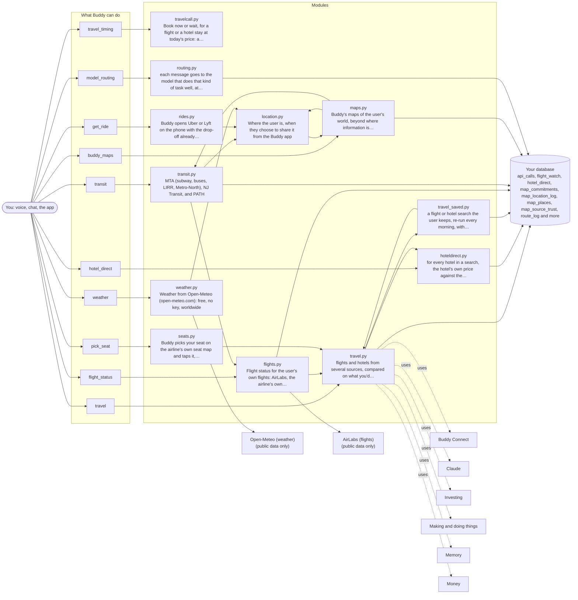

# Travel and getting around

Flights and hotels with book now or wait, checking the hotel direct, saved searches, seats, transit alerts, maps, rides, weather and where you are.

## Architecture



The diagram reads left to right: what you ask, the tools Buddy uses, the modules that do the work, and what they keep or call. Dashed arrows are other features this one relies on.

## What Buddy can do here

| Tool | What it is for | Actions | Module |
|---|---|---|---|
| `travel` | Flights and hotels from Duffel (live airline offers with bag and change rules), Google Flights / Google Hotels (market prices) and Travelpayouts (cheapest dates | flights, hotels, cheapest_dates, refresh, profile, set_profile, chose, price_pattern, watch, watches, unwatch, save_search, saved_searches, unsave_search | travel.py |
| `travel_timing` | Book now or wait, for a flight or a hotel stay at today's price | flight, hotel | travelcall.py |
| `hotel_direct` | Booking a hotel direct against booking sites | note, stats, rule | hoteldirect.py |
| `flight_status` | Live status of the user's flights (status with no flight: every upcoming flight Buddy knows from tracked flights, emails and uploads; never ask for the number b | status, track, untrack, list, test | flights.py |
| `pick_seat` | Pick seats on an airline's seat map open in the browser on the user's phone (their own booking, in Manage Booking or check-in, any airline) | read, scroll, choose | seats.py |
| `transit` | Live transit alerts for the user's commute, from the official MTA (subway, buses, LIRR, Metro-North), NJ Transit (trains and light rail) and PATH feeds | status, watch, unwatch, list, test | transit.py |
| `buddy_maps` | Buddy's maps of the user's world | places, name_place, routine, situation, trust, goals, commitments, add_commitment, done_commitment, people, money_flow, skills, forget_location | maps.py |
| `model_routing` | How Buddy picks a model for each message: 'which model answers what?', 'how much does each kind of question cost?', 'why did you use the quick model?' | - | routing.py |
| `get_ride` | Open Uber and/or Lyft on the user's phone with the trip filled in (pickup: where they are, unless they name another place; drop-off: a place name, address, or a | open, compare, prices, status, save_place, places | rides.py |
| `weather` | Weather from Open-Meteo (free): now and up to 7 days (conditions, high/low, chance of rain by day and hour) | - | weather.py |

## Technical design, module by module

### travel.py

```text
Travel: flights and hotels from several sources, compared on what you'd really pay, with the catches.

Sources (each an adapter returning the same Offer shape; the rest of Buddy never knows which one):
  duffel         live airline offers you could book (later), with bag allowance and change / refund rules
                 for each fare                                       BUDDY_DUFFEL_TOKEN
  google         Google Flights and Google Hotels through SerpApi: the market benchmark, Google's
                 low / typical / high price rating, and a link to book from     BUDDY_SERPAPI_KEY
  travelpayouts  the cheapest fares Aviasales travellers found lately, for cheapest dates
                                                                     BUDDY_TRAVELPAYOUTS_TOKEN

What Buddy adds on top (all in code, on the server):
  true total     fare + the bags you travel with + seat + payment fees, or room + taxes + fees; a fee
                 the source doesn't price is estimated and marked as an estimate
  caveats        basic economy, no carry-on, bags for a fee, no refunds or a change fee, tight or
                 overnight layovers, changing airports, often delayed, long trips, red-eyes; for hotels
                 taxes and fees on top, resort and cleaning fees, no free cancellation, parking, Wi-Fi,
                 vacation-rental rules, and what reviews say about surprise fees
  ranking        best value (true total, plus time and stops weighed in), cheapest, fastest; the same
                 flight from two sources shown once, with both prices
  history        every search's prices are kept, so "18% below the usual for this route" is possible
  links          each offer opens where it can be booked (Google Flights, the hotel, Kayak, Aviasales);
                 Buddy never books or pays by itself

Every call to an outside API is logged (api_calls) with its cost, for Insights.
```

- Tables: `api_calls`, `travel_patterns`, `travel_prices`, `travel_searches`, `travel_watches`
- Settings: `BUDDY_DUFFEL_COST_PER_SEARCH`, `BUDDY_DUFFEL_TOKEN`, `BUDDY_DUFFEL_VERSION`, `BUDDY_SERPAPI_COST_PER_SEARCH`, `BUDDY_SERPAPI_KEY`, `BUDDY_TRAVELPAYOUTS_TOKEN`
- Uses: brain.py, cards.py, hoteldirect.py, memory.py, pricebook.py, social.py, tools.py, travel_saved.py

### travelcall.py

```text
Book now or wait, for a flight or a hotel stay at today's price: a call with its reasons, written down and
judged later against the prices Buddy then sees, so the reasons can be re-weighed like the shopping ones.

  Reasons (each a push towards waiting or towards booking now):
    window         how far ahead the trip is. A rule of thumb until the route's own pattern is learned: fares
                   usually climb in the last three weeks, and dates four months or more away often come down
    route_pattern  what the pattern learner found for this route (the usual price by days before the trip): is a
                   cheaper stretch still ahead, or is this already the cheap stretch
    vs_usual       today's price against the route's (or the place's) usual price in the price book
    near_lowest    at or near the lowest Buddy has seen for it
  The call is "wait" when the chance of a price 8% or more lower, before two weeks ahead of the trip, is a half
  or more. It is saved with its reasons; the route is then followed (free, through Travelpayouts) so the outcome
  is known (a hotel's rate is looked up again every three days through Google Hotels), and whentobuy.learn("flight" / "hotel") re-weighs each reason once it has 15 judged calls.

For hotels the better advice is often neither: book a rate with free cancellation now and let Buddy re-check,
and the call says so. Buddy never books.
```

- Uses: memory.py, modeltrain.py, patterns.py, pricebook.py, tools.py, whentobuy.py

### hoteldirect.py

```text
Check direct: for every hotel in a search, the hotel's own price against the booking sites', and what booking
direct adds; and a record of who really was cheaper, per chain.

Where the direct price comes from (no scraping of hotel sites):
  Google Hotels   each hotel's result lists its sellers' nightly prices, often including the hotel's own site
                  ("Marriott.com", "Hilton", "Official site"); Buddy picks that one out
  the owner       "Marriott direct was $189 a night" (after checking as a member): note()
Every comparison is kept (hotel, chain, the direct and the best booking-site price, when). stats() then says, per
chain, how often direct was cheaper or the same and by how much, so the advice is from this owner's own searches.

The rule (the owner can change it): prefer booking direct when it's within 5% of the cheapest booking site, because
direct bookings earn the chain's points and nights, usually have better change and cancellation terms, and carry
the chain's best-rate guarantee. Buddy never books: it shows the link to the hotel's own site.
```

- Tables: `hotel_direct`
- Uses: memory.py, tools.py

### travel_saved.py

```text
Saved travel searches: a flight or hotel search the user keeps, re-run every morning, with an alert on a deal.

"Save & track" on a search result keeps its exact query (route and dates, or place and nights). Each morning Buddy
runs it again live (Duffel, Google Flights / Hotels, Travelpayouts), compares the cheapest TRUE TOTAL (bags, seat,
fees included, the way the user travels) with the price when it was saved and the lowest since, and messages when:
  - it's at or under the user's target price, or
  - it dropped at least 5% (and at least $15) below the price when saved, or
  - it's a new low since saving.
Each drop is said once (it has to fall another 3% to be said again). A search ends after its travel date.
Every re-check is one search (SerpApi is paid per search), so at most MAX_SAVED are tracked, once a day each.
Buddy never books: the alert links to the fresh results to book yourself.
```

- Tables: `travel_saved`
- Uses: memory.py, tools.py, travel.py

### flights.py

```text
Flight status for the user's own flights: AirLabs, the airline's own app and emails, then FlightAware.

Sources, in order: AirLabs (schedule, live position, and more on paid plans); the airline's app notifications and
emails about the flight, read on Buddy's server with text rules (gate, terminal, new departure time, delay,
boarding, cancellation: the airline knows first); FlightAware AeroAPI as the final backup for what's still missing,
rationed (only near departure, every 30 minutes at most, 12 calls a flight, BUDDY_AEROAPI_MONTHLY a month, key
BUDDY_AEROAPI_KEY) because it's paid per query. FlightAware's reply format is from its public documentation and is
checked with a real key on first use.

"Track AA 1234 tomorrow" (or Buddy finds the flight in a booking email and asks). From about 4 hours before the
scheduled departure until it lands, Buddy checks every 15 minutes and messages only when something changes: a
delay (or a bigger one), a gate or terminal change, a cancellation, a diversion, departure, landing (with the bag
carousel when known). Any time: "is my flight on time?".

AirLabs: GET https://airlabs.co/api/v9/schedules?flight_iata=AA1234&api_key=… (status scheduled / active / landed /
cancelled, times, estimated and actual times, gates, terminals, baggage, delays) and /flight?flight_iata=… (the
closest flight, with its live position). Which fields come back depends on the AirLabs plan: per its docs the free
plan has the route, scheduled times and live position, while gates, terminals, delays, estimated times and status
may need a paid plan. Buddy uses whatever the key returns and says what's missing. Key: BUDDY_AIRLABS_KEY.
Only flight numbers go to AirLabs, nothing about the user. Read-only: Buddy never changes a booking.
```

- Tables: `flight_watch`
- Outside services: AirLabs (flights)
- Settings: `BUDDY_AEROAPI_KEY`, `BUDDY_AEROAPI_MONTHLY`, `BUDDY_AIRLABS_KEY`
- Uses: connect.py, gateway.py, markets.py, memory.py, tools.py, travel.py

### seats.py

```text
Seat helper: Buddy picks your seat on the airline's own seat map and taps it, after your yes.

  "Buddy, pick my seats on the Etihad flight"
    -> open the airline's Manage Booking in the phone's browser (Buddy gives the link and fills the booking
       reference and last name with the form helper; you tap Retrieve or Continue yourself)
    -> on the seat map: pick_seat read. The phone's form helper sends the seats on screen (their labels, where
       each sits across the row, whether it can be tapped); Buddy works out window / aisle / middle, the price,
       exit rows and extra legroom, and ranks the free ones by what you like (window or aisle, together,
       near the front for a tight connection)
    -> "Seat 32A: window, free, row to yourself. Select it?" Only after a yes does the phone tap it
    -> you check the page and tap Continue / Confirm, and pay yourself if the seat has a price

Buddy never taps Confirm, Continue to payment, Pay or Purchase (formfill.NEVER_TAP, checked here and on the
phone), and never types a card number. Works with any airline's website whose seat map the phone can read;
some seat maps are pictures the phone can't read, and then Buddy says so.
```

- Uses: brain.py, formfill.py, tools.py, travel.py

### transit.py

```text
Transit alerts for the user's commute: MTA (subway, buses, LIRR, Metro-North), NJ Transit, and PATH.

The user names the lines they ride and when ("the Q weekdays 8 to 9:30", "Hudson-Bergen Light Rail", "PATH
Newark-WTC from Journal Square"). During those times Buddy checks each line's official alerts every few minutes,
messages once when a delay, suspension or other change starts, and once when it clears. Any time, "is the Q
running?" gets the live answer. Read-only: Buddy only reads public alert feeds, it never books or buys anything.

Sources (official):
- MTA: the GTFS-realtime alerts feed as JSON, api-endpoint.mta.info (no key needed).
- PATH: the Port Authority's real-time arrivals (ridepath.json) and its PATH incidents feed (www.panynj.gov).
- NJ Transit: the RailData API (raildata.njtransit.com): getToken with the developer account's username and
  password (BUDDY_NJT_USERNAME / BUDDY_NJT_PASSWORD, from developer.njtransit.com), then getStationMSG for the
  service messages. The token is kept and reused (NJ Transit limits how often a new one can be made).
Only line and station names go to these services; nothing about the user.
```

- Tables: `transit_open`, `transit_watch`
- Settings: `BUDDY_NJT_PASSWORD`, `BUDDY_NJT_USERNAME`
- Uses: flights.py, gateway.py, location.py, markets.py, memory.py, tools.py

### maps.py

```text
Buddy's maps of the user's world, beyond where information is (reasoning.SOURCES): who, where, when, why, and
how far to trust it. Each map is built from data Buddy already has; the conversation gets the parts that matter
for the question (context_lines), and Moments-style nudges use them to speak at the right time.

1. Places and routines: where the user goes (home, work, named places) and when (usual weekday leave time),
   learned from the location history the app shares. A commute check before the usual leave time.
2. Situation: right now: at home / at work / travelling / driving / in a meeting / quiet hours. Non-urgent nudges
   wait while driving or in a meeting.
3. Source trust: how often each source turned out right (fact-checks that held, the user's corrections). When
   sources disagree, the more reliable one wins and Buddy says so.
4. Goals and priorities: the user's goals (general and money) and stated priorities, weighed in every decision.
5. Commitments: promises with a date ("I'll send it Monday", "call Amma Sunday") from conversation, emails and
   chats; a reminder the day before and on the day.
6. People: who they are, how to reach them, when the user last heard from them; a nudge when a close family
   member hasn't been heard from in three weeks.
7. Money flow: which account pays each bill (learned from past payments); a heads-up when an account is short of
   what will come out of it.
8. Skills and costs: for each outside service and model, how often it works and what it costs this month, so Buddy
   picks the reliable, cheap path and says when a paid one is worth it.
```

- Tables: `map_commitments`, `map_location_log`, `map_places`, `map_source_trust`
- Uses: brain.py, commute.py, connect.py, location.py, memory.py, money.py, plaid.py, tools.py, transit.py

### routing.py

```text
Smart model routing: each message goes to the model that does that kind of task well, at the lowest cost.

1. Signals, by code (no model call, under a millisecond): the task (one of TASKS: reminders, quick facts,
   email, money, credit, markets, travel, places, writing, code, research, health / legal / tax, planning...),
   how hard it looks (length, several parts, "compare", "step by step", "strategy"), whether it's personal
   (then it never goes to a free model; that guard also runs again in free_models), and whether it follows
   a bigger question a moment ago (same model, so a follow-up keeps its context).
2. Policy: each task has a tier (fast = Haiku, main = Sonnet); hard questions go up a tier; high-stakes ones
   (health, legal, tax, investing) with a hard question get a hint to step up to the expert (Opus, ask_expert).
   The user picks the mode in their own words ("save money on AI", "always use the best model"):
     saver     quick model unless the task needs tools or depth; it hands over when it must
     balanced  the default
     best      the main model for everything but greetings and closers
3. Learning: every decision is logged (route_log) with its task and reason. A task where the quick model
   often fails (handed over, an error, a thumbs down, or "that's wrong" right after) over the last 14 days
   is moved to the main model automatically; it's tried on the quick model again after 14 days.
0. Free models first (free_kind): small talk, and simple, general, timeless requests with nothing personal and no
   tool needed (a fact, an explanation, a translation, a poem or caption, ideas, rewording, a short coding
   how-to). Anything personal, current, needing Buddy's tools, high stakes or hard goes to a paid model. A free
   model that isn't sure hands it back; hand-backs, thumbs down and "that's wrong" count as misses, and a kind the
   free models keep missing goes to Claude for two weeks.
```

- Tables: `route_log`
- Uses: config.py, router.py

### rides.py

```text
Rides: Buddy opens Uber or Lyft on the phone with the drop-off already filled in.

Uber and Lyft don't let personal apps see prices or book rides through their APIs, so Buddy does
the part it can: finds the place, builds the apps' own ride links, and the phone opens them. The
user sees the real price in the app and taps Confirm; nothing is booked or paid by Buddy.

  "Uber to the airport"       -> Uber opens, pickup here, drop-off Miami International
  "compare Uber and Lyft"     -> Uber opens; coming back to Buddy opens Lyft with the same trip
  "Lyft home"                 -> saved places: "save home as 123 Main St" once

The pickup is the phone's location unless the user names another one. Places are found with
Google Maps (Serper) near where the user is, or OpenStreetMap when there's no Serper key.
```

- Uses: brain.py, cards.py, location.py, memory.py, tools.py

### location.py

```text
Where the user is, when they choose to share it from the Buddy app.

The phone sends its location when Buddy is opened or spoken to (Settings → Share my
location). It's kept in the encrypted database, only the latest one, and treated as
stale after MAX_AGE_HOURS. Coordinates are turned into a neighbourhood and city with
OpenStreetMap's free geocoder (cached), so "a spa near me" becomes "a spa in
Miraflores, Lima".

With the GPS fix the phone shares, Buddy also works out:
  street        the street address (house number and road, from the same OpenStreetMap lookup)
  current_shop  the place the coordinates are inside, if any: the shop/amenity OpenStreetMap puts the point in.
                Remembered (name and spot only) so the learned routine (routine.py) can name exact places.
The coordinates go only to OpenStreetMap's geocoder (as before), never to a search service: a list of nearby places
could be passed in (nearby=), but none is looked up by default, so the owner's exact position isn't shared.
When nothing matches, neighbourhood and city are still there, as before.
```

- Uses: maps.py, memory.py, tools.py

### weather.py

```text
Weather from Open-Meteo (open-meteo.com): free, no key, worldwide.

forecast(place or coordinates): now, today and the next days (high, low, chance of rain, conditions), in the
user's units. Used for "will it rain tomorrow?", the morning heads-up when rain or snow is likely (said only when
it matters), and the evening before a flight: the weather where the user is going.
Only coordinates (rounded to about 1 km) or a place name go to Open-Meteo, nothing about the user.
```

- Outside services: Open-Meteo (weather)
- Settings: `BUDDY_TEMP_UNIT`
- Uses: gateway.py, location.py, memory.py, tools.py

## How it connects

- Relies on: Buddy Connect; Claude: the brain; Investing: signals, research and practice; Making and doing things; Memory; Money; News, trends and research; Shopping and deals; Speaking up on its own: briefing, reminders and alerts; The price book, pattern learning and trained models
- Relied on by: Buddy Connect; Claude: the brain; Email, messages and apps; Going out: restaurants and events; Home and health; Insights and costs; Memory; Money; Phone calls; Shopping and deals; Speaking up on its own: briefing, reminders and alerts; The server and the app

