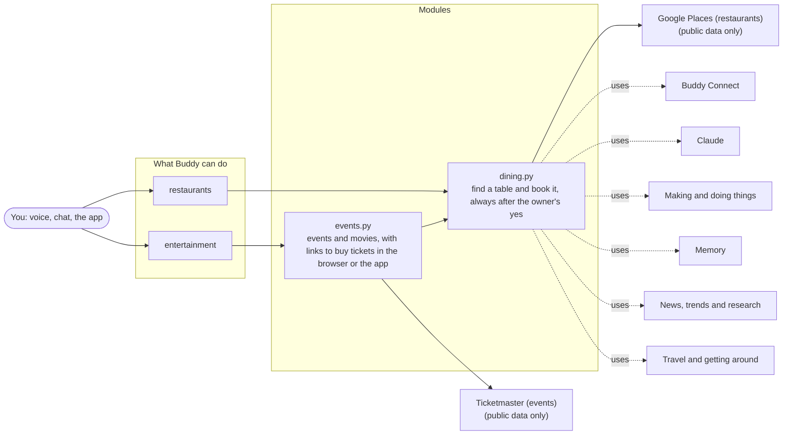

# Going out: restaurants and events

Finding and booking a table after your yes; events and films with links to buy tickets yourself.

## Architecture



The diagram reads left to right: what you ask, the tools Buddy uses, the modules that do the work, and what they keep or call. Dashed arrows are other features this one relies on.

## What Buddy can do here

| Tool | What it is for | Actions | Module |
|---|---|---|---|
| `restaurants` | Find restaurants and help book a table | search, book | dining.py |
| `entertainment` | Concerts, sports, theatre, comedy and movies, with links to buy tickets | events, tickets, movies | events.py |

## Technical design, module by module

### dining.py

```text
Restaurants: find a table and book it, always after the owner's yes.

Finding: Google Places (the official API, Buddy Connect "google_places") when its key is set, else the Google Maps
results Buddy already gets through Serper. Either way only the search words and a neighbourhood or city go out
("Italian in Chelsea, New York"), never the owner's exact position.

Booking, three ways, the owner picks:
  link   booking pages with the party size, date and time filled in where the site takes them: OpenTable, Resy, the
         restaurant's own site, and Google Maps (its "Reserve a table" for places that take bookings through Google).
         The owner taps the final button there: Buddy never confirms or pays on its own.
  call   Buddy's phone agent calls the restaurant (calls.py, kind reservation) after the owner's yes; it shares only
         the owner's name and callback number, never a card number (if they need a card to hold the table, Buddy
         says the owner will book online or call back).
OpenTable, Resy and Yelp only let approved business partners book through their systems, so links are the way in.
```

- Outside services: Google Places (restaurants)
- Uses: cards.py, gateway.py, location.py, memory.py, social.py, tools.py

### events.py

```text
Entertainment: events and movies, with links to buy tickets in the browser or the app. Buddy never pays.

Events (concerts, sports, theatre, comedy): Ticketmaster's Discovery API (Buddy Connect "ticketmaster", a free key).
Each event comes with its own Ticketmaster page, sent to the Buddy app as a card: the owner taps it and buys there (in
the browser or the Ticketmaster app). Other sellers (SeatGeek, StubHub) are offered as searches for the same event.
Movies (AMC, Regal, Fandango): no public API, so showtime links: Google's showtimes for the area, and searches that
land on the AMC and Fandango pages for that film. Only the search words and the owner's city go out, never their
position.
```

- Outside services: Ticketmaster (events)
- Settings: `BUDDY_TICKETMASTER_KEY`
- Uses: cards.py, dining.py, gateway.py, memory.py, tools.py

## How it connects

- Relies on: Buddy Connect; Claude: the brain; Making and doing things; Memory; News, trends and research; Travel and getting around
- Relied on by: Claude: the brain; News, trends and research; Speaking up on its own: briefing, reminders and alerts

