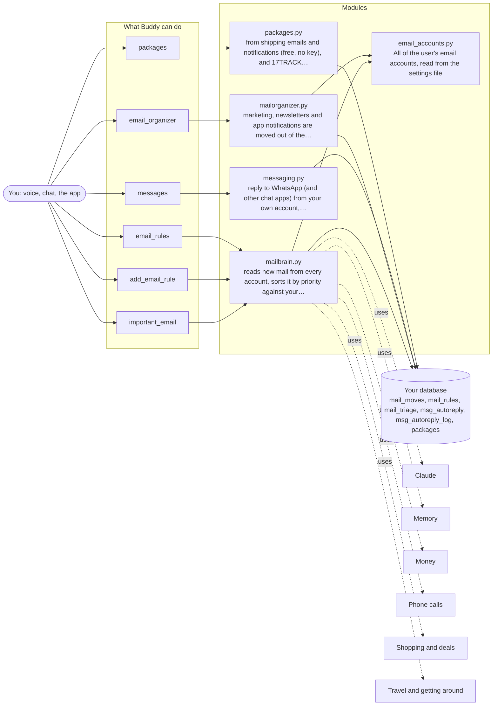

# Email, messages and apps

Gmail and other accounts sorted and summarised, marketing and notices moved out of the inbox, messages, and package tracking.

## Architecture



The diagram reads left to right: what you ask, the tools Buddy uses, the modules that do the work, and what they keep or call. Dashed arrows are other features this one relies on.

## What Buddy can do here

| Tool | What it is for | Actions | Module |
|---|---|---|---|
| `important_email` | What's important in the user's email lately, across all accounts, already sorted by priority (urgent first) with a one-line reason, and anything Buddy organised | - | mailbrain.py |
| `add_email_rule` | Add one of the user's email rules, in their words | - | mailbrain.py |
| `email_rules` | List the user's email rules (with ids), or remove one with remove_id. | - | mailbrain.py |
| `email_organizer` | Keeps the inbox for real email by moving marketing, newsletters and app notifications into their own folders (Buddy Promotions, Buddy Newsletters, Buddy Notific | preview, organize, undo, keep, always, forget, auto, status | mailorganizer.py |
| `messages` | Reply to WhatsApp, Messages, Telegram or Signal from the user's own account, through the phone's notification (free; works for chats with a recent notification) | chats, reply, auto_reply, auto_replies, stop_auto_reply | messaging.py |
| `packages` | The user's packages: from shipping emails and notifications (Amazon, UPS, FedEx, USPS, DHL), and 17TRACK live status when its key is set | list, track, remove, test | packages.py |

## Technical design, module by module

### mailbrain.py

```text
Email manager: reads new mail from every account, sorts it by priority against
your rules, tells you about what matters, and organises mail the way you asked.
The same call also reads charges, bills and payments for the money agent.

  urgent  told straight away (outside quiet hours), e.g. a bill due tomorrow, a fraud
          alert, a flight change, family or your boss needing an answer
  normal  worth reading: in "what's important in my email?" and the morning briefing
  low     newsletters, promotions, routine notifications: never mentioned

Rules are your own words ("anything from Chase about a payment is urgent", "label
Uber and Lyft receipts Travel", "archive LinkedIn notifications"). Rules that change
mail (label, archive, mark read) are only added after your yes, then run by
themselves on new Gmail mail; nothing is ever deleted or sent automatically.

New mail is sorted in small batches by the cheap model, about a tenth of a cent each.
```

- Tables: `mail_rules`, `mail_triage`
- Uses: agent.py, budgets.py, cancelling.py, config.py, email_accounts.py, memory.py, money.py, thrift.py, tools.py, usage.py

### mailorganizer.py

```text
The email organizer: marketing, newsletters and app notifications are moved out of the inbox into their own
folders, so what is left in the inbox is real email: from people, and the automated mail that matters.

How a message is judged (from its headers only: the body is never read, and no AI is involved):
  stays in the inbox, always
    - anything that is not bulk mail: no unsubscribe header and not marked bulk. A person's email has neither,
      so a personal email can never be moved, whatever its subject says
    - bulk mail that matters, by its subject: security and sign-in alerts, codes, bills, payments, statements,
      receipts, orders, deliveries, bookings, tickets, travel changes, appointments, taxes, job offers
    - any sender the owner said to keep
  is moved, when it is bulk mail and none of the above
    Buddy Promotions      sales, offers, coupons, deals
    Buddy Newsletters     newsletters, digests, roundups, blog and product updates
    Buddy Notifications   everything else automated: social networks, app activity, build and system notices

Nothing is ever deleted and nothing is marked read: a moved message sits in its folder exactly as it arrived.
Every move is written down, so "undo" puts a run's messages back in the inbox. Moving a message back yourself
(or saying "keep emails from X") teaches Buddy to leave that sender alone.

The owner is always shown a preview first (how many would move, where, with examples by sender), and Buddy moves
mail only after their yes. With "organize my email automatically" on, new mail is organized each night after the
deals reader has taken what it needs from the marketing mail. Works with any account Buddy can read over IMAP
(Gmail, Yahoo, iCloud and others); in Gmail the folders appear as labels and the mail leaves the inbox.
```

- Tables: `mail_moves`
- Settings: `BUDDY_EMAIL_ADDRESS`, `BUDDY_EMAIL_APP_PASSWORD`
- Uses: dealmail.py, email_accounts.py, memory.py, tools.py

### email_accounts.py

```text
All of the user's email accounts, read from the settings file.

Account 1 uses BUDDY_EMAIL_ADDRESS and BUDDY_EMAIL_APP_PASSWORD; accounts 2 to 9
use BUDDY_EMAIL_2_ADDRESS, BUDDY_EMAIL_2_APP_PASSWORD and so on. Servers are
found from the address (Gmail, Yahoo, iCloud...); BUDDY_EMAIL[_N]_IMAP_HOST,
_SMTP_HOST, _SMTP_PORT and _FOLDER override them. Google Workspace addresses
on your own domain work like Gmail, which is also the default for unknown domains.
```

- Settings: `BUDDY_EMAIL`, `BUDDY_EMAIL_`, `BUDDY_EMAIL_2_ADDRESS`, `BUDDY_EMAIL_2_APP_PASSWORD`, `BUDDY_EMAIL_ADDRESS`, `BUDDY_EMAIL_APP_PASSWORD`

### messaging.py

```text
Messages: reply to WhatsApp (and other chat apps) from your own account, through the phone's notification.

How: when a WhatsApp, Messages, Telegram or Signal notification arrives, the Buddy app keeps that chat's "Reply"
action (the same one you use from the notification shade). "Tell Neha I'll be 10 minutes late" -> Buddy finds the
chat, shows the exact text, and sends it only after the user's yes. Free: no WhatsApp Business account, no Meta
fees; it works for chats with a recent notification on the phone.

Auto-replies, only by the user's own rules: for a named contact (or anyone saved in Buddy's people), in a
situation (driving, in a meeting, quiet hours, or always), with the user's own text, signed as Buddy. Never to
groups or unknown numbers, at most once per chat every 2 hours, and the user is told each time. Buddy never makes
up an answer on the user's behalf without a yes: for anything beyond the user's own away-message, it drafts a
reply and asks.

Memories: chat messages feed the brain like emails do (connect.py): promises with dates, plans, and facts about
people, read by Claude's quick model, never a free model.
```

- Tables: `msg_autoreply`, `msg_autoreply_log`
- Uses: contacts.py, memory.py, tools.py

### packages.py

```text
Package tracking: from shipping emails and notifications (free, no key), and 17TRACK for live status.

Free path: shipping emails and phone notifications (Amazon, UPS, FedEx, USPS, DHL, store "your order shipped"
mails) are read on Buddy's server with text rules for tracking numbers and status (shipped, out for delivery,
delivered, delayed, exception). Each package gets the carrier's own tracking link.
17TRACK (optional, BUDDY_17TRACK_KEY, free tier at 17track.net): numbers are registered once and their live status
is checked every two hours while in transit (POST api.17track.net/track/v2.2/register and gettrackinfo, header
17token). 17TRACK's reply format is from its documentation; the first real check confirms it.

Said once each: out for delivery today, delivered (and, when the user is away from home, that it's waiting there),
delayed or a problem. Only tracking numbers go to 17TRACK. Delivered packages are dropped 30 days later.
```

- Tables: `packages`
- Settings: `BUDDY_17TRACK_KEY`
- Uses: memory.py, tools.py, travel.py

## How it connects

- Relies on: Claude: the brain; Memory; Money; Phone calls; Shopping and deals; Travel and getting around
- Relied on by: Claude: the brain; Memory; Money; Shopping and deals; Speaking up on its own: briefing, reminders and alerts; The server and the app

