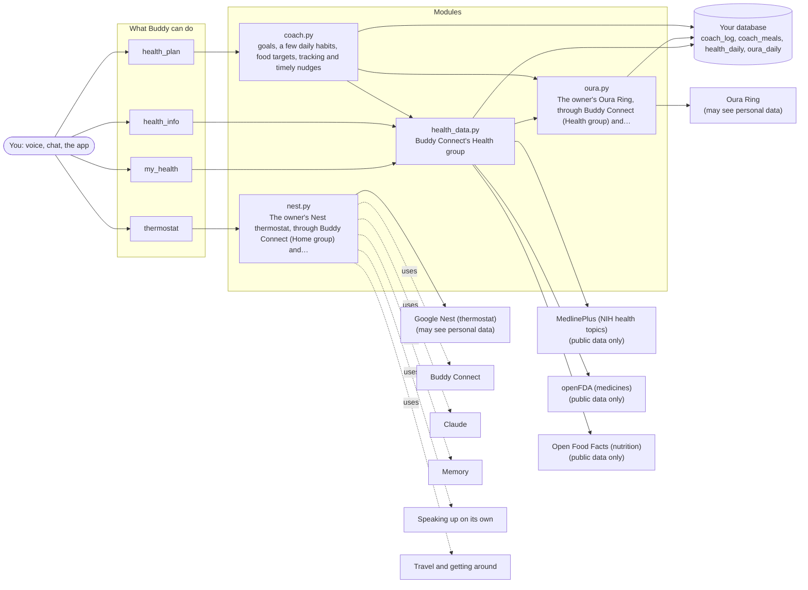

# Home and health

Your Nest thermostat, your phone's health data and Oura Ring, and your health plan with public medical sources.

## Architecture



The diagram reads left to right: what you ask, the tools Buddy uses, the modules that do the work, and what they keep or call. Dashed arrows are other features this one relies on.

## What Buddy can do here

| Tool | What it is for | Actions | Module |
|---|---|---|---|
| `thermostat` | The user's Nest thermostat (Buddy Connect, Home group) | status, set_temperature, set_mode | nest.py |
| `my_health` | The user's own health data from their phone (Google Health Connect, read by the Buddy app with their permission): daily steps, sleep, resting and average heart  | - | health_data.py |
| `health_info` | Public health information through Buddy Connect: drug (what a medicine is for, warnings, side effects, interactions, from the US FDA label), recalls (FDA drug r | drug, recalls, topic, food | health_data.py |
| `health_plan` | The owner's health plan: goals, daily habits, food targets, tracking, progress | show, set_plan, today, progress, log, meal, food, forget | coach.py |

## Technical design, module by module

### nest.py

```text
The owner's Nest thermostat, through Buddy Connect (Home group) and Google's Smart Device Management API.

Read: room temperature and humidity, mode (heat, cool, both, off), eco, the target, and whether it's heating or
cooling now. Change (set the temperature, the mode, eco): only after the owner's yes (thrift.ask_action), never on
Buddy's own. Linked once with deploy/nest.sh (Google sign-in; the tokens stay in the server's settings).
Temperatures are shown in Fahrenheit; Google's API speaks Celsius.
```

- Outside services: Google Nest (thermostat)
- Settings: `BUDDY_NEST_PROJECT_ID`
- Uses: commute.py, gateway.py, tools.py

### health_data.py

```text
Buddy Connect's Health group.

Personal: daily totals the Buddy app reads from Google Health Connect on the phone (steps, sleep, resting and
average heart rate, active minutes, workouts), with the owner's permission, sent to this server only. Kept 90 days.
They are the owner's data: only Claude sees them (the tool isn't one of the public ones, so a turn that used it
can't go to a free model), and nothing here is sent anywhere.

Public: openFDA (drug labels and recalls), MedlinePlus (NIH health topics) and Open Food Facts (nutrition), through
Buddy Connect. Only the drug, topic or product goes out, never anything about the owner. General information, not
medical advice: the tool says so.
```

- Tables: `health_daily`
- Outside services: MedlinePlus (NIH health topics), openFDA (medicines), Open Food Facts (nutrition)
- Uses: gateway.py, memory.py, oura.py, tools.py

### oura.py

```text
The owner's Oura Ring, through Buddy Connect (Health group) and Oura's API v2.

Read only. Each day: the Readiness, Sleep and Activity scores, the night's sleep (total, deep, REM, efficiency, HRV,
lowest heart rate, bedtime and wake time), temperature deviation, steps and active calories, stress and recovery
time, resilience, blood oxygen and workouts. Kept 90 days in the encrypted database, like the phone's Health Connect
data. Personal: only Claude sees it (never the free models), and nothing about the owner is sent anywhere else.

Two steps, made for anyone using Buddy:
  once per server  whoever runs it registers an Oura app and runs deploy/oura.sh (client ID and secret, hidden).
  each user        Connections > Health > Oura Ring > Connect: Buddy makes a sign-in link (start_link, with a
                   one-time state valid 15 minutes), the browser goes to Oura, the user allows access, and Oura sends
                   it back to this server's own page (/connect/oura/linked, on the private tailnet only), which swaps
                   the code for the tokens (finish_link). Nothing to copy, and the code never passes through anyone
                   else's site.
The tokens live in the encrypted database. Oura's refresh tokens work once: every renewal returns a new one, which
is saved at once. Connecting again replaces them.
```

- Tables: `oura_daily`
- Outside services: Oura Ring
- Settings: `BUDDY_OURA_CLIENT_ID`, `BUDDY_OURA_CLIENT_SECRET`, `BUDDY_OURA_REDIRECT`
- Uses: gateway.py, memory.py, tools.py

### coach.py

```text
The owner's health plan: goals, a few daily habits, food targets, tracking and timely nudges.

Set up in conversation: Buddy asks about the owner's goals, current habits, food (preferences, allergies, what they
avoid), schedule and anything a doctor should weigh in on, proposes a small plan, and saves it only once the owner
agrees (tool health_plan, set_plan). Then:
  tracking   habits are checked automatically from the Oura Ring (oura.py) and the phone's Health Connect data
             (health_data.py): steps, sleep, bedtime, workouts, active minutes. Others (water, no sugar, stretching)
             the owner ticks off by telling Buddy. Meals the owner mentions are noted with Claude's estimate of their
             calories and protein, so "what should I eat?" knows what's left for the day.
  nudges     a morning line (how recovered they are and what that means for today), an evening one when a habit
             is behind ("2,800 steps to go: a 25-minute walk"), a wind-down reminder before the bedtime target, and
             a Sunday review of the week. Plain sentences from the numbers: no model call, nothing sent anywhere.
  guidance   readiness, HRV, temperature and sleep shape the day's advice (a low readiness: an easy day). It is
             coaching, not medical advice: signs worth a doctor's look are said as such.
Personal: kept on this server (90 days of logs), seen only by Claude. "Forget my health plan" deletes it all.
```

- Tables: `coach_log`, `coach_meals`
- Uses: health_data.py, location.py, memory.py, oura.py, tools.py

## How it connects

- Relies on: Buddy Connect; Claude: the brain; Memory; Speaking up on its own: briefing, reminders and alerts; Travel and getting around
- Relied on by: Claude: the brain; Security and privacy; Speaking up on its own: briefing, reminders and alerts; The server and the app

