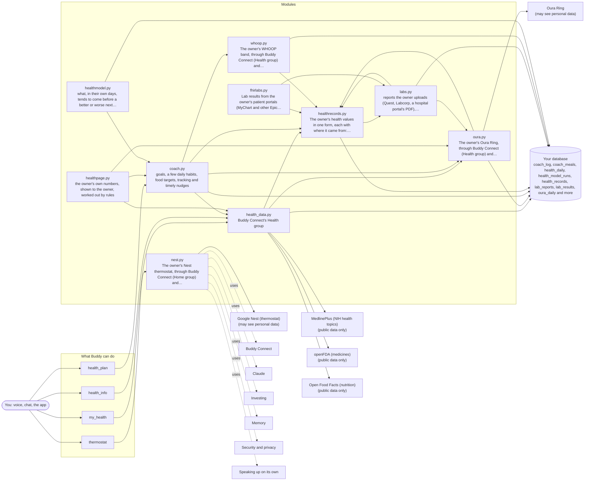

# Home and health

Your Nest thermostat, your phone's health data and Oura Ring, and your health plan with public medical sources.

## Architecture



The diagram reads left to right: what you ask, the tools Buddy uses, the modules that do the work, and what they keep or call. Dashed arrows are other features this one relies on.

## What Buddy can do here

| Tool | What it is for | Actions | Module |
|---|---|---|---|
| `thermostat` | The user's Nest thermostat (Buddy Connect, Home group) | status, set_temperature, set_mode | nest.py |
| `my_health` | The user's own health data from their phone (Google Health Connect, read by the Buddy app with their permission): daily steps, sleep, resting and average heart  | - | health_data.py |
| `health_info` | Public health information through Buddy Connect: drug (what a medicine is for, warnings, side effects, interactions, from the US FDA label), recalls (FDA drug r | drug, recalls, topic, food | health_data.py |
| `health_plan` | The owner's health plan: goals, daily habits, food targets, tracking, progress | show, set_plan, today, progress, log, meal, food, forget | coach.py |

## Technical design, module by module

### nest.py

```text
The owner's Nest thermostat, through Buddy Connect (Home group) and Google's Smart Device Management API.

Read: room temperature and humidity, mode (heat, cool, both, off), eco, the target, and whether it's heating or
cooling now. Change (set the temperature, the mode, eco): only after the owner's yes (thrift.ask_action), never on
Buddy's own. Linked once with deploy/nest.sh (Google sign-in; the tokens stay in the server's settings).
Temperatures are shown in Fahrenheit; Google's API speaks Celsius.
```

- Outside services: Google Nest (thermostat)
- Settings: `BUDDY_NEST_PROJECT_ID`
- Uses: commute.py, gateway.py, tools.py

### health_data.py

```text
Buddy Connect's Health group.

Personal: daily totals the Buddy app reads from Google Health Connect on the phone (steps, sleep, resting and
average heart rate, active minutes, workouts), with the owner's permission, sent to this server only. Kept 90 days.
They are the owner's data: only Claude sees them (the tool isn't one of the public ones, so a turn that used it
can't go to a free model), and nothing here is sent anywhere.

Public: openFDA (drug labels and recalls), MedlinePlus (NIH health topics) and Open Food Facts (nutrition), through
Buddy Connect. Only the drug, topic or product goes out, never anything about the owner. General information, not
medical advice: the tool says so.
```

- Tables: `health_daily`
- Outside services: MedlinePlus (NIH health topics), openFDA (medicines), Open Food Facts (nutrition)
- Uses: connecthub.py, gateway.py, healthrecords.py, memory.py, oura.py, tools.py

### oura.py

```text
The owner's Oura Ring, through Buddy Connect (Health group) and Oura's API v2.

Read only. Each day: the Readiness, Sleep and Activity scores, the night's sleep (total, deep, REM, efficiency, HRV,
lowest heart rate, bedtime and wake time), temperature deviation, steps and active calories, stress and recovery
time, resilience, blood oxygen and workouts. Kept 90 days in the encrypted database, like the phone's Health Connect
data. Personal: only Claude sees it (never the free models), and nothing about the owner is sent anywhere else.

Two steps, made for anyone using Buddy:
  once per server  whoever runs it registers an Oura app and runs deploy/oura.sh (client ID and secret, hidden).
  each user        Connections > Health > Oura Ring > Connect: Buddy makes a sign-in link (start_link, with a
                   one-time state valid 15 minutes), the browser goes to Oura, the user allows access, and Oura sends
                   it back to this server's own page (/connect/oura/linked, on the private tailnet only), which swaps
                   the code for the tokens (finish_link). Nothing to copy, and the code never passes through anyone
                   else's site.
The tokens live in the encrypted database. Oura's refresh tokens work once: every renewal returns a new one, which
is saved at once. Connecting again replaces them.
```

- Tables: `oura_daily`
- Outside services: Oura Ring
- Settings: `BUDDY_OURA_CLIENT_ID`, `BUDDY_OURA_CLIENT_SECRET`, `BUDDY_OURA_REDIRECT`
- Uses: connecthub.py, gateway.py, healthrecords.py, memory.py, tools.py

### coach.py

```text
The owner's health plan: goals, a few daily habits, food targets, tracking and timely nudges.

Set up in conversation: Buddy asks about the owner's goals, current habits, food (preferences, allergies, what they
avoid), schedule and anything a doctor should weigh in on, proposes a small plan, and saves it only once the owner
agrees (tool health_plan, set_plan). Then:
  tracking   habits are checked automatically from the Oura Ring (oura.py) and the phone's Health Connect data
             (health_data.py): steps, sleep, bedtime, workouts, active minutes. Others (water, no sugar, stretching)
             the owner ticks off by telling Buddy. Meals the owner mentions are noted with Claude's estimate of their
             calories and protein, so "what should I eat?" knows what's left for the day.
  nudges     a morning line (how recovered they are and what that means for today), an evening one when a habit
             is behind ("2,800 steps to go: a 25-minute walk"), a wind-down reminder before the bedtime target, and
             a Sunday review of the week. Plain sentences from the numbers: no model call, nothing sent anywhere.
  guidance   readiness, HRV, temperature and sleep shape the day's advice (a low readiness: an easy day). It is
             coaching, not medical advice: signs worth a doctor's look are said as such.
Personal: kept on this server (90 days of logs), seen only by Claude. "Forget my health plan" deletes it all.
```

- Tables: `coach_log`, `coach_meals`
- Uses: health_data.py, healthrecords.py, location.py, memory.py, oura.py, tools.py, whoop.py

### healthpage.py

```text
The Health page (web/health.html): the owner's own numbers, shown to the owner, worked out by rules.

Since the Privacy Gateway, no AI model is given health information, so Buddy no longer talks about it. This page
is where the owner sees it instead, and where the health plan is set up and changed (a form, in place of the
conversation that used to do it).

  view     today's readings with what they mean for the day (coach.body: fixed rules), each measure over the
           last weeks against the owner's own usual (the same bands healthranges uses), the plan's habits today,
           how each habit went over 7 and 30 days, and food against the plan's targets.
  act      tick a habit off, note a meal (the owner types the calories and protein if they want them counted:
           nothing estimates them), save or forget the plan, read the ring now.

Nothing here calls a model or leaves this server, apart from reading the ring from Oura when the owner presses
"Read the ring now". It is not medical advice.
```

- Uses: coach.py, health_data.py, healthranges.py, memory.py, oura.py, tools.py

### healthrecords.py

```text
The owner's health values in one form, each with where it came from: the common record every health source
writes into (the Oura Ring and the phone's Health Connect now; lab results and other devices next).

Each record keeps:
  connector, measure, at     which source, which measure (MEASURES), which day (or time, for lab results)
  value, unit                the value in a standard unit (UCUM: /min, ms, min, kcal/d, %, Cel)
  original_value/unit        the value and unit as the source gave them
  quality                    how it was obtained: measured by a device, estimated by the maker's software (sleep
                             stages, calories, scores), entered by the owner, or a lab result. A ring is not a lab.
  loinc                      the LOINC code, only where one exactly matches what the source measures (checked
                             against LOINC and HL7's physical activity value set); blank otherwise. Oura's HRV is
                             RMSSD, so it does not take LOINC's SDNN code.
  source_ref                 the source's own row it came from (its table and day): kept beside it, unchanged
  imported_at, sync_id       when, and in which sync (connecthub's sync history)

Readers (the health plan, the Health page) still read the sources' own tables; lab results (labs.py) are read in
this form too, as measure "lab:<test>". How long readings are kept is one setting, BUDDY_HEALTH_KEEP_DAYS (two
years when unset; the owner chose longer than 90 days, 25 November 2026, so a personal model has history to
learn from); lab results are kept until the owner deletes the report. Everything stays on the owner's server and
no AI model is given it (the Privacy Gateway's health rule).
```

- Tables: `health_records`
- Settings: `BUDDY_HEALTH_KEEP_DAYS`
- Uses: connecthub.py, gateway.py, labs.py, memory.py, tools.py

### labs.py

```text
Lab results: reports the owner uploads (Quest, Labcorp, a hospital portal's PDF), read by code, never by an AI
model, and kept only after the owner has checked what was read.

How a report is read.
  1. The PDF's text is taken out in the sandbox (docread: a throwaway container with no network), not in Buddy.
  2. Code picks out the lines that name a test Buddy knows (TESTS: about 45 common blood tests, matched by the
     names Quest, Labcorp and hospital portals print), and on each line the result, the lab's flag (H, L), the
     reference range ("70-99", "<200", "> OR = 40") and the unit. Lines with other tests are not read.
  3. The owner sees what was read beside the report's own words and ticks, corrects or removes each result, and
     sets the date the sample was taken (read from the report when it says "Collected"). Only then is anything kept.

When a report prints no range for a test (and no flag), Buddy fills in a typical adult range (TYPICAL), only when
the report's unit is the table's unit, and for tests whose range differs for men and women only when the owner's
sex is known (from the Oura profile). It is always called "the typical range", never "the lab's range": labs set
their own ranges, and the lab's printed range wins whenever there is one.

What is kept: the report itself in the vault (library.py: encrypted on disk with a key derived from the database
key, covered by the backup; marked as a health document, so Buddy's library tool never lists, opens or unlocks it
for an AI model, and it has no searchable text) and each confirmed result: the test, the name printed on the
report, the value, the unit, the range (the lab's, or the typical one) and the lab's flag, whether it is below,
within or above that range, the date, and that the owner confirmed it. Each result is also a health record
(healthrecords: quality "lab"). Kept until the owner deletes the report. A test's LOINC code is not guessed from
a printed name (the same name can be different tests); results that arrive from a portal with their code keep it.

Lab ranges for Claude (a separate switch, off until the owner turns it on, on the server:
sudo bash /opt/buddy/deploy/set.sh BUDDY_LAB_RANGES). When on, and only for Claude, the health tool's result may
carry one line a test, of exactly this form and nothing else:

    [lab range] LDL cholesterol: above the lab's range; up since the last test

No value, unit, date, lab or identity is in it. The Privacy Gateway lets a line through only if it matches that
form exactly (allowed); everything else about lab results stays on the server, as all health information does.
It does reveal which tests the owner has had and whether each is in range: that is the trade-off of the switch.
```

- Tables: `lab_reports`, `lab_results`
- Settings: `BUDDY_LAB_RANGES`
- Uses: connecthub.py, docread.py, healthrecords.py, library.py, memory.py, oura.py, tools.py

### fhirlabs.py

```text
Lab results from the owner's patient portals (MyChart and other Epic sites) over SMART on FHIR: the owner signs
in at their health system, Buddy reads their lab results (read only), and they join the Labs tab beside uploaded
reports.

What has to be set up once (docs/HEALTH.md): a free patient app registered at fhir.epic.com ("Epic on FHIR"), with
this server's return address (https://<your tailnet name>/connect/mychart/linked) and read access to Patient,
Observation and DiagnosticReport; its client ID goes into Buddy with
sudo bash /opt/buddy/deploy/set.sh BUDDY_EPIC_CLIENT_ID. Epic decides when a new app's production client ID works
at each health system; until then a sign-in fails at the health system's page, and Buddy says so.

How it works (the SMART App Launch "standalone" flow):
  1. The owner picks their health system (Epic's public directory of patient endpoints, or its FHIR address).
  2. Buddy reads the system's /.well-known/smart-configuration, makes a one-time state and a PKCE secret, and gives
     the sign-in link (scopes: launch/patient, openid, fhirUser, offline_access, read of Patient, Observation and
     DiagnosticReport).
  3. The health system sends the browser back to /connect/mychart/linked; the code is swapped for tokens, kept in
     the encrypted database. With a refresh token Buddy reads new results once a day by itself; without one (the
     health system decides), each read after the first hour needs the owner to sign in again: shown as "Sign in
     again" (connecthub) until they do.
  4. Lab Observations (category laboratory) are read page by page: the test (with its LOINC code, given by the
     health system, not guessed), the value and unit (UCUM), the reference range, the flag (H, L, A), the date.
     Results with no number (a "negative", a comment) are not kept. Each is kept once (by the health system's own
     id) in labs.py's tables, as a health record (quality "lab"), and shown on the Labs tab.

Nothing here is given to an AI model; only the lab ranges switch (labs.py) lets Claude have a test's range word.
```

- Settings: `BUDDY_EPIC_CLIENT_ID`
- Uses: connecthub.py, gateway.py, healthrecords.py, labs.py, memory.py

### whoop.py

```text
The owner's WHOOP band, through Buddy Connect (Health group) and WHOOP's developer API (v2). Read only.

Each day: recovery (score, resting heart rate, HRV, blood oxygen, skin temperature), the day's strain, energy and
heart rate, the main sleep (total, deep "slow wave", REM, light, efficiency, performance, respiratory rate) and
workouts. Kept like the other health readings (healthrecords.keep_days), in the encrypted database, and also as
health records with their source. No AI model is given any of it (the Privacy Gateway's health rule).

Two steps, as for the Oura Ring:
  once per server  register an app at developer.whoop.com with this server's return address
                   (https://<tailnet name>/connect/whoop/linked) and run deploy/whoop.sh (client ID and secret).
  each user        Connections > Health > WHOOP > Connect: a sign-in link with a one-time state (15 minutes); WHOOP
                   sends the browser back to this server's own page, which swaps the code for tokens (with the
                   "offline" scope, a refresh token, so Buddy reads new days by itself every few hours).

Built from WHOOP's published v2 API (records under "records", pages by "next_token", up to 25 at a time) and tested
against a made-up WHOOP, not a real band: the first real sync is the true test, and a field WHOOP names differently
is simply left empty.
```

- Tables: `whoop_daily`
- Settings: `BUDDY_WHOOP_CLIENT_ID`, `BUDDY_WHOOP_CLIENT_SECRET`, `BUDDY_WHOOP_REDIRECT`
- Uses: connecthub.py, gateway.py, healthrecords.py, memory.py, tools.py

### healthmodel.py

```text
The owner's personal health model: what, in their own days, tends to come before a better or worse next day.

Learned on the owner's server by plain code (no AI model, nothing sent anywhere), once a week and when they ask,
from the readings Buddy keeps (two years: the owner chose to keep health data longer so this has history):

  what happened on a day   steps, active minutes, workouts, WHOOP strain, time under stress, and each habit of the
                           health plan the owner ticks off themselves (done or not)
  that night               bedtime (later or earlier)
  the next morning         readiness (Oura), recovery (WHOOP), sleep score, sleep time, HRV, resting heart rate,
                           lowest night heart rate

Two ways, both kept honest:
  Patterns   for each factor and next-morning measure: the days above the factor's middle value against the days
             below (or, for a habit, done against not ticked), the difference in the next morning's average, and how
             often that difference keeps its direction when the days are drawn again at random (200 times). A pattern
             is shown only with at least 10 days on each side, a difference of at least a quarter of the measure's
             usual spread, and the same direction in at least 90% of the redraws.
  A model    for each next-morning measure with at least 60 days: a small linear model (ridge regression) of the
             factors, learned on the oldest 70% of days and tested on the newest 30%, which it never saw. It counts
             only if its error on those days is at least 5% smaller than always guessing the average.

These are patterns in one person's days, not causes, and not medical advice: the page says so. Shown to the owner
only (Health → Patterns); no AI model is given them (the Privacy Gateway's health rule).
```

- Tables: `health_model_runs`
- Uses: coach.py, memory.py, tools.py

## How it connects

- Relies on: Buddy Connect; Claude: the brain; Investing: signals, research and practice; Memory; Security and privacy; Speaking up on its own: briefing, reminders and alerts; Travel and getting around
- Relied on by: Buddy Connect; Claude: the brain; Security and privacy; Speaking up on its own: briefing, reminders and alerts; The server and the app

