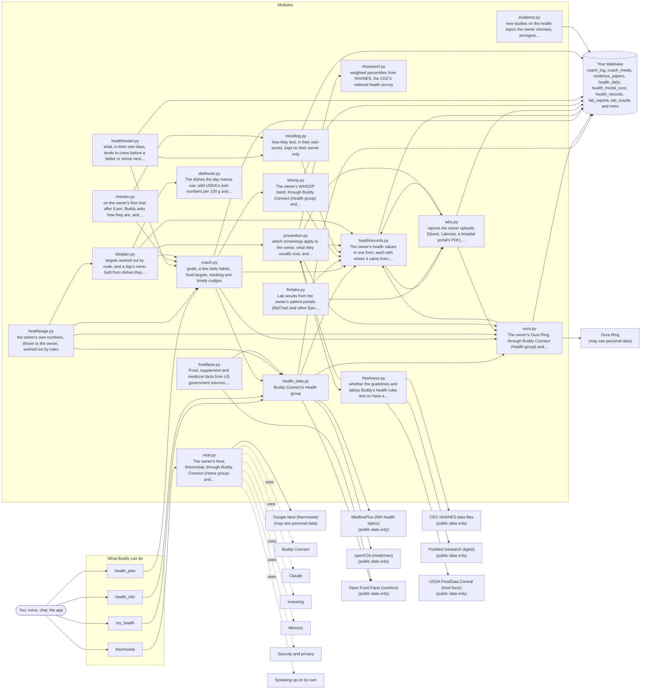

# Home and health

Your Nest thermostat, your phone's health data and Oura Ring, and your health plan with public medical sources.

## Architecture



The diagram reads left to right: what you ask, the tools Buddy uses, the modules that do the work, and what they keep or call. Dashed arrows are other features this one relies on.

## What Buddy can do here

| Tool | What it is for | Actions | Module |
|---|---|---|---|
| `thermostat` | The user's Nest thermostat (Buddy Connect, Home group) | status, set_temperature, set_mode | nest.py |
| `my_health` | The user's own health data from their phone (Google Health Connect, read by the Buddy app with their permission): daily steps, sleep, resting and average heart  | - | health_data.py |
| `health_info` | Public health information through Buddy Connect: drug (what a medicine is for, warnings, side effects, interactions, from the US FDA label), recalls (FDA drug r | drug, recalls, topic, food | health_data.py |
| `health_plan` | The owner's health plan: goals, daily habits, food targets, tracking, progress | show, set_plan, today, progress, log, meal, food, forget | coach.py |

## Technical design, module by module

### nest.py

```text
The owner's Nest thermostat, through Buddy Connect (Home group) and Google's Smart Device Management API.

Read: room temperature and humidity, mode (heat, cool, both, off), eco, the target, and whether it's heating or
cooling now. Change (set the temperature, the mode, eco): only after the owner's yes (thrift.ask_action), never on
Buddy's own. Linked once with deploy/nest.sh (Google sign-in; the tokens stay in the server's settings).
Temperatures are shown in Fahrenheit; Google's API speaks Celsius.
```

- Outside services: Google Nest (thermostat)
- Settings: `BUDDY_NEST_PROJECT_ID`
- Uses: commute.py, gateway.py, tools.py

### health_data.py

```text
Buddy Connect's Health group.

Personal: daily totals the Buddy app reads from Google Health Connect on the phone (steps, sleep, resting and
average heart rate, active minutes, workouts), with the owner's permission, sent to this server only. Kept 90 days.
They are the owner's data: only Claude sees them (the tool isn't one of the public ones, so a turn that used it
can't go to a free model), and nothing here is sent anywhere.

Public: openFDA (drug labels and recalls), MedlinePlus (NIH health topics) and Open Food Facts (nutrition), through
Buddy Connect. Only the drug, topic or product goes out, never anything about the owner. General information, not
medical advice: the tool says so.
```

- Tables: `health_daily`
- Outside services: MedlinePlus (NIH health topics), openFDA (medicines), Open Food Facts (nutrition)
- Uses: connecthub.py, gateway.py, healthrecords.py, memory.py, oura.py, tools.py

### oura.py

```text
The owner's Oura Ring, through Buddy Connect (Health group) and Oura's API v2.

Read only. Each day: the Readiness, Sleep and Activity scores, the night's sleep (total, deep, REM, efficiency, HRV,
lowest heart rate, bedtime and wake time), temperature deviation, steps and active calories, stress and recovery
time, resilience, blood oxygen and workouts. Kept 90 days in the encrypted database, like the phone's Health Connect
data. Personal: only Claude sees it (never the free models), and nothing about the owner is sent anywhere else.

Two steps, made for anyone using Buddy:
  once per server  whoever runs it registers an Oura app and runs deploy/oura.sh (client ID and secret, hidden).
  each user        Connections > Health > Oura Ring > Connect: Buddy makes a sign-in link (start_link, with a
                   one-time state valid 15 minutes), the browser goes to Oura, the user allows access, and Oura sends
                   it back to this server's own page (/connect/oura/linked, on the private tailnet only), which swaps
                   the code for the tokens (finish_link). Nothing to copy, and the code never passes through anyone
                   else's site.
The tokens live in the encrypted database. Oura's refresh tokens work once: every renewal returns a new one, which
is saved at once. Connecting again replaces them.
```

- Tables: `oura_daily`
- Outside services: Oura Ring
- Settings: `BUDDY_OURA_CLIENT_ID`, `BUDDY_OURA_CLIENT_SECRET`, `BUDDY_OURA_REDIRECT`
- Uses: connecthub.py, gateway.py, healthrecords.py, memory.py, tools.py

### coach.py

```text
The owner's health plan: goals, a few daily habits, food targets, tracking and timely nudges.

Set up in conversation: Buddy asks about the owner's goals, current habits, food (preferences, allergies, what they
avoid), schedule and anything a doctor should weigh in on, proposes a small plan, and saves it only once the owner
agrees (tool health_plan, set_plan). Then:
  tracking   habits are checked automatically from the Oura Ring (oura.py) and the phone's Health Connect data
             (health_data.py): steps, sleep, bedtime, workouts, active minutes. Others (water, no sugar, stretching)
             the owner ticks off by telling Buddy. Meals the owner mentions are noted with Claude's estimate of their
             calories and protein, so "what should I eat?" knows what's left for the day.
  nudges     a morning line (how recovered they are and what that means for today), an evening one when a habit
             is behind ("2,800 steps to go: a 25-minute walk"), a wind-down reminder before the bedtime target, and
             a Sunday review of the week. Plain sentences from the numbers: no model call, nothing sent anywhere.
  guidance   readiness, HRV, temperature and sleep shape the day's advice (a low readiness: an easy day). It is
             coaching, not medical advice: signs worth a doctor's look are said as such.
Personal: kept on this server (90 days of logs), seen only by Claude. "Forget my health plan" deletes it all.
```

- Tables: `coach_log`, `coach_meals`
- Uses: health_data.py, healthrecords.py, location.py, memory.py, oura.py, tools.py, whoop.py

### healthpage.py

```text
The Health page (web/health.html): the owner's own numbers, shown to the owner, worked out by rules.

Since the Privacy Gateway, no AI model is given health information, so Buddy no longer talks about it. This page
is where the owner sees it instead, and where the health plan is set up and changed (a form, in place of the
conversation that used to do it).

  view     today's readings with what they mean for the day (coach.body: fixed rules), each measure over the
           last weeks against the owner's own usual (the same bands healthranges uses), the plan's habits today,
           how each habit went over 7 and 30 days, and food against the plan's targets.
  act      tick a habit off, note a meal (the owner types the calories and protein if they want them counted:
           nothing estimates them), save or forget the plan, read the ring now.

Nothing here calls a model or leaves this server, apart from reading the ring from Oura when the owner presses
"Read the ring now". It is not medical advice.
```

- Uses: coach.py, dietplan.py, health_data.py, healthranges.py, memory.py, oura.py, tools.py

### healthrecords.py

```text
The owner's health values in one form, each with where it came from: the common record every health source
writes into (the Oura Ring and the phone's Health Connect now; lab results and other devices next).

Each record keeps:
  connector, measure, at     which source, which measure (MEASURES), which day (or time, for lab results)
  value, unit                the value in a standard unit (UCUM: /min, ms, min, kcal/d, %, Cel)
  original_value/unit        the value and unit as the source gave them
  quality                    how it was obtained: measured by a device, estimated by the maker's software (sleep
                             stages, calories, scores), entered by the owner, or a lab result. A ring is not a lab.
  loinc                      the LOINC code, only where one exactly matches what the source measures (checked
                             against LOINC and HL7's physical activity value set); blank otherwise. Oura's HRV is
                             RMSSD, so it does not take LOINC's SDNN code.
  source_ref                 the source's own row it came from (its table and day): kept beside it, unchanged
  imported_at, sync_id       when, and in which sync (connecthub's sync history)

Readers (the health plan, the Health page) still read the sources' own tables; lab results (labs.py) are read in
this form too, as measure "lab:<test>". How long readings are kept is one setting, BUDDY_HEALTH_KEEP_DAYS (two
years when unset; the owner chose longer than 90 days, 25 November 2026, so a personal model has history to
learn from); lab results are kept until the owner deletes the report. Everything stays on the owner's server and
no AI model is given it (the Privacy Gateway's health rule).
```

- Tables: `health_records`
- Settings: `BUDDY_HEALTH_KEEP_DAYS`
- Uses: connecthub.py, gateway.py, labs.py, memory.py, tools.py

### labs.py

```text
Lab results: reports the owner uploads (Quest, Labcorp, a hospital portal's PDF), read by code, never by an AI
model, and kept only after the owner has checked what was read.

How a report is read.
  1. The PDF's text is taken out in the sandbox (docread: a throwaway container with no network), not in Buddy.
  2. Code picks out the lines that name a test Buddy knows (TESTS: about 45 common blood tests, matched by the
     names Quest, Labcorp and hospital portals print), and on each line the result, the lab's flag (H, L), the
     reference range ("70-99", "<200", "> OR = 40") and the unit. Lines with other tests are not read.
  3. The owner sees what was read beside the report's own words and ticks, corrects or removes each result, and
     sets the date the sample was taken (read from the report when it says "Collected"). Only then is anything kept.

When a report prints no range for a test (and no flag), Buddy fills in a typical adult range (TYPICAL), only when
the report's unit is the table's unit, and for tests whose range differs for men and women only when the owner's
sex is known (from the Oura profile). It is always called "the typical range", never "the lab's range": labs set
their own ranges, and the lab's printed range wins whenever there is one.

What is kept: the report itself in the vault (library.py: encrypted on disk with a key derived from the database
key, covered by the backup; marked as a health document, so Buddy's library tool never lists, opens or unlocks it
for an AI model, and it has no searchable text) and each confirmed result: the test, the name printed on the
report, the value, the unit, the range (the lab's, or the typical one) and the lab's flag, whether it is below,
within or above that range, the date, and that the owner confirmed it. Each result is also a health record
(healthrecords: quality "lab"). Kept until the owner deletes the report. A test's LOINC code is not guessed from
a printed name (the same name can be different tests); results that arrive from a portal with their code keep it.

Lab ranges for Claude (a separate switch, off until the owner turns it on, on the server:
sudo bash /opt/buddy/deploy/set.sh BUDDY_LAB_RANGES). When on, and only for Claude, the health tool's result may
carry one line a test, of exactly this form and nothing else:

    [lab range] LDL cholesterol: above the lab's range; up since the last test

No value, unit, date, lab or identity is in it. The Privacy Gateway lets a line through only if it matches that
form exactly (allowed); everything else about lab results stays on the server, as all health information does.
It does reveal which tests the owner has had and whether each is in range: that is the trade-off of the switch.
```

- Tables: `lab_reports`, `lab_results`
- Settings: `BUDDY_LAB_RANGES`
- Uses: connecthub.py, docread.py, healthrecords.py, library.py, memory.py, oura.py, tools.py

### fhirlabs.py

```text
Lab results from the owner's patient portals (MyChart and other Epic sites) over SMART on FHIR: the owner signs
in at their health system, Buddy reads their lab results (read only), and they join the Labs tab beside uploaded
reports.

What has to be set up once (docs/HEALTH.md): a free patient app registered at fhir.epic.com ("Epic on FHIR"), with
this server's return address (https://<your tailnet name>/connect/mychart/linked) and read access to Patient,
Observation and DiagnosticReport; its client ID goes into Buddy with
sudo bash /opt/buddy/deploy/set.sh BUDDY_EPIC_CLIENT_ID. Epic decides when a new app's production client ID works
at each health system; until then a sign-in fails at the health system's page, and Buddy says so.

How it works (the SMART App Launch "standalone" flow):
  1. The owner picks their health system (Epic's public directory of patient endpoints, or its FHIR address).
  2. Buddy reads the system's /.well-known/smart-configuration, makes a one-time state and a PKCE secret, and gives
     the sign-in link (scopes: launch/patient, openid, fhirUser, offline_access, read of Patient, Observation and
     DiagnosticReport).
  3. The health system sends the browser back to /connect/mychart/linked; the code is swapped for tokens, kept in
     the encrypted database. With a refresh token Buddy reads new results once a day by itself; without one (the
     health system decides), each read after the first hour needs the owner to sign in again: shown as "Sign in
     again" (connecthub) until they do.
  4. Lab Observations (category laboratory) are read page by page: the test (with its LOINC code, given by the
     health system, not guessed), the value and unit (UCUM), the reference range, the flag (H, L, A), the date.
     Results with no number (a "negative", a comment) are not kept. Each is kept once (by the health system's own
     id) in labs.py's tables, as a health record (quality "lab"), and shown on the Labs tab.

Nothing here is given to an AI model; only the lab ranges switch (labs.py) lets Claude have a test's range word.
```

- Settings: `BUDDY_EPIC_CLIENT_ID`
- Uses: connecthub.py, gateway.py, healthrecords.py, labs.py, memory.py

### whoop.py

```text
The owner's WHOOP band, through Buddy Connect (Health group) and WHOOP's developer API (v2). Read only.

Each day: recovery (score, resting heart rate, HRV, blood oxygen, skin temperature), the day's strain, energy and
heart rate, the main sleep (total, deep "slow wave", REM, light, efficiency, performance, respiratory rate) and
workouts. Kept like the other health readings (healthrecords.keep_days), in the encrypted database, and also as
health records with their source. No AI model is given any of it (the Privacy Gateway's health rule).

Two steps, as for the Oura Ring:
  once per server  register an app at developer.whoop.com with this server's return address
                   (https://<tailnet name>/connect/whoop/linked) and run deploy/whoop.sh (client ID and secret).
  each user        Connections > Health > WHOOP > Connect: a sign-in link with a one-time state (15 minutes); WHOOP
                   sends the browser back to this server's own page, which swaps the code for tokens (with the
                   "offline" scope, a refresh token, so Buddy reads new days by itself every few hours).

Built from WHOOP's published v2 API (records under "records", pages by "next_token", up to 25 at a time) and tested
against a made-up WHOOP, not a real band: the first real sync is the true test, and a field WHOOP names differently
is simply left empty.
```

- Tables: `whoop_daily`
- Settings: `BUDDY_WHOOP_CLIENT_ID`, `BUDDY_WHOOP_CLIENT_SECRET`, `BUDDY_WHOOP_REDIRECT`
- Uses: connecthub.py, gateway.py, healthrecords.py, memory.py, tools.py

### healthmodel.py

```text
The owner's personal health model: what, in their own days, tends to come before a better or worse next day.

Learned on the owner's server by plain code (no AI model, nothing sent anywhere), once a week and when they ask,
from the readings Buddy keeps (two years: the owner chose to keep health data longer so this has history):

  what happened on a day   steps, active minutes, workouts, WHOOP strain, time under stress, and each habit of the
                           health plan the owner ticks off themselves (done or not)
  that night               bedtime (later or earlier)
  the next morning         readiness (Oura), recovery (WHOOP), sleep score, sleep time, HRV, resting heart rate,
                           lowest night heart rate

Two ways, both kept honest:
  Patterns   for each factor and next-morning measure: the days above the factor's middle value against the days
             below (or, for a habit, done against not ticked), the difference in the next morning's average, and how
             often that difference keeps its direction when the days are drawn again at random (200 times). A pattern
             is shown only with at least 10 days on each side, a difference of at least a quarter of the measure's
             usual spread, and the same direction in at least 90% of the redraws.
  A model    for each next-morning measure with at least 60 days: a small linear model (ridge regression) of the
             factors, learned on the oldest 70% of days and tested on the newest 30%, which it never saw. It counts
             only if its error on those days is at least 5% smaller than always guessing the average.

These are patterns in one person's days, not causes, and not medical advice: the page says so. Shown to the owner
only (Health → Trends → Patterns); no AI model is given them (the Privacy Gateway's health rule).
```

- Tables: `health_model_runs`
- Uses: coach.py, memory.py, moodlog.py, tools.py

### moodlog.py

```text
The owner's mood and stress journal: how they feel, in their own words, kept on their server only.

Each entry: mood, stress and energy from 1 to 5 (1 low, 5 high), what was going on (fixed tags: work, family, sleep,
exercise, illness, travel, money, alcohol, social, alone time), and a short note of their own. Several a day are
fine; a day is the average of its entries. The days feed the personal model (healthmodel.py) as factors: a stressful
day, then the next morning. No AI model is given any of it, the notes least of all (the Privacy Gateway's health
rule); kept as long as the other health readings (two years), and deleted entry by entry or all at once.
```

- Tables: `mood_log`
- Uses: healthrecords.py, memory.py, tools.py

### checkin.py

```text
The evening check-in: on the owner's first chat after 6 pm, Buddy asks how they are, and code reads the answers.

The owner chose this on 26 Nov 2026: a check-in run by code, with no AI model. On the first message they send Buddy
after 6 pm each day, Buddy answers that message as usual and then asks, in fixed words:

1. mood, stress and energy, each from 1 to 5 ("4, 2, 3", "mood 4 stress 2", or a word such as "good");
2. whether they have been in touch with friends or family (yes, a little, no);
3. how rested they feel, from 1 to 5;
4. anything on their mind, in a few words.

Each answer is read here, before the Privacy Gateway and before any model, and the whole check-in goes into the mood
journal (moodlog.py). Buddy then reads the day back in fixed sentences: what was noted, last night's sleep and
readiness, the week's average mood. Only a note that a check-in happened is kept in the conversation later turns send
to Claude. "Skip" ends it; a message that isn't an answer ends it too and is handled as a normal message (what was
already answered is kept). "Check in" starts it at any time. It never sends a notification: it asks only while the
owner is already talking to Buddy. Switched off or on from Health → Trends → Mood.

Spoken answers pass through a speech recognizer first, like every spoken word (the phone's, or Whisper); typed
answers go only to the owner's server.
```

- Uses: coach.py, memory.py, moodlog.py, privacygate.py, tools.py

### prevention.py

```text
Checkups: which screenings apply to the owner, what they usually cost, and where their numbers sit.

From a few answers the owner gives on the Health page (birth year, sex, ancestry, where they were born or lived,
smoking, family history, known conditions, height and waist), their lab results and their devices' readings, plain
code works out:

- **Screenings for you:** the US Preventive Services Task Force's A and B adult recommendations (and its C for
  prostate, as a decision), each with why it applies, how often, when it was last done, and a coverage mark. Ancestry
  changes the rules where the guidelines say so: the task force screens Asian Americans for diabetes from a BMI of 23
  (not 25), the ADA lists Asian, Black, Hispanic, Native American and Pacific Islander ancestry as a risk factor, the
  2026 ACC/AHA dyslipidemia guideline counts higher-risk ancestry (South Asian, Filipino) as a risk enhancer, and the WHO's Asian BMI action points
  are 23 and 27.5. Being born in, or having lived in, a country where hepatitis B or TB is common (most of Asia,
  India and China included) brings those two screenings in.
- **Worth asking about:** lipoprotein(a) once, a glucose sensor (CGM) and genetic testing: whether either is worth
  raising with a doctor, by fixed rules on the owner's answers and results, and when it isn't needed.
- **Compared with others:** where the owner's BMI, waist, blood pressure, A1c, cholesterol and glucose sit among US
  adults of their sex and age, and among those of Asian ancestry (NHANES, nhanesref.py).

Coverage marks are general: under the ACA most non-grandfathered private plans cover A and B screenings in-network
with no cost sharing (upheld by the Supreme Court in Kennedy v. Braidwood, June 2025); Medicare and Medicaid have their
own lists, and the owner's plan type (which they pick; no insurer, member number or money) adjusts the wording.

Buddy never orders a test, books a visit or contacts a doctor. Not medical advice. No AI model is given any of it
(the Privacy Gateway's health rule): the answers are kept in the owner's database until they change or delete them.
```

- Uses: freshness.py, healthrecords.py, labs.py, memory.py, nhanesref.py, oura.py, tools.py

### nhanesref.py

```text
Where a value sits among US adults: weighted percentiles from NHANES, the CDC's national health survey.

Built once, offline, by docs/data/nhanes_ref_build.py from the public NHANES files of 2017-March 2020 (P_ files) and
August 2021-August 2023 (_L files): adults 20 and over, all of them ("all") and those NHANES records as non-Hispanic
Asian ("asian", RIDRETH3 = 6; NHANES does not split South Asian from East Asian), by sex and age band. Each cycle's
weight (exam, blood-draw or fasting subsample) is scaled by the years it covers (3.2 and 2.0 of 5.2) so the two
combine. Blood pressure is the mean of the three seated oscillometric readings; LDL is the Martin-Hopkins estimate;
glucose and LDL are from the fasting subsample. A group is kept with 30 or more people; the page wants 80.
Percentiles: 5, 10, 25, 50, 75, 90, 95. NHANES data are public domain (CDC/NCHS).
```

### foodfacts.py

```text
Food, supplement and medicine facts from US government sources, looked up when the owner asks on the Health page.

- **Foods: USDA FoodData Central** (api.nal.usda.gov, a free api.data.gov key in BUDDY_USDA_KEY). Basic foods,
  survey foods (with household portions such as "1 cup") and branded products, each with calories, protein, carbs,
  fat, fibre, sugar and sodium per 100 g. The page works out a portion by code and can add it to today's meals.
- **Supplements: the NIH Office of Dietary Supplements' Label Database (DSLD)** (api.ods.od.nih.gov, no key): a
  product's label, ingredient by ingredient, per serving, with each ingredient's daily amount at the label's most
  servings a day set against the adult Tolerable Upper Intake Level (the National Academies' limits, as ODS gives
  them), and a link to ODS's fact sheet for it.
- **Medicines: openFDA's drug labels and recalls**, through health_data.drug and health_data.recalls.
- **Packs scanned on the phone**: the phone reads the barcode itself (on-device; no photo leaves it) and only the
  number comes here, to be looked up in USDA's branded foods and in Open Food Facts (Open Database License).

Only the words the owner types go out (a food or product name; for a label, the database's own number); nothing
about the owner. Public data, so no AI model is involved and nothing is kept but a day's cache of the answers.
Not medical advice.
```

- Outside services: Open Food Facts (nutrition)
- Settings: `BUDDY_USDA_KEY`
- Uses: gateway.py, health_data.py, memory.py, tools.py

### evidence.py

```text
The research digest: new studies on the health topics the owner chooses, strongest evidence first, from PubMed.

The owner picks topics on the Health page (Learn → Research): ready-made ones (longevity research from Nature Aging,
Aging Cell, GeroScience, the National Institute on Aging, the Buck Institute and AFAR; South Asian heart and metabolic
health; prediabetes; sleep; exercise and ageing; supplements) and up to five of their own words. Once a week (Sunday
night), or when they press Refresh, Buddy asks the National Library of Medicine's E-utilities for each topic's papers
from the last 30 days (90 the first time), by default only guidelines, meta-analyses, systematic reviews and randomised
trials, and leaves out studies only in animals. Each paper is shown with its journal, date, first author and evidence
type, guidelines first, then reviews, then trials, then other studies; its abstract is fetched when the owner opens
it. Code only: no AI model reads or summarises any of it, and no notification is sent (a page, not a push).

Only the topic words go to NCBI (with tool=buddy and no email or key); papers are kept 180 days, the topics until
changed. Research isn't advice: one study rarely changes what anyone should do.
```

- Tables: `evidence_papers`
- Uses: gateway.py, memory.py, tools.py

### dietplan.py

```text
The owner's daily diet: targets worked out by code, and a day's menu built from dishes they eat, with USDA numbers.

**Targets** (each says where it comes from):
- Calories: what the owner's devices estimate they burn (the average of 7 or more of the last 14 days), or, without
  that, the Mifflin-St Jeor equation from weight, height, age and sex times an activity factor from their steps;
  then their weight goal (keep; lose slowly, 500 a day less but never under 1,500 for men or 1,200 for women; gain
  slowly, 300 more). A calorie or protein number the owner typed in their plan wins.
- Protein: 1.2 to 1.6 g per kg of body weight (Dietary Guidelines for Americans 2025-2030).
- Fibre: 14 g per 1,000 calories (the National Academies' adequate intake; the 2025-2030 guidelines give no number).
- Sodium under 2,300 mg; saturated fat at most 10% of calories; added sugar: none recommended, at most 10 g a meal
  (all three from the 2025-2030 guidelines).
- With prediabetes-range numbers or South Asian ancestry, a carbohydrate note: whole grains over refined ones,
  brown rice over white, rice at the portion shown, protein and vegetables at every meal.

**The day's menu**: breakfast, lunch, dinner and a snack from meal templates in the cuisines the owner eats where
they are: in the US (Kerala food is hard to find there) American grilled chicken and salads and Mediterranean, in
India Kerala home food and other Indian dishes, each list the owner's to change. Where they are comes from the
phone's last location (its country only), or the owner sets it. Rotated by date, each dish with USDA FNDDS numbers
and portions (dietfoods.py). The staple of each meal (rice, idli, dosa, quinoa, oatmeal, bread) is scaled so the
meal fits its share of the day's calories, protein is topped up at the snack when the day falls short, and the day is
checked against fibre, sodium and saturated fat. Brown rice replaces white with prediabetes-range numbers. A meal can
be added to the day's meals with all its numbers.

Plain code, on the owner's server; no AI model is given any of it. Not medical advice: a registered dietitian (often
covered; see Labs -> Checkups) can tailor it.
```

- Uses: coach.py, dietfoods.py, healthrecords.py, memory.py, prevention.py, tools.py

### dietfoods.py

```text
The dishes the day menus use, with USDA's own numbers per 100 g and one household portion each.

Generated by docs/data/dietfoods_build.py from USDA FoodData Central's FNDDS survey foods (2024-10-31; public
domain). Names are USDA's. Dishes USDA doesn't have (avial, thoran, appam, puttu, chapati) are not included.
```

### freshness.py

```text
The freshness watch: whether the guidelines and tables Buddy's health rules rest on have a newer version, and
whether Buddy itself has a newer version waiting to be deployed.

Health rules are fixed in code on purpose (exact, tested), so they don't change by themselves. This watch tells the
owner when one may be out of date; it never rewrites a rule. A rule it flags shows as "under review" on the page
until the code is updated (by the owner asking for it, with tests) and deployed. Checked by code, from official
sources only, once a week (Sunday night) or on request:

- **Screenings (US Preventive Services Task Force)**: its own data API (the Prevention TaskForce API) when the owner
  has the key AHRQ grants on request (BUDDY_USPSTF_KEY; BUDDY_USPSTF_URL if AHRQ gives another address). The whole
  data set is fetched, with no age, sex or anything else about the owner, and each recommendation's grade and ages
  are compared with last week's; topics newer than the date Buddy's rules were checked are flagged too. The
  task force's own words are kept, to show verbatim as its terms require. Without the key: PubMed, for new task
  force recommendation statements (published in JAMA).
- **Diabetes rules (ADA Standards of Care)**: PubMed, for a newer yearly edition.
- **Cholesterol and heart-risk rules (ACC/AHA)**: PubMed, for a guideline newer than the 2026 dyslipidemia guideline.
- **Menu dish numbers (USDA FNDDS)**: USDA FoodData Central's API (the owner's key), for a newer survey-food release.
- **Compared with others (CDC NHANES)**: CDC's public data files, for the next survey cycle's demographics file.
- **Diet targets (Dietary Guidelines for Americans 2025-2030)**: the next edition is due in 2030; nothing to watch.
- **Buddy itself**: the server's copy of the code against the repository's branch (git ls-remote, read only; the
  deploy stays the owner's command).

Nothing about the owner is sent anywhere by these checks. No AI model is involved.
```

- Outside services: CDC NHANES data files, PubMed (research digest), USDA FoodData Central (food facts), US Preventive Services Task Force (Prevention TaskForce API)
- Settings: `BUDDY_USDA_KEY`, `BUDDY_USPSTF_KEY`, `BUDDY_USPSTF_URL`
- Uses: gateway.py, memory.py, prevention.py, tools.py

## How it connects

- Relies on: Buddy Connect; Claude: the brain; Investing: signals, research and practice; Memory; Security and privacy; Speaking up on its own: briefing, reminders and alerts; Travel and getting around
- Relied on by: Buddy Connect; Claude: the brain; Security and privacy; Speaking up on its own: briefing, reminders and alerts; The server and the app

