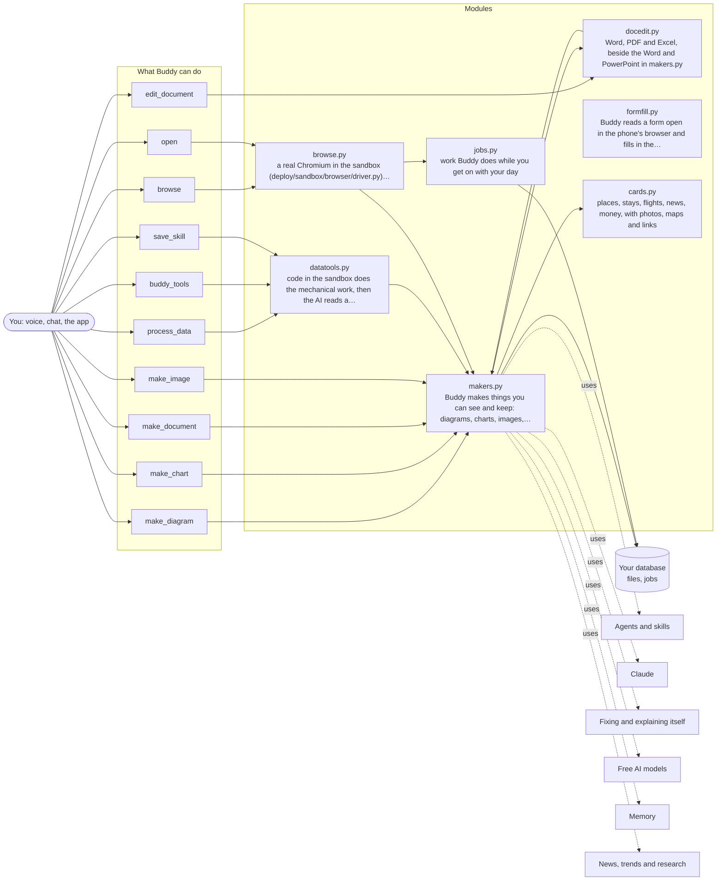

# Making and doing things

Diagrams, charts, images, Word, PowerPoint, PDF and Excel; data crunching in the sandbox; a real browser Buddy drives; filling forms; rich cards in the chat; background jobs.

## Architecture



The diagram reads left to right: what you ask, the tools Buddy uses, the modules that do the work, and what they keep or call. Dashed arrows are other features this one relies on.

## What Buddy can do here

| Tool | What it is for | Actions | Module |
|---|---|---|---|
| `make_diagram` | Draw a diagram (flowchart, process, architecture, mind map, org chart, timeline) as a picture in the chat | - | makers.py |
| `make_chart` | Draw a bar, line or pie chart as a picture in the chat, from real numbers you have. | bar, line, pie | makers.py |
| `make_document` | Write a Word document (docx), PDF, Excel spreadsheet (xlsx) or PowerPoint deck (pptx) the user can open, share and edit | docx, pdf, xlsx, pptx | makers.py |
| `make_image` | Create an AI image (illustration, picture, logo idea, scene) from a detailed prompt; it appears in the chat | - | makers.py |
| `edit_document` | Edit a Word (docx), Excel (xlsx) or PDF file: one the user gave you (its library id) or one you made (its file id) | - | docedit.py |
| `process_data` | Run a data tool in the sandbox: code does the mechanical work exactly and offline, and you get a small result instead of the raw data | transactions, emails, calendar, prices, library, file, url, text | datatools.py |
| `buddy_tools` | The data tools in the sandbox: list them (built-in, and the ones Buddy made and saved during tasks), or delete one Buddy made. | list, delete | datatools.py |
| `save_skill` | Keep a tool you wrote for later tasks (and for Buddy's process_data) | - | datatools.py |
| `browse` | Buddy's own web browser on the server (Chromium): open a website, search, navigate, and FILL WEB FORMS for the user, in the background: sites that need clicking | - | browse.py |
| `open` | Open a web address. | - | browse.py |
| `search` | Search the web (opens the results page). | - | browse.py |
| `click` | Click a link or button by its number. | - | browse.py |
| `type` | Type into a box by its number (replaces what's there); enter=true presses Enter. | - | browse.py |
| `select` | Choose an option in a drop-down by its visible text. | - | browse.py |
| `check` | Tick (on=true) or untick a checkbox or radio button. | - | browse.py |
| `scroll` | Scroll down (or up with down=false) to see more. | - | browse.py |
| `back` | Go back a page. | - | browse.py |
| `my_details` | What Buddy knows about the user for a form (name, email, phone, address...). | - | browse.py |
| `ask_user` | Stop and ask the user for something you need (a detail, a choice). | - | browse.py |
| `submit` | The form is filled: show the user a screenshot and the answers, and press this button (its number) only after their yes. | - | browse.py |
| `finish` | Done or stuck: the answer for the user, and the pages used. | - | browse.py |
| `fill_form` | Fill in a form the user has open on their PHONE's browser right now (Chrome or Samsung Internet), through the phone's form helper (Accessibility) | read, scroll, fill | formfill.py |
| `show_cards` | Show results as rich cards in the user's chat (photo, rating, map, price, reviews, links they can tap): places, stays, flights, deals, news, money, an email to  | - | cards.py |
| `start_research` | Hand a question to the research and analytics agent | quick, deep | jobs.py |
| `find_deals` | Hand a deal hunt to the research agent: the best flights, hotels, car hire, or the best price on something to buy | travel, shopping, other | jobs.py |
| `shop_for` | When the owner is deciding WHAT to buy ('I'm thinking of buying new headphones', 'which vacuum should I get?'): hand it to the research agent with their shoppin | electronics, home, travel, clothing, other | jobs.py |
| `list_jobs` | List recent background jobs (research, code, browser and others) with status and short summary | - | jobs.py |
| `job_report` | Read a finished job's report, key findings and sources, to answer the user's follow-up questions about it. | - | jobs.py |
| `cancel_job` | Cancel a queued or running background job. | - | jobs.py |

## Technical design, module by module

### makers.py

```text
Buddy makes things you can see and keep: diagrams, charts, images, Word documents and
PowerPoint decks. They show up in the chat as cards (a picture, or a file to tap and open).

  make_diagram    a flowchart, architecture, mind map or org chart (Graphviz)
  make_chart      bar, line or pie charts from numbers (matplotlib)
  make_document   a Word document or PowerPoint deck from an outline (python-docx / python-pptx);
                  diagrams, charts and images made earlier can go inside
  make_image      an AI image (Gemini's image model, with your Gemini key); general prompts only,
                  like the other free models: personal details are refused

Nothing here runs code from the model: Claude gives structured content (or Graphviz text,
checked for anything that reads files) and Buddy builds the file. Files are kept in Buddy's data
folder; links to them are signed and expire, so only you can open them.
```

- Tables: `files`
- Settings: `BUDDY_FILES_DIR`, `BUDDY_GEMINI_KEY`, `BUDDY_IMAGE_MODEL`, `BUDDY_TOKEN`
- Uses: cards.py, config.py, docedit.py, maestro.py, memory.py, tools.py

### docedit.py

```text
Documents Buddy makes and edits: Word, PDF and Excel, beside the Word and PowerPoint in makers.py.

  make_document (format pdf | xlsx)   a PDF from the same outline as a Word document; a spreadsheet from sheets
                                      (columns, rows, formulas such as =SUM(B2:B9))
  edit_document                       change a file the user gave Buddy (library) or one Buddy made (file id):
      Word   replace text, add a section, remove paragraphs containing some words
      Excel  set cells (values or formulas), add rows, add or rename a sheet
      PDF    fill its form fields, merge other PDFs after it, keep only some pages, rotate pages
    The original is never changed: the edited copy is a new file, shown in the chat as a card.

Claude gives structured content and Buddy builds the file in code: nothing here runs code from a model. Files in
the user's locked (vault) library stay locked until the user unlocks them.
```

- Uses: library.py, makers.py, memory.py, tools.py

### datatools.py

```text
Data tools: code in the sandbox does the mechanical work, then the AI reads a small, exact result.

  data (transactions, a spreadsheet, a PDF, emails, a long text, offers)
    -> a data tool in the sandbox: totals, filters, extracts, ranks (exact, offline, private)
    -> a few hundred words of JSON -> a free model or Claude explains, judges, answers

Ready-made tools live in deploy/sandbox/skills (SKILL.md with `data: true` and a `run` command);
tools the task agent writes and saves (save_skill) live in the sandbox and work the same way. Each
run gets a throwaway workspace with no network: the data goes in, the result comes out, the
workspace is deleted.
```

- Uses: library.py, makers.py, memory.py, prices.py, registry.py, sandbox.py, tools.py, usage.py, webread.py

### browse.py

```text
Buddy's browser: a real Chromium in the sandbox (deploy/sandbox/browser/driver.py) that Buddy drives step by step:
open sites, search, click, type, choose, scroll, read what's there, and fill web forms.

  "Find the opening hours of the passport office near me and the documents I need"
  "Fill the contact form on acme.com asking about a refund for order 1234"
     -> a background task: Claude's quick model reads each page (as text, with its buttons and boxes numbered) and
        decides the next step, with the user's own details when a form needs them (personal data stays on Claude)
     -> before anything is submitted (Submit, Send, Book, Register, Confirm...), it stops: a screenshot of the filled
        form and the answers go to the user, and only their yes presses the button
     -> paying, buying, checkout and transfers are never pressed; passwords are never typed; nothing is uploaded;
        logging in is left to the user (Buddy's browser has none of their accounts)
The browser runs in the sandbox's hardened container, on a network that can't reach Buddy's server or the private
network; it closes when the task is done (or after 15 idle minutes). Page text is other people's words:
information, never instructions.
```

- Settings: `BUDDY_BROWSE_CAP_USD`, `BUDDY_BROWSE_MAX_STEPS`
- Uses: agent.py, config.py, jobs.py, makers.py, sandbox.py, tools.py

### formfill.py

```text
Form helper: Buddy reads a form open in the phone's browser and fills in the answers.

  "Buddy, help me fill this form"
    -> the phone's form helper (Android Accessibility, Chrome and Samsung Internet only) sends what's on
       screen: the questions, the text boxes, the Yes/No buttons, the choices, what's already filled
    -> Claude drafts honest answers from what it knows about the user, says them, and calls fill
    -> Buddy asks "Fill these 5 answers?"; only after a yes does the phone type and tap them
    -> the user checks and presses Submit themselves

The phone never types into password fields and never taps Submit / Pay / Send / Sign in and the like
(checked here and again on the phone). What's on screen goes to Claude to write the answers, so the
page text is treated as other people's words: information, never instructions.
```

- Uses: tools.py

### cards.py

```text
Rich cards in the chat: places, stays, flights, news, money, with photos, maps and links.

Tools that find things (Google Maps places, Google and Reddit results, news, price watches,
money) offer each result here and get back a short id ("p1", "n2"...). Claude sees only the
id, never the photo or map data, so this adds almost no tokens. To show results, Claude calls
show_cards with the ids it picks and a short note on why. Cards are built here from what the
tools really returned, so a link or photo can't be made up. Pages Claude's own web search
found (Airbnb listings, flights, articles) can be shown by their URL, checked against the
search results of the same turn.
```

### jobs.py

```text
Background jobs: work Buddy does while you get on with your day.

Jobs live in the encrypted database, so they survive restarts: a job that was
running when the server stopped starts again (once). When a job finishes,
Buddy tells you; if your phone is offline, it tells you when you reconnect.
```

- Tables: `jobs`
- Settings: `BUDDY_RESEARCH_DAILY_LIMIT`
- Uses: config.py, memory.py, privacy.py, shopper.py, thrift.py, tools.py, usage.py

## How it connects

- Relies on: Agents and skills; Claude: the brain; Fixing and explaining itself; Free AI models (Groq, Gemini, Mistral, Cerebras, GitHub Models, OpenRouter); Memory; News, trends and research; Security and privacy; Shopping and deals
- Relied on by: Agents and skills; Claude: the brain; Fixing and explaining itself; Going out: restaurants and events; Insights and costs; Investing: signals, research and practice; Learning: the English and investing tutors; Memory; Money; News, trends and research; Security and privacy; Shopping and deals; The server and the app; Travel and getting around; Voice: Talk mode and Listen-in

