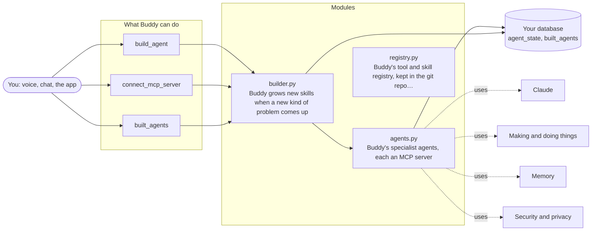

# Agents and skills

Specialist agents Buddy can connect or build, and its registry of tools and skills.

## Architecture



The diagram reads left to right: what you ask, the tools Buddy uses, the modules that do the work, and what they keep or call. Dashed arrows are other features this one relies on.

## What Buddy can do here

| Tool | What it is for | Actions | Module |
|---|---|---|---|
| `build_agent` | When the user needs a capability none of your tools or agents has (a service, an API, a kind of lookup), build a new agent for it: researched, written, safety-c | - | builder.py |
| `connect_mcp_server` | Connect an existing MCP server the user gives you the address of (https://...), as a new agent | - | builder.py |
| `built_agents` | Agents Buddy has built or connected, with what they do, the websites they talk to and whether they're on | - | builder.py |

## Technical design, module by module

### agents.py

```text
Agent registry: Buddy's specialist agents, each an MCP server.

Buddy (the orchestrator) connects to every enabled agent, offers their tools to
Claude as `<agent>__<tool>`, and enforces the safety rules on every call:

- only agents you enabled are reachable, and Claude can pause an agent but
  never re-enable one (only you can, through the admin API);
- tools listed as needing approval do nothing until you have said "yes";
- each agent has a daily call limit;
- every call is written to the audit log with its arguments masked;
- results are masked before Claude sees them.

Agents are declared in agents.yaml (see agents.example.yaml).
```

- Tables: `agent_state`
- Settings: `BUDDY_DB_KEY`, `BUDDY_DO_TOKEN`, `BUDDY_EMAIL_`, `BUDDY_PLAID_`, `BUDDY_SIMPLEFIN`, `BUDDY_TAILSCALE_`, `BUDDY_TOKEN`
- Uses: memory.py, privacy.py

### builder.py

```text
Agent builder: Buddy grows new skills when a new kind of problem comes up.

Two ways:
  - connect an existing MCP server by its URL (Notion, a company tool, any service
    that offers one), with every change gated behind the user's yes
  - build a new agent: a background job researches the service's API, writes a
    small MCP server in Python, checks it (an import allowlist and banned calls,
    then a second model's safety review), and starts it once to list its tools.
    The user hears what it can do and which websites it talks to, and nothing runs
    until they say yes.

Built agents run as their own process with only the settings they declared, ask
before every tool unless the user later relaxes that, and can be paused or removed
by voice. Code lives in the data folder, never in the app's own code.
```

- Tables: `built_agents`
- Uses: agent.py, agents.py, config.py, jobs.py, memory.py, privacy.py, tools.py

### registry.py

```text
Buddy's tool and skill registry, kept in the git repo (deploy/sandbox/registry and skills).

The task agent searches it with find_tools: vetted tools (pinned versions, checked downloads)
and skills (tested scripts with a short guide). The same files are mounted read-only into the
sandbox at /buddy, where install_tool and the pip / npm guard use them.
```

## How it connects

- Relies on: Claude: the brain; Making and doing things; Memory; Security and privacy
- Relied on by: Claude: the brain; Fixing and explaining itself; Making and doing things; Security and privacy; The server and the app

