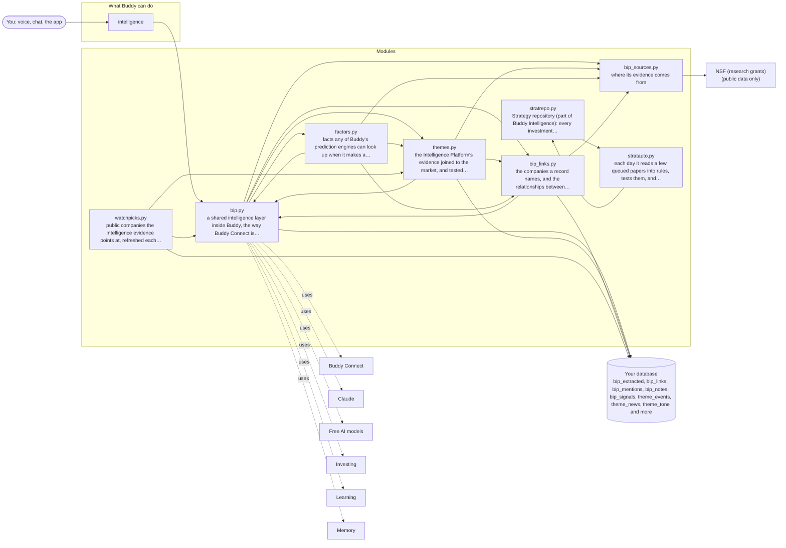

# Buddy Intelligence Platform

A shared layer, like Buddy Connect, that collects public evidence on emerging technologies (papers, clinical studies, company filings, federal awards, code, discussion), finds which are converging across sectors and what stage each is at, and that Buddy's other features read from.

## Architecture



The diagram reads left to right: what you ask, the tools Buddy uses, the modules that do the work, and what they keep or call. Dashed arrows are other features this one relies on.

## What Buddy can do here

| Tool | What it is for | Actions | Module |
|---|---|---|---|
| `intelligence` | The Buddy Intelligence Platform: public evidence about emerging technologies and industries (research papers, registered clinical studies, company filings, US f | overview, technology, organisation, search, switch, scan, relationships, themes, patterns, predictions | bip.py |

## Technical design, module by module

### bip.py

```text
Buddy Intelligence Platform (BIP): a shared intelligence layer inside Buddy, the way Buddy Connect is the
shared layer for outside services. It collects public evidence about technologies, works out which are forming
into industries and which are converging, and Buddy's features (Investments, News, Security, the briefing, the
tutor) read from it through the functions at the bottom of this file instead of each gathering their own.

  The map         ten sectors, each with its technologies (SECTORS). Four are switched on to start: AI,
                  cybersecurity, AI infrastructure and semiconductors, and energy. The others are defined and
                  can be switched on; each night costs only free API calls.
  Evidence        dated signals from free official and first-hand sources (bip_sources.py): research papers,
                  registered clinical studies, company filings, US federal awards and research grants,
                  private fundraising notices, new code, news and discussion. Every signal keeps its source,
                  its link, the date it happened and the date Buddy first saw it, what kind of evidence it
                  is, and its standing: verified (an official record exists) or reported (someone's claim).
  One name        the same organisation written different ways ("Oklo Inc. (OKLO)", "OKLO INC") is counted
                  once, by a normalised name.
  Tagging         each signal is tagged with the technologies it mentions, by their names and terms, in code.
  Convergence     two technologies from different sectors that keep appearing in the same signals. Ranked by
                  how many signals join them lately, how many kinds of evidence, and whether it is growing.
  Maturity        a stage for each technology and each convergence, from the evidence collected, by fixed
                  rules: only papers = scientific research; working code = prototype; a registered study or a
                  government award = pilot; companies writing about it in filings = early commercialization;
                  many companies = scaling. The rule that fired is shown. A sector that is long established
                  is marked so, not "discovered".
  Formation       an alert, once, when three or more independent kinds of evidence for a technology are all
                  rising at the same time.
  Pulse           the sectors that are switched off are not ignored: once a week each of their technologies
                  gets a light check (recent company filings and discussion only). When a sector's movement
                  jumps against its own earlier weeks, Buddy says so once and suggests switching it on, so
                  something starting there isn't missed.
  Interpretation  for the strongest convergences a free model writes what the pair adds up to. It is stored
                  and shown as "AI interpretation", apart from the evidence, and never changes a stage or a
                  rank.

What it is not: market sizes are not computed (Buddy can't verify one); nothing here is investment advice or a
forecast; a stage is read from the evidence Buddy has, which is US-heavy (SEC, US federal awards) and limited to
what these sources publish. Everything is public data, kept in Buddy's public store (the DuckDB file beside the
database), never mixed with the owner's data, so free models may read it.
```

- Tables: `bip_notes`, `bip_signals`
- Uses: bip_links.py, bip_sources.py, factors.py, maestro.py, memory.py, pricebook.py, themes.py, tools.py

### bip_sources.py

```text
Buddy Intelligence Platform: where its evidence comes from.

Every source is free, official or first-hand, and read through Buddy Connect (gateway.py), so each call is
rate-limited, logged and can be switched off. Only a technology's search phrase is sent; nothing about the owner.

  research     arXiv (preprints) and Europe PMC (biomedical papers): work published by its authors
  trials       ClinicalTrials.gov: registered clinical studies, with sponsor and phase
  filings      SEC EDGAR full-text search: company filings (8-K, 10-K, S-1) that mention the technology
  awards       USAspending.gov: US federal contracts and grants that mention it, with recipient and amount
  code         GitHub: new public repositories about it
  discussion   Hacker News: stories about it that drew real attention
  news         GDELT: news coverage of it worldwide (the report's title, outlet and date)
  research     OpenAlex: scholarly works across every field, beyond the two sources above
  grants       NIH RePORTER, NSF and SBIR.gov: US research grants, including those to small companies
  funding      SEC Form D: a private company's own notice that it is raising money

What each kind of evidence is worth is fixed here, in EVIDENCE, and shown beside every item: an official record
is a fact that the record exists; a paper is its authors' claim; a filing is the company's own statement; a
story is a report. None of it is Buddy's opinion.

Not used: paid databases (Crunchbase, PitchBook, CB Insights) and anything that would need scraping.
A source that fails is recorded and skipped; the others still run.
```

- Outside services: NSF (research grants)
- Uses: funds.py, gateway.py

### themes.py

```text
Themes: the Intelligence Platform's evidence joined to the market, and tested with practice money.

  Themes     each technology the platform follows, with the public companies its filings name, how its evidence
             is moving, and which of those companies are on the owner's watchlist or in their trade ideas and
             practice portfolio. Matching is plain code: no model sees the owner's lists.
  Patterns   fixed rules that notice a change in the evidence (PATTERNS below): several kinds rising at once,
             a jump in company filings, a jump in news, a jump in research, a large award or grant, a run of
             private fundraising notices. Each time a rule fires for a technology that has public companies, an
             event is written with that day's closing prices.
  News       news is read, not only counted. A free model labels each headline about a technology or one of its
             companies as good, bad or neutral for it (headlines are public; the label is shown beside the
             headline so it can be checked, and it will sometimes be wrong). Good and bad news each have their
             own pattern and their own record. News about the companies themselves is searched by company name.
  Signals    each company also shows whether Buddy's Signals practice book has an open buy or avoid on it.
  Practice   every event is a practice basket: pretend money split equally across up to five of the companies,
             measured after 30 and after 90 days against the S&P 500 fund (SPY) over the same days. Nothing is
             bought. No costs or taxes are taken off, so real results would be a little worse.
  Record     per pattern: how many baskets have finished, how many beat the market, the middle result. Until a
             pattern has MIN_EVENTS finished baskets Buddy says only that there is not enough history. After
             that it says which way the pattern has leaned so far. It is a record of the past, never a promise,
             and events close together in time are not independent tests.

Stored in the public-data store beside the evidence: these are public prices and Buddy's own practice results.
```

- Tables: `theme_events`, `theme_news`, `theme_tone`
- Uses: bip.py, bip_links.py, bip_sources.py, maestro.py, markets.py, memory.py, modeltrain.py, paper.py, tools.py

### factors.py

```text
The shared signals library: facts any of Buddy's prediction engines can look up when it makes a call.

Buddy has three engines that learn from how their own calls turned out (modeltrain.py trains and tests a model for
each once it has enough judged calls): investing (signals and themes), travel (flight and hotel book-or-wait
calls) and shopping (buy-or-wait calls). Each engine keeps its own reasons. This library adds what the others
already know, so a call is saved with more to learn from:

  investing   what the Intelligence Platform holds on the technologies whose filings name the company: how many
              records in 90 days and how fast that is growing, how many kinds of evidence, the stage, good and
              bad headlines in 14 days (the technology's and the company's own), and evidence patterns that
              fired in the last 30 days
  travel      the season for the month of travel and for now (government price data for air fares and hotels),
              oil's move over 30 days (fuel feeds into fares), how many flight or hotel deals reached the inbox
              and feeds in 30 days against the 30 before, deals that name this route or place, days until travel
  shopping    deals for this item in 90 days from the inbox, from Reddit and from the feeds, the category's
              season now and the gain from its best month ahead

Every factor is a number, named f_..., worked out in code from what Buddy already stores (no AI, and no new
outside call except oil, once a day, when its free key is set). A factor that can't be worked out is left out, and
the trainer treats a missing factor as zero. Factors never decide a call themselves: they are saved with it, and
a model uses them only after it has passed its test on calls it never saw.

Only public data is read here: evidence, headlines, prices, deals. Nothing about the owner goes anywhere.
```

- Uses: bip.py, bip_links.py, bip_sources.py, market_school.py, memory.py, modeltrain.py, newsdesk.py, newssent.py, pricebook.py, seasons.py, themes.py, tools.py

### bip_links.py

```text
Who is connected to whom: the companies a record names, and the relationships between organisations.

The evidence store knows that two technologies share records. This adds the organisations: which companies a
headline is about, and who funds, supplies, buys from, partners with, acquires, invests in, licenses to or
competes with whom.

  From official records (code, no AI; standing: verified)
      A federal award names the agency and the recipient; an NIH, NSF or small-business grant names the funder
      and the organisation. Each becomes "agency funds organisation", with the record as its proof.
  From headlines (an AI model reads the headline; standing: reported)
      The model chosen for the 'extract' job (maestro.py) is given headlines, a batch at a time, and asked
      for the companies each names and any relationship the headline states. Its answer is checked in code
      before anything is kept: every name must appear in the headline itself, the relationship must be one of
      the eight kinds, and the two sides must differ. A name the headline does not contain is dropped, so the
      model cannot add a company from its own memory. A headline is read once.

Every relationship keeps the record it came from, its date and its standing, so "A supplies B" can always be
traced to one headline or one award. A relationship from a headline is what was reported, not a checked fact,
and a single headline can be wrong. Only public records are read; nothing about the owner is involved.
```

- Tables: `bip_extracted`, `bip_links`, `bip_mentions`
- Uses: bip.py, bip_sources.py, maestro.py, memory.py, tools.py

### watchpicks.py

```text
Recommended watchlist: public companies the Intelligence evidence points at, refreshed each night.

Your own watchlist stays yours. This is a second list that Buddy keeps from its market intelligence:

  recommended  a company a technology's filings name, where the company was named in a filing in the last
               30 days or one of the technology's evidence patterns fired in the last 30 days. Each one says
               why, with the sector and the technology it belongs to. The strongest 30 are listed and are
               added to the daily scan next to your own symbols.
  archived     a recommended company with nothing new for 30 days. It is moved out of the list, not deleted,
               and kept grouped by sector and technology with the dates it was recommended. If its evidence
               picks up again it comes back by itself.
  dismissed    one you removed. Buddy does not recommend it again unless you restore it.

It reads only the public evidence (filings, patterns) in the price book. No AI model is used and no outside
call is made here. A recommendation is a reason to look, not advice to buy; nothing is ever bought.
```

- Tables: `watch_picks`
- Uses: bip.py, markets.py, memory.py, themes.py, tools.py

### stratrepo.py

```text
Strategy repository (part of Buddy Intelligence): every investment strategy Buddy has collected, in one
catalogue, with where it came from, what it needs, how it tested, and whether it passed.

  Discover   arXiv's quantitative-finance papers (researchdesk.py), public GitHub files with a stated licence,
             documents the owner uploads, and a public directory of strategy papers (CC0) read here.
  Collect    only where a licence allows it; the source and its link stay with the rule. Published returns are
             never copied: a strategy is worth what Buddy's own test of it says.
  Extract    each strategy becomes a rule in the fixed form (stratrules.py): universe, entry, exit, holding
             period, needed data. No downloaded code is ever run.
  Validate   the rule is replayed over past daily prices by Buddy's own replay (stratlab.replay).
  Evaluate   the scorecard below: yearly return, Sharpe ratio, worst fall, trades a year, costs, and the result
             against the market, in rising and falling markets and in the latest stretch.
             A rule also has to clear the luck test: the more rules are tried, the better the best of them
             looks by chance alone, so its Sharpe ratio is judged against what the luckiest of that many rules
             would show (the deflated Sharpe ratio of Bailey and Lopez de Prado).
  Learn      rules that the owner approves paper-trade every weekday; a rule is "proven live" only on its own
             live trades.

What the scorecard is, and is not. Every trade is a fixed pretend stake, so the "book" a rule needs is its
stake times the most trades it ever held at once. Yearly return, Sharpe and worst fall are worked out on that
book from the trades' closing dates. That is a fair way to compare rules with each other; it is not what a real
account would have earned. The replay uses today's list of companies, so companies that failed are missing and
the past looks better than it was. Sizing is one fixed stake per trade; no rule sizes positions differently.
```

- Uses: memory.py, pricebook.py, researchdesk.py, stratauto.py, stratlab.py, stratrules.py, tools.py

### stratauto.py

```text
Investment Intelligence on its own: each day it reads a few queued papers into rules, tests them, and pauses a
rule that is failing live. The owner still decides what trades.

  Read     the newest READ_A_DAY items in the research queue are read into rules (researchdesk.read). Each new rule
           also gets a second reading by another model job, which says whether the rule matches the document
           (stratrules.critique).
  Test     the new rules are replayed over past prices straight away, without being switched on.
  Keep     a rule that passed stays in the Library as proposed, waiting for the owner's approval. So does a rule
           that reads company figures, which have no history to test on. A rule that failed its test, or made too
           few trades to judge, is removed, and its paper in the queue says why.
  Pause    an approved rule that has lost to the market over PAUSE_AFTER or more live closed trades is paused.
           Only rules the owner added can be paused this way; the six built-in ones are reported instead.
  Tell     one message: what was read, what passed, what was paused.

What it never does: approve a rule, or start one trading. Reading uses the free model unless the owner chose
another; a strategy document is public text, so the Privacy Gateway lets it go to any model.
```

- Uses: memory.py, researchdesk.py, stratlab.py, stratrepo.py, stratrules.py, tools.py

## How it connects

- Relies on: Buddy Connect; Claude: the brain; Free AI models (Groq, Gemini, Mistral, Cerebras, GitHub Models, OpenRouter); Investing: signals, research and practice; Learning: the English and investing tutors; Memory; Shopping and deals; The price book, pattern learning and trained models
- Relied on by: Claude: the brain; Free AI models (Groq, Gemini, Mistral, Cerebras, GitHub Models, OpenRouter); Investing: signals, research and practice; Shopping and deals; Speaking up on its own: briefing, reminders and alerts; The price book, pattern learning and trained models; The server and the app; Travel and getting around

