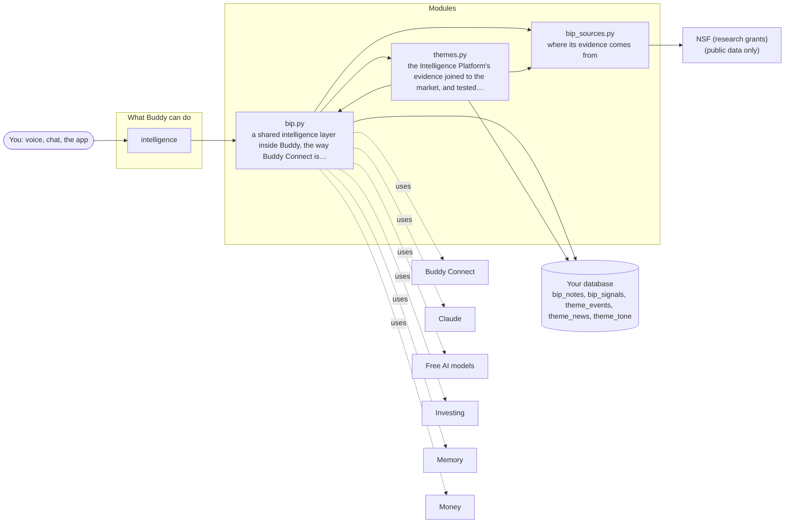

# Buddy Intelligence Platform

A shared layer, like Buddy Connect, that collects public evidence on emerging technologies (papers, clinical studies, company filings, federal awards, code, discussion), finds which are converging across sectors and what stage each is at, and that Buddy's other features read from.

## Architecture



The diagram reads left to right: what you ask, the tools Buddy uses, the modules that do the work, and what they keep or call. Dashed arrows are other features this one relies on.

## What Buddy can do here

| Tool | What it is for | Actions | Module |
|---|---|---|---|
| `intelligence` | The Buddy Intelligence Platform: public evidence about emerging technologies and industries (research papers, registered clinical studies, company filings, US f | overview, technology, organisation, search, switch, scan, themes, patterns | bip.py |

## Technical design, module by module

### bip.py

```text
Buddy Intelligence Platform (BIP): a shared intelligence layer inside Buddy, the way Buddy Connect is the
shared layer for outside services. It collects public evidence about technologies, works out which are forming
into industries and which are converging, and Buddy's features (Investments, News, Security, the briefing, the
tutor) read from it through the functions at the bottom of this file instead of each gathering their own.

  The map         ten sectors, each with its technologies (SECTORS). Four are switched on to start: AI,
                  cybersecurity, AI infrastructure and semiconductors, and energy. The others are defined and
                  can be switched on; each night costs only free API calls.
  Evidence        dated signals from free official and first-hand sources (bip_sources.py): research papers,
                  registered clinical studies, company filings, US federal awards and research grants,
                  private fundraising notices, new code, news and discussion. Every signal keeps its source,
                  its link, the date it happened and the date Buddy first saw it, what kind of evidence it
                  is, and its standing: verified (an official record exists) or reported (someone's claim).
  One name        the same organisation written different ways ("Oklo Inc. (OKLO)", "OKLO INC") is counted
                  once, by a normalised name.
  Tagging         each signal is tagged with the technologies it mentions, by their names and terms, in code.
  Convergence     two technologies from different sectors that keep appearing in the same signals. Ranked by
                  how many signals join them lately, how many kinds of evidence, and whether it is growing.
  Maturity        a stage for each technology and each convergence, from the evidence collected, by fixed
                  rules: only papers = scientific research; working code = prototype; a registered study or a
                  government award = pilot; companies writing about it in filings = early commercialization;
                  many companies = scaling. The rule that fired is shown. A sector that is long established
                  is marked so, not "discovered".
  Formation       an alert, once, when three or more independent kinds of evidence for a technology are all
                  rising at the same time.
  Pulse           the sectors that are switched off are not ignored: once a week each of their technologies
                  gets a light check (recent company filings and discussion only). When a sector's movement
                  jumps against its own earlier weeks, Buddy says so once and suggests switching it on, so
                  something starting there isn't missed.
  Interpretation  for the strongest convergences a free model writes what the pair adds up to. It is stored
                  and shown as "AI interpretation", apart from the evidence, and never changes a stage or a
                  rank.

What it is not: market sizes are not computed (Buddy can't verify one); nothing here is investment advice or a
forecast; a stage is read from the evidence Buddy has, which is US-heavy (SEC, US federal awards) and limited to
what these sources publish. Everything is public data, kept in Buddy's public store (the DuckDB file beside the
database), never mixed with the owner's data, so free models may read it.
```

- Tables: `bip_notes`, `bip_signals`
- Uses: benefits.py, bip_sources.py, free_models.py, markets.py, memory.py, pricebook.py, themes.py, tools.py

### bip_sources.py

```text
Buddy Intelligence Platform: where its evidence comes from.

Every source is free, official or first-hand, and read through Buddy Connect (gateway.py), so each call is
rate-limited, logged and can be switched off. Only a technology's search phrase is sent; nothing about the owner.

  research     arXiv (preprints) and Europe PMC (biomedical papers): work published by its authors
  trials       ClinicalTrials.gov: registered clinical studies, with sponsor and phase
  filings      SEC EDGAR full-text search: company filings (8-K, 10-K, S-1) that mention the technology
  awards       USAspending.gov: US federal contracts and grants that mention it, with recipient and amount
  code         GitHub: new public repositories about it
  discussion   Hacker News: stories about it that drew real attention
  news         GDELT: news coverage of it worldwide (the report's title, outlet and date)
  research     OpenAlex: scholarly works across every field, beyond the two sources above
  grants       NIH RePORTER, NSF and SBIR.gov: US research grants, including those to small companies
  funding      SEC Form D: a private company's own notice that it is raising money

What each kind of evidence is worth is fixed here, in EVIDENCE, and shown beside every item: an official record
is a fact that the record exists; a paper is its authors' claim; a filing is the company's own statement; a
story is a report. None of it is Buddy's opinion.

Not used: paid databases (Crunchbase, PitchBook, CB Insights) and anything that would need scraping.
A source that fails is recorded and skipped; the others still run.
```

- Outside services: NSF (research grants)
- Uses: funds.py, gateway.py

### themes.py

```text
Themes: the Intelligence Platform's evidence joined to the market, and tested with practice money.

  Themes     each technology the platform follows, with the public companies its filings name, how its evidence
             is moving, and which of those companies are on the owner's watchlist or in their trade ideas and
             practice portfolio. Matching is plain code: no model sees the owner's lists.
  Patterns   fixed rules that notice a change in the evidence (PATTERNS below): several kinds rising at once,
             a jump in company filings, a jump in news, a jump in research, a large award or grant, a run of
             private fundraising notices. Each time a rule fires for a technology that has public companies, an
             event is written with that day's closing prices.
  News       news is read, not only counted. A free model labels each headline about a technology or one of its
             companies as good, bad or neutral for it (headlines are public; the label is shown beside the
             headline so it can be checked, and it will sometimes be wrong). Good and bad news each have their
             own pattern and their own record. News about the companies themselves is searched by company name.
  Signals    each company also shows whether Buddy's Signals practice book has an open buy or avoid on it.
  Practice   every event is a practice basket: pretend money split equally across up to five of the companies,
             measured after 30 and after 90 days against the S&P 500 fund (SPY) over the same days. Nothing is
             bought. No costs or taxes are taken off, so real results would be a little worse.
  Record     per pattern: how many baskets have finished, how many beat the market, the middle result. Until a
             pattern has MIN_EVENTS finished baskets Buddy says only that there is not enough history. After
             that it says which way the pattern has leaned so far. It is a record of the past, never a promise,
             and events close together in time are not independent tests.

Stored in the public-data store beside the evidence: these are public prices and Buddy's own practice results.
```

- Tables: `theme_events`, `theme_news`, `theme_tone`
- Uses: benefits.py, bip.py, bip_sources.py, free_models.py, markets.py, memory.py, paper.py, tools.py

## How it connects

- Relies on: Buddy Connect; Claude: the brain; Free AI models (Groq, Gemini, Mistral, Cerebras, GitHub Models, OpenRouter); Investing: signals, research and practice; Memory; Money; The price book, pattern learning and trained models
- Relied on by: Claude: the brain; Speaking up on its own: briefing, reminders and alerts; The server and the app

