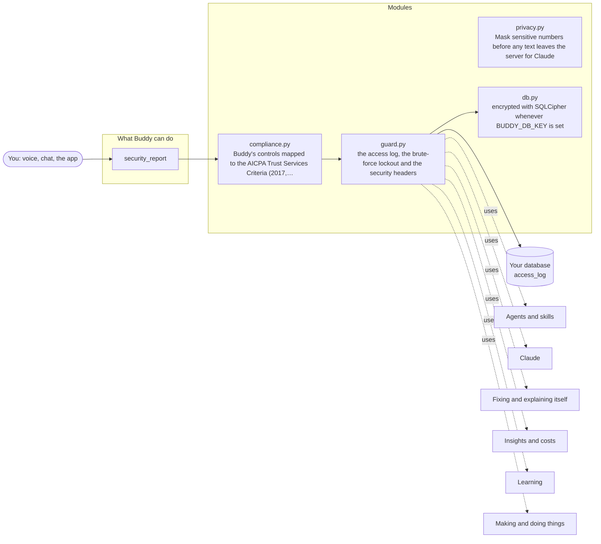

# Security and privacy

Who can reach Buddy, lockouts, secrets kept out of logs and prompts, the encrypted database.

## Architecture



The diagram reads left to right: what you ask, the tools Buddy uses, the modules that do the work, and what they keep or call. Dashed arrows are other features this one relies on.

## What Buddy can do here

| Tool | What it is for | Actions | Module |
|---|---|---|---|
| `security_report` | Buddy's SOC 2 readiness assessment (security, availability, confidentiality, privacy): every control checked against live evidence from the server, the gaps and | report, status | compliance.py |

## Technical design, module by module

### guard.py

```text
Server security controls: the access log, the brute-force lockout and the security headers.

Access log: every call to Buddy's API, admin pages, bank pages and app connections, with when,
who (the tailnet login Tailscale passes along, when there is one), the network address, the
method, the path (never the query string, so tokens and search words stay out), the result and
how long it took. Never a message, a body or a key. Kept ACCESS_LOG_DAYS (400) days, in its own
database file, encrypted with the same key as Buddy's memory.

Lockout: LOCKOUT_FAILURES failed sign-ins (a wrong or missing token) from one address within
LOCKOUT_WINDOW seconds block that address for LOCKOUT_SECONDS; each lockout is logged.
```

- Tables: `access_log`
- Settings: `BUDDY_LOCKOUT_FAILURES`
- Uses: config.py, db.py

### privacy.py

```text
Mask sensitive numbers before any text leaves the server for Claude.

Covers the USA, India and South America. Card numbers keep their last four
digits ("card ****4521") so Buddy can still tell cards apart; everything else
is replaced outright. Masking is plain code, so it is predictable and works
without any AI model.
```

### db.py

```text
Database connection: encrypted with SQLCipher whenever BUDDY_DB_KEY is set.
```

- Settings: `BUDDY_DB_KEY`

### compliance.py

```text
SOC 2 readiness assessment: Buddy's controls mapped to the AICPA Trust Services Criteria (2017,
revised points of focus 2022), with evidence read live from the server, a gap and remediation plan,
and a Word document to download.

This is a self-assessment. It is NOT a SOC 2 report: only an independent licensed CPA firm can
examine controls and issue a SOC 2 Type I or Type II report. The document says so on its first page.

Evidence:
  - the weekly root security check (deploy/maintain.py -> /var/lib/buddy/security.json): its findings
    and "facts" (firewall, SSH, keys sealed and their ages, backups, timers, access review, patches)
  - Buddy itself: the access token, database encryption, the access log and lockouts (guard.py),
    retention periods, read-only bank access, the code sandbox, connector isolation
  - the policies in docs/ (SECURITY.md, ACCESS_CONTROL.md)
What only the owner can show (vendor reports, training, a restore test, the annual sign-off) is
marked "Owner to confirm" with what to keep on file.
```

- Settings: `BUDDY_DB_KEY`
- Uses: agents.py, companydocs.py, config.py, diagnostics.py, finance.py, guard.py, health.py, jobs.py, makers.py, memory.py, sandbox.py, tools.py, transcripts.py, tutor.py, usage.py

## How it connects

- Relies on: Agents and skills; Claude: the brain; Fixing and explaining itself; Insights and costs; Learning: the English and investing tutors; Making and doing things; Memory; Money; Speaking up on its own: briefing, reminders and alerts; Voice: Talk mode and Listen-in
- Relied on by: Agents and skills; Claude: the brain; Fixing and explaining itself; Free AI models (Groq, Gemini, Mistral, Cerebras, GitHub Models, OpenRouter); Learning: the English and investing tutors; Making and doing things; Memory; Money; News, trends and research; Speaking up on its own: briefing, reminders and alerts; The server and the app; Voice: Talk mode and Listen-in

