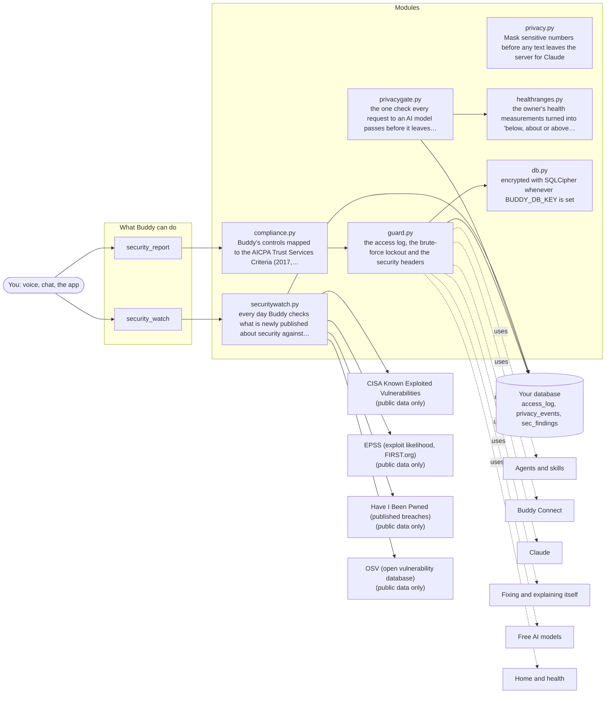

# Security and privacy

Who can reach Buddy, lockouts, secrets kept out of logs and prompts, the encrypted database.

## Architecture



The diagram reads left to right: what you ask, the tools Buddy uses, the modules that do the work, and what they keep or call. Dashed arrows are other features this one relies on.

## What Buddy can do here

| Tool | What it is for | Actions | Module |
|---|---|---|---|
| `security_report` | Buddy's SOC 2 readiness assessment (security, availability, confidentiality, privacy): every control checked against live evidence from the server, the gaps and | report, status | compliance.py |
| `security_watch` | Buddy's own security: a daily check of newly published vulnerabilities and flaws being exploited now against what this server runs, plus the server and settings | report, scan, explain, accept, patch_now, services, disconnect, reconnect | securitywatch.py |

## Technical design, module by module

### guard.py

```text
Server security controls: the access log, the brute-force lockout and the security headers.

Access log: every call to Buddy's API, admin pages, bank pages and app connections, with when,
who (the tailnet login Tailscale passes along, when there is one), the network address, the
method, the path (never the query string, so tokens and search words stay out), the result and
how long it took. Never a message, a body or a key. Kept ACCESS_LOG_DAYS (400) days, in its own
database file, encrypted with the same key as Buddy's memory.

Lockout: LOCKOUT_FAILURES failed sign-ins (a wrong or missing token) from one address within
LOCKOUT_WINDOW seconds block that address for LOCKOUT_SECONDS; each lockout is logged.
```

- Tables: `access_log`
- Settings: `BUDDY_LOCKOUT_FAILURES`
- Uses: config.py, db.py

### privacy.py

```text
Mask sensitive numbers before any text leaves the server for Claude.

Covers the USA, India and South America. Card numbers keep their last four
digits ("card ****4521") so Buddy can still tell cards apart; everything else
is replaced outright. Masking is plain code, so it is predictable and works
without any AI model.
```

### privacygate.py

```text
Privacy Gateway: the one check every request to an AI model passes before it leaves this server.

The rules (the owner's decision, 17 November 2026):

  Health   the owner's health information goes to NO model, Claude included: measurements (sleep, readiness,
           HRV, heart rate, temperature, weight, lab values), symptoms, conditions, medicines, allergies, what
           was eaten, health goals, and anything worked out from them. Taking the name off does not make it safe.
  Personal everything else about the owner (who they are, mail, money, documents, and any key or password in
           the text) goes to Claude ONLY. No other model, free or paid, sees it; and nothing falls back to another
           model after a refusal.
  Public   anything else may go to any model the owner has set up.
  Unsure   if this check fails or cannot decide, the request is refused (fail closed).
  Ranges   the one thing the owner can change, and only on the server (healthranges.py): when they switch it on,
           Claude, and only Claude, may be given health as ranges against the owner's own usual ("sleep duration:
           latest below usual"), never a value. Only lines of that exact form pass; everything above still holds.

Where it is enforced (the only doors to a model):
  Claude       config.claude_client(): every request, streamed or not, passes sanitize_request just before it
               is sent. Health information found anywhere in it (the instructions, the memory lines, an old turn
               of the conversation, a tool's result) is cut out and replaced by a marker; the rest goes on. The
               request is cut, not refused, so one remembered health fact cannot stop Buddy working for good.
  Other models free_models._post and maestro.ask_with: authorize, which refuses the whole request unless it is
               public.
  Health tools agent.py: what a health tool returns is shown to the owner on a card and withheld from the model
               (HEALTH_TOOLS), so it never becomes part of a request in the first place.
  The chat     agent.reply: a message about the owner's own health is answered by Buddy itself and never sent on.

How health is recognised. Two ways, because neither is enough alone:
  by source    a health tool's result is health information whatever it looks like. This is the strong control.
  by content   rules over the text: a health measure with a number beside it; the owner (I, my, "the user", their
               name) beside a symptom, condition, medicine or test; the field names health data is stored under.
               No AI model takes part in the decision.
A question that names no person ("what does HDL cholesterol mean?") is public and may be asked.

What this cannot do, said plainly: content rules miss things no rule was written for (a symptom described in
unusual words, a number with no label), and they sometimes stop something harmless. Speech is turned into text
by a speech model before any rule can read it, so spoken words reach that model first. Both are listed in
docs/PRIVACY-GATEWAY.md under "Not covered".

The record. Every decision is kept as: when, which part of Buddy asked, which model, the level, the kinds of
information found, what was decided and why, and a reference number. Never the content, and never a value.
```

- Tables: `privacy_events`
- Uses: free_models.py, healthranges.py

### healthranges.py

```text
Health as ranges: the owner's health measurements turned into "below, about or above your usual" by plain rules.

Why. The Privacy Gateway sends no health information to any AI model. With that alone Buddy cannot say anything
about the owner's sleep or recovery. This is the middle the owner chose on 17 November 2026: when they switch it on
from the server, Claude (and only Claude) may be given ranges and trends, never the values behind them.

What a model receives, and nothing else:

    [health range] sleep duration: latest below usual; week about usual; trend falling; 5 of 7 days below usual, 0 above

    latest   the most recent day against the owner's own usual (the middle value of the earlier days)
    week     the last seven days' average against the same usual
    trend    the last three days against the four before them
    n of 7   how many of the last seven days were below, and above, the usual

No value, unit, date, name, age or place is in it. "Usual" is the owner's own, so the line does not even say
whether a number is high or low for people in general.

How it stays that way. Every line is built here from a fixed list of measures and a fixed list of words, and the
Privacy Gateway lets a line through only if it matches that exact form (LINE). Text that merely starts with the
marker but says anything else is treated as health information and cut like any other.

What it does not hide: that the owner tracks these measures, and which way each is going. And the request still
goes out under the owner's own account, so the provider can tell all of it comes from one person
(docs/PRIVACY-GATEWAY.md). Free text about health (symptoms, medicines, food) is never sent, in this mode or any.
```

- Settings: `BUDDY_HEALTH_RANGES`
- Uses: coach.py

### db.py

```text
Database connection: encrypted with SQLCipher whenever BUDDY_DB_KEY is set.
```

- Settings: `BUDDY_DB_KEY`

### compliance.py

```text
SOC 2 readiness assessment: Buddy's controls mapped to the AICPA Trust Services Criteria (2017,
revised points of focus 2022), with evidence read live from the server, a gap and remediation plan,
and a Word document to download.

This is a self-assessment. It is NOT a SOC 2 report: only an independent licensed CPA firm can
examine controls and issue a SOC 2 Type I or Type II report. The document says so on its first page.

Evidence:
  - the weekly root security check (deploy/maintain.py -> /var/lib/buddy/security.json): its findings
    and "facts" (firewall, SSH, keys sealed and their ages, backups, timers, access review, patches)
  - Buddy itself: the access token, database encryption, the access log and lockouts (guard.py),
    retention periods, read-only bank access, the code sandbox, connector isolation
  - the policies in docs/ (SECURITY.md, ACCESS_CONTROL.md)
What only the owner can show (vendor reports, training, a restore test, the annual sign-off) is
marked "Owner to confirm" with what to keep on file.
```

- Settings: `BUDDY_DB_KEY`
- Uses: agents.py, companydocs.py, config.py, diagnostics.py, finance.py, guard.py, health.py, jobs.py, makers.py, memory.py, sandbox.py, tools.py, transcripts.py, tutor.py, usage.py

### securitywatch.py

```text
The threat watch: every day Buddy checks what is newly published about security against what this server
actually runs, and keeps a plain record of what is open, what was fixed, why each one matters and how it could
be used against this server.

  What is checked, daily
    Buddy's packages   every installed Python package and its exact version is looked up in OSV (the open
                       vulnerability database Google runs, which includes the GitHub and PyPI advisories)
    exploited now      CISA's Known Exploited Vulnerabilities list: a finding that is on it is being used in
                       real attacks, and is raised to critical; new entries about the software this server is
                       built on (Linux, OpenSSH, OpenSSL, Docker, Tailscale, Python, SQLite, sudo, glibc...)
                       are shown as "check" even when Buddy can't tell the exact version affected
    likelihood         EPSS (FIRST.org): the chance, from 0 to 100%, that a vulnerability is exploited in the
                       next 30 days
    the server         Ubuntu security updates waiting to be installed; the weekly root check's findings
                       (firewall, SSH, keys, backups, exposure: deploy/maintain.py); and Buddy's own settings
                       (the access token's strength, database encryption, developer mode, a stale check)

  What a finding says
    severity           critical | high | medium | low, from the published score, raised when it is exploited
    why it matters     what an attacker gains (read data, change data, take Buddy offline), in plain words
    how it could be used   from the published attack details (over the network or only on the server; with or
                       without signing in; with or without someone clicking) AND where that software sits in
                       Buddy: in the part reachable from the internet (the phone-call path), in the part that
                       reads outside files (email attachments, web pages, uploads), or inside only (reachable
                       only from the owner's private network with the access token)
    the fix            the version that fixes it, or the command to run

  Open and fixed       a finding that a later scan no longer finds is marked fixed, with the date. Only a
                       source that answered can mark its findings fixed: an unreachable database changes
                       nothing. The owner can accept a risk with a reason; it stays listed as accepted.
  Patching             packages with a published fix are upgraded by the weekly root job (and rolled back if
                       Buddy doesn't come back healthy). "Patch now" asks the owner, then asks that same root
                       job to run at once; Buddy itself never runs as root.
  Alerts               only for a new critical or high finding, or one that is being exploited. The rest is in
                       the Security page.

Only package names and versions are sent out (to OSV); nothing personal. This reduces risk; it cannot prove the
server is safe: a flaw nobody has published yet is in no database.
```

- Tables: `sec_findings`
- Outside services: CISA Known Exploited Vulnerabilities, EPSS (exploit likelihood, FIRST.org), Have I Been Pwned (published breaches), OSV (open vulnerability database)
- Settings: `BUDDY_ACCESS_TOKEN`, `BUDDY_DB_KEY`, `BUDDY_DEV_MODE`, `BUDDY_PATCH_REQUEST`
- Uses: config.py, gateway.py, health.py, memory.py, tools.py

## How it connects

- Relies on: Agents and skills; Buddy Connect; Claude: the brain; Fixing and explaining itself; Free AI models (Groq, Gemini, Mistral, Cerebras, GitHub Models, OpenRouter); Home and health; Insights and costs; Learning: the English and investing tutors; Making and doing things; Memory; Money; Speaking up on its own: briefing, reminders and alerts; Voice: Talk mode and Listen-in
- Relied on by: Agents and skills; Claude: the brain; Fixing and explaining itself; Free AI models (Groq, Gemini, Mistral, Cerebras, GitHub Models, OpenRouter); Learning: the English and investing tutors; Making and doing things; Memory; Money; News, trends and research; Speaking up on its own: briefing, reminders and alerts; The server and the app; Voice: Talk mode and Listen-in

