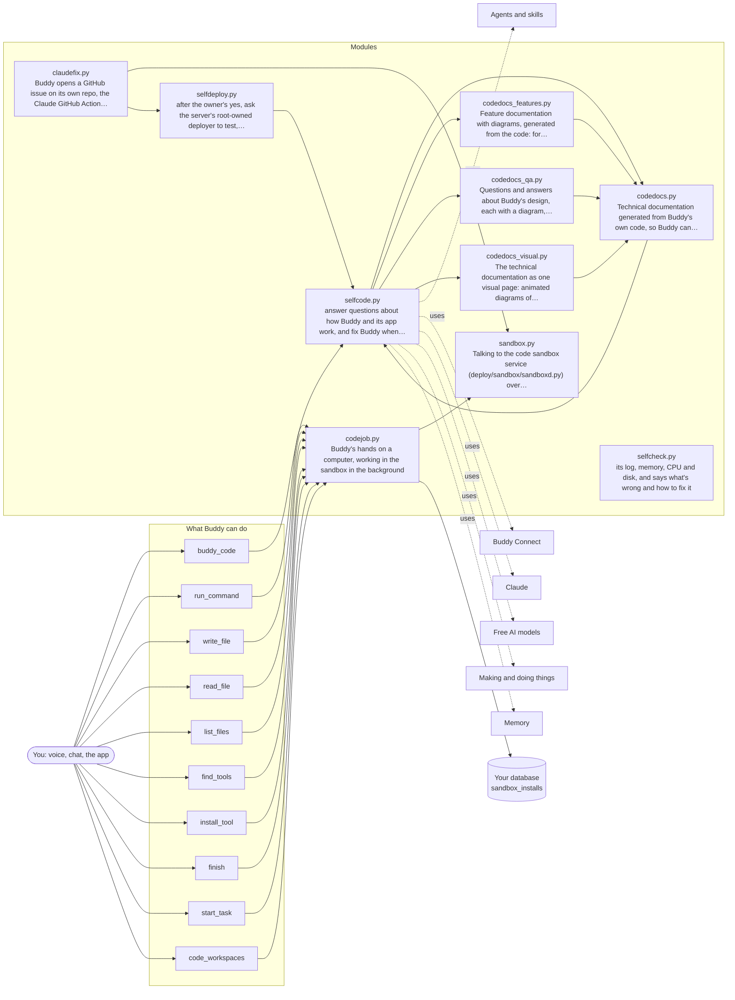

# Fixing and explaining itself

Reads its own code and these docs, draws its own architecture, checks its own server, and fixes itself on a branch you review.

## Architecture



The diagram reads left to right: what you ask, the tools Buddy uses, the modules that do the work, and what they keep or call. Dashed arrows are other features this one relies on.

## What Buddy can do here

| Tool | What it is for | Actions | Module |
|---|---|---|---|
| `buddy_code` | Your own code: Buddy's server (backend/buddy, Python), its Android app (android/, Kotlin), deploy scripts and data tools, exactly as running on this server | feature, architecture, design, docs, doc, export_docs, overview, search, read, recent, fix, deploy | selfcode.py |
| `run_command` | Run a shell command in /work (bash) | - | codejob.py |
| `write_file` | Create or replace a file (path relative to /work). | - | codejob.py |
| `read_file` | Read a file (path relative to /work), up to 200 KB. | - | codejob.py |
| `list_files` | List the files in the workspace (or a folder in it). | - | codejob.py |
| `find_tools` | Search Buddy's registry for vetted tools and ready-made skills (tested scripts with a guide) that fit a job, e.g | - | codejob.py |
| `install_tool` | Install tools from Buddy's registry into this workspace (pinned, checked versions) | - | codejob.py |
| `finish` | Done (or stuck): your summary for the user. | - | codejob.py |
| `start_task` | Hand a task to Buddy's task agent, which works on a computer (the sandbox on the server) in the background and tells the user when it's done, with the files it  | auto, free, haiku, sonnet | codejob.py |
| `code_workspaces` | The sandbox's workspaces (one per repo or task) and their disk use; or delete one. | - | codejob.py |
| `claude_code_fix` | Hand a fix to Buddy's own code to Claude Code (the GitHub Action on Buddy's repo, run on the owner's Claude subscription, not Buddy's API budget): use it when t | send, status, deploy | claudefix.py |
| `self_check` | Buddy's own server: problems in its log (crashes, out of memory, repeated errors, call audio stutters), grouped by cause and explained, with the fix; and the se | status, run | selfcheck.py |

## Technical design, module by module

### selfcode.py

```text
Buddy's own code: answer questions about how Buddy and its app work, and fix Buddy when asked.

  "Buddy, how do you decide which model to use?"   -> search + read the code that's running
  "Buddy, why did the form helper skip that field?" -> read formfill.py and FormHelper.kt
  "Buddy, fix that bug in yourself"                 -> a code task on Buddy's GitHub repo in the sandbox:
                                                       change, run the tests, and (after the user's yes)
                                                       push to a buddy/... branch for the user to merge

Reading uses the checkout on this server (/opt/buddy), which is exactly the code that's running.
Secrets never live in the repo, and files that could hold them (.env, databases, keys, the
agents file) are skipped anyway. Buddy never deploys itself: a fix lands on a branch, the user
merges it on GitHub and runs update.sh.
```

- Settings: `BUDDY_SELF_BRANCH`, `BUDDY_SELF_REPO`, `BUDDY_SELF_ROOT`
- Uses: codedocs.py, codedocs_features.py, codedocs_qa.py, codedocs_visual.py, makers.py, tools.py

### codedocs.py

```text
Technical documentation generated from Buddy's own code, so Buddy can explain its design and details.

Built from the code that's running (the same checkout selfcode.py reads), with no model and no cost:
  - every Python module: what it's for (its docstring), its classes and functions with their signatures and
    descriptions, the tools it gives Buddy, the server endpoints, the database tables, the settings it reads, and
    which other modules it uses and is used by;
  - every Kotlin file of the app: its documented classes, screens and functions;
  - every deploy script: what its header says it does;
  - the hand-written guides in docs/: one section per heading;
  - index pages across the whole code: the design overview, all tools, endpoints, settings, tables and the Buddy
    Connect services.
The pages are rebuilt whenever the code changes, kept in memory only, and searched with SQLite's full-text index
(word forms included: "booking" finds "book"). Code holds no personal data (selfcode skips files that could).
```

- Uses: gateway.py, selfcode.py

### codedocs_features.py

```text
Feature documentation with diagrams, generated from the code: for every feature of Buddy, its technical design
and an architecture diagram, so Buddy can explain any part of itself and show how the pieces connect.

  A feature is one entry of codedocs.COMPONENTS: a name, what it does, and the server modules that make it up.
  For each one this builds, from the running code and with no model:
    design      each module's own description (its docstring is the design note, kept next to the code it
                describes, so it can't drift from it)
    tools       what Buddy can do in this feature (the tool names and what each is for)
    data        the database tables the feature keeps, the settings it reads, the server endpoints it serves
    services    the outside services it calls through Buddy Connect, with whether each may see personal data
    links       the other features it relies on, and the ones that rely on it
    diagram     you -> the tools -> the modules -> the database, the outside services and the other features

  Three ways it is used:
    in conversation  "how does the deals collector work?", "show me the investing architecture": Buddy answers
                     from the design and the diagram appears in the chat as an image (Graphviz on the server)
    the whole thing  "show me Buddy's architecture": every feature in one diagram
    as documents     python -m buddy.codedocs_features docs/architecture writes one Markdown page per feature
                     (diagrams as Mermaid, which GitHub draws) and an overview page

Code holds no personal data, and nothing here leaves the server.
```

- Uses: codedocs.py, gateway.py, makers.py, tools.py

### codedocs_qa.py

```text
Questions and answers about Buddy's design, each with a diagram, written from the generated documentation.

For every component (codedocs.COMPONENTS), a model reads that component's documentation and writes the questions
the owner is likely to ask ("How does Buddy Connect keep my data private?"), a short answer, and the answer's steps,
which the visual page draws as an animated diagram. The documentation is Buddy's code, which holds no personal
data, so the free models write them; Claude's quick model only when none of them can. Answers are kept and
rewritten only when that component's documentation changes.
```

- Uses: codedocs.py, free_models.py

### codedocs_visual.py

```text
The technical documentation as one visual page: animated diagrams of how Buddy works, drawn from the code.

  - Architecture: the phone, the server, Claude, the free models, Buddy Connect and the database, with moving dots
    showing which way data flows (and a count of modules, tools, endpoints and tables read from the code).
  - Two flows, animated step by step: a chat message, and a phone call.
  - Buddy Connect: every service, grouped, coloured by whether it may see personal data.
  - Every server module: what it's for, and a small map of what it uses and what uses it.
  - Tools, endpoints, tables and settings, with a search box over the whole page.

One self-contained HTML file (inline SVG, CSS and a few lines of script; no outside libraries): it downloads to the
phone and opens offline in the browser. Every piece of text from the code is escaped.
```

- Uses: codedocs.py, free_models.py, gateway.py

### codejob.py

```text
The task agent: Buddy's hands on a computer, working in the sandbox in the background.

Anything that needs real work rather than a quick answer: crunch numbers or analyse a
spreadsheet, convert or merge files, download and process data from the web, write and run a
script, build a report, a spreadsheet, a PDF or slides, or work on code in a GitHub repo.
It works in its own workspace, inside the sandbox's throwaway containers (Buddy never runs
code itself), stops at a cost cap and a step limit, and when it's done Buddy tells you, with
the files it made as cards in the chat and the full report (steps, checks, changes) in
Reports. One-off workspaces are deleted once the results are delivered; repo workspaces are
kept. Nothing is pushed to GitHub until you say yes, and only to a new buddy/... branch.

Repo content is untrusted: the agent here has only the sandbox tools, so text in a repo
can't make it read your email or spend money, and the sandbox can't reach Buddy.
```

- Tables: `sandbox_installs`
- Settings: `BUDDY_CODE_MAX_STEPS`, `BUDDY_CODE_MODEL`, `BUDDY_CODE_TASK_CAP_USD`, `BUDDY_TASKS_DAILY_LIMIT`
- Uses: agent.py, config.py, datatools.py, free_models.py, jobs.py, makers.py, model_advisor.py, privacy.py, registry.py, sandbox.py, tools.py, usage.py

### sandbox.py

```text
Talking to the code sandbox service (deploy/sandbox/sandboxd.py) over its local socket.

The sandbox runs code in throwaway containers, away from Buddy: Buddy never runs a command
itself, it asks the sandbox to. Nothing here works until deploy/sandbox.sh has set it up.
```

- Settings: `BUDDY_SANDBOX_SOCKET`

### selfdeploy.py

```text
Self-deploy, Buddy's side: after the owner's yes, ask the server's root-owned deployer to test, merge and deploy
Buddy's own fix (deploy/selfdeploy.sh does the work, and refuses anything touching Buddy's guard rails), then tell the
owner how it went: deployed, refused (and why), or rolled back.

Buddy can only drop a request here; it can't merge, deploy or skip the checks. Off until the owner runs
`sudo bash /opt/buddy/deploy/selfdeploy.sh on`.
```

- Settings: `BUDDY_DEPLOY_DIR`, `BUDDY_SELFDEPLOY_FLAG`
- Uses: selfcode.py

### claudefix.py

```text
Hand a code fix to Claude Code: Buddy opens a GitHub issue on its own repo, the Claude GitHub Action fixes it on a
buddy/claude-... branch (on the owner's Claude subscription), and Buddy tells the owner when it's ready to review.
Deploying it goes through self-deploy as usual: tests again, guard rails refused, merge, deploy, roll back if sick.

Every step that acts needs the owner's yes, read in code (thrift). The brief is code instructions only: never the
owner's personal data (it becomes issue text on GitHub). The GitHub token stays in the sandbox service.
```

- Uses: sandbox.py, selfdeploy.py

### selfcheck.py

```text
Buddy looks at its own server: its log, memory, CPU and disk, and says what's wrong and how to fix it.

Once a week, Friday morning (SELFCHECK_DAY, SELFCHECK_HOUR), over the past week (memory and disk are read every
hour in between, locally and free, so the report covers the whole week):
  log      the past week of Buddy's own service log (journalctl -u buddy; the service is in the systemd-journal group
           for this), only problem lines: crashes and out-of-memory kills, tracebacks, errors, warnings, call audio
           stutters. Call words (the "heard:"/"decided:" lines of call debugging) are skipped, numbers, emails and
           account-like strings are masked. Grouped by cause ("mail sorting: BudgetStop, 40 times").
  server   memory (and swap), load, disk, from this machine; the DigitalOcean droplet's size and price with a
           read-only token (BUDDY_DO_TOKEN, droplet:read), so a resize can be suggested. Buddy never resizes,
           reboots or changes the server: the owner does that in DigitalOcean.
  diagnose only when a new kind of problem appears, one small Claude call (the quick model) explains each in plain
           words with the fix; code problems come with a brief for Claude Code (code instructions only), which the
           owner sends with "send it to Claude" (claude_code_fix asks first, then self-deploy tests and rolls back).
  tell     the weekly report as one message (outside quiet hours); each problem at most once a week.
Kept: the last report and 7 days of server samples. Nothing leaves the server except the masked lines to Claude.
```

- Settings: `BUDDY_DO_TOKEN`
- Uses: config.py, memory.py, privacy.py, tools.py, usage.py

## How it connects

- Relies on: Agents and skills; Buddy Connect; Claude: the brain; Free AI models (Groq, Gemini, Mistral, Cerebras, GitHub Models, OpenRouter); Making and doing things; Memory; Security and privacy
- Relied on by: Claude: the brain; Free AI models (Groq, Gemini, Mistral, Cerebras, GitHub Models, OpenRouter); Insights and costs; Investing: signals, research and practice; Making and doing things; News, trends and research; Security and privacy; The price book, pattern learning and trained models; The server and the app

