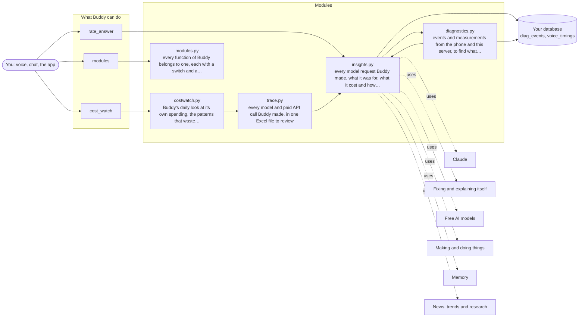

# Insights and costs

What Buddy spends and how well it does, model by model and service by service, and what makes it feel slow; and the modules: which parts are switched on for this server, and the meter that counts what each one is used for.

## Architecture



The diagram reads left to right: what you ask, the tools Buddy uses, the modules that do the work, and what they keep or call. Dashed arrows are other features this one relies on.

## What Buddy can do here

| Tool | What it is for | Actions | Module |
|---|---|---|---|
| `rate_answer` | The user judges your previous answer by voice ("that was wrong", "great answer", "that didn't help"): record it as a thumbs up or down for the models that worke | - | insights.py |
| `cost_watch` | Buddy's own cost analysis: yesterday's spend on AI models and paid APIs against a usual day, and the patterns wasting money (loops, repeated requests, spikes, a | analyse, since_reset, fix_brief, trace | costwatch.py |
| `modules` | Buddy's modules on this server: which are on, and what each was used for in a month and what that cost to run ("which modules are on?", "what did each module co | list, statement | modules.py |

## Technical design, module by module

### insights.py

```text
Insights: every model request Buddy made, what it was for, what it cost and how fast it came back.

Built from the model_calls log (one row per request; see usage.log_call). Previews are short
and masked; the log keeps 90 days.
```

- Tables: `voice_timings`
- Settings: `BUDDY_FREE_MODELS`, `BUDDY_ZAPIER_PLAN_USD`, `BUDDY_ZAPIER_TASKS_PER_MONTH`
- Uses: budgets.py, calls.py, config.py, diagnostics.py, free_models.py, memory.py, tools.py, travel.py, usage.py, webread.py, whisper.py

### trace.py

```text
The request trace: every model and paid API call Buddy made, in one Excel file to review.

  Summary      totals; where the money went by kind of work, by model and by hour; what a chat reply's cost is made of
               (fresh input, reading the cache, writing the cache, output); the 25 costliest calls
  Calls        one row per model call: time, provider, model, kind of work, tokens (fresh, cache read, cache write,
               output), its cost split into those four parts, seconds, failed or not, why it stopped, the tools it
               asked for, and short masked previews of what was asked and answered
  Outside APIs one row per paid or free API call (search, travel prices, transit...)

From the last cost reset (or the last N days). Previews are the same short, masked ones Insights shows; room speech
(other people's words) is never in them. Made by code, no AI: the trace itself costs nothing.
```

- Uses: budgets.py, insights.py, makers.py, memory.py, tools.py, usage.py

### costwatch.py

```text
Cost watch: Buddy's daily look at its own spending, the patterns that waste money, and where in its code they are.

Every morning (code only: no AI, so the analysis itself costs nothing) it reads yesterday's model and API calls against
the 7 days before and looks for the patterns behind the bugs that have cost money before:

  loop          one kind of background work calling far more often than it's useful (the briefing that was rewritten
                every 15 seconds while the phone was away; the market scan that re-ran all evening)
  repeat        the same request sent again and again (an answer thrown away and asked for again)
  spike         a kind of work costing 3x or more its usual day
  big model     a premium model writing short background text a quick model would do as well
  no cache      big prompts sent again and again without prompt caching
  cut off       answers stopping at the token limit (paid for, then often redone)
  failing       paid calls failing (paid for, nothing used) and free models failing (work falls to paid ones)
  duplicates    the same report saved many times in a day

Each finding has its cost, an estimated monthly saving, a recommendation, and where it lives in the code (file:line,
found by searching the running code for the purpose's name). The report lands in Reports, a short message goes out
in the morning, and a ready brief lets Buddy fix itself: a code task on its own repo (tests run, pushed to a branch
only after the user's yes; never deployed by Buddy).
```

- Uses: budgets.py, jobs.py, makers.py, memory.py, selfcode.py, tools.py, trace.py

### diagnostics.py

```text
Diagnostics: events and measurements from the phone and this server, to find what makes Buddy feel
slow or deaf: the microphone, the phone putting the app to sleep, the network, or the server.

Never audio, never words: only times, levels, error codes and device states. Kept 30 days.
On by default; BUDDY_DIAGNOSTICS=0 on the server (or "Collect diagnostics" off in the app) stops it.
Self-contained on purpose: this file plus one-line hooks, so it's easy to switch off or revert.

  phone   mic (which mic, route changes, Bluetooth drops, recorder failures), each clip's levels
          (noise, speech, speech-to-noise ratio, clipping, clips dropped as too short), recognizer
          errors, app in background / foreground, battery saver and Doze, network type and changes,
          connection drops and reconnect time, ping to the server, Buddy's own voice heard back
  server  speech to text (engine, time, confidence, fallbacks), clips waiting in line, phone
          connections, slow replies with the server's load and free memory at that moment
```

- Tables: `diag_events`
- Settings: `BUDDY_DIAGNOSTICS`, `BUDDY_GROQ_KEY`
- Uses: insights.py, memory.py

### modules.py

```text
Modules: every function of Buddy belongs to one, each with a switch and a meter (docs/PLATFORM.md).

  core      always on: the brain, Maestro, Buddy Connect, memory, security and privacy, costs, the server and app
  module    a part Buddy already has (Voice, Money, Travel...): on or off for this server
  wearable  the new parts for glasses. Devices and Link are built (glasslink.py). The rest (Vision, Voice on a
            device, Integrations...) are listed here and cannot be on until they are

THE SWITCH belongs to whoever runs the server, not to the person talking to Buddy: it is the setting BUDDY_MODULES
in the server's root-only settings (deploy/modules.sh changes it). In a conversation the modules can be listed,
never switched.

  unset, or "all"       everything Buddy has today is on: the owner's own server is unchanged
  "core"                core only: where a new customer's server starts
  "all,-investing"      everything but one
  "core,voice,money"    just those

A module that is off does not exist for the conversation: its tools are not offered to Claude (allowed), and a
call to one is refused (refusal). The background loops that belong to one module (email, price watches, bank
feeds, the tutors) do not start. Not gated yet: the app's pages, and the jobs inside the loop that speaks up on its
own (proactive.py).

THE METER is one line a day for each module and unit (the table module_usage): how many, and what it cost to run.
It is written as things happen, at the places Buddy already logs its work:

  request        a model request made for the module, with its cost            (usage.log_call)
  use            a tool of the module was run                                   (usage.log_tool)
  outside_call   a paid outside service was called for the module, with its cost (travel.log_call)
  minute         speech heard (Voice) or time on the line (Phone calls)
  day_on         the module was on that day
  device_day     a pair of glasses was connected that day, once for each device (mark); a statement counts the
                 different devices of the month as active_device
  ...            whatever a module records itself with record(): image, action, seat_month

Lines are kept for three years. A wrong or failing meter never breaks a reply: every hook swallows its errors.

THE PRICE LIST is the operator's table, kept out of the code: a CSV file named by BUDDY_PRICE_LIST with the columns
module,unit,price_usd. Without it a statement shows counts and running cost and no charge. Charging (an invoice,
a card) is not built.
```

- Settings: `BUDDY_MODULES`, `BUDDY_PRICE_LIST`

## How it connects

- Relies on: Claude: the brain; Fixing and explaining itself; Free AI models (Groq, Gemini, Mistral, Cerebras, GitHub Models, OpenRouter); Making and doing things; Memory; News, trends and research; Phone calls; Travel and getting around; Voice: Talk mode and Listen-in
- Relied on by: Claude: the brain; Free AI models (Groq, Gemini, Mistral, Cerebras, GitHub Models, OpenRouter); Phone calls; Security and privacy; Speaking up on its own: briefing, reminders and alerts; The server and the app; Travel and getting around; Voice: Talk mode and Listen-in

