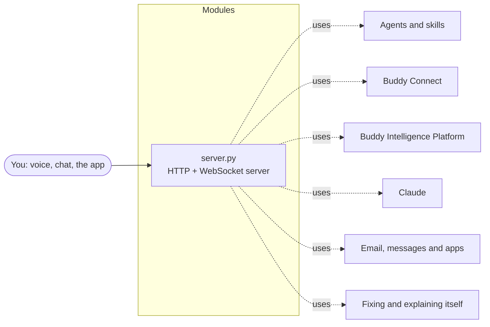

# The server and the app

The one server the phone talks to: the chat connection, the app's pages and their data.

## Architecture



The diagram reads left to right: what you ask, the tools Buddy uses, the modules that do the work, and what they keep or call. Dashed arrows are other features this one relies on.

## Technical design, module by module

### server.py

```text
HTTP + WebSocket server. The phone connects to /ws and streams text both ways.

Protocol (JSON messages):
  phone -> server  {"type": "hello", "timezone": "America/Sao_Paulo"}  on connect
                   {"type": "user", "text": "..."}   something the user said
                   {"type": "interrupt"}              user started talking over Buddy
                   {"type": "ambient", "text": "...", "lang": "hi-IN"}
  phone -> server  {"type": "audio", "pcm": "<base64 16 kHz mono 16-bit>", "lang": "auto", "mode": "talk"}
  server -> phone  {"type": "heard", "text": "...", "lang": "es"}  (Whisper on the server)
  phone -> server  {"type": "rate", "turn": "a1b2c3", "up": true}  thumbs on a reply (null clears)
  phone -> server  {"type": "location", "lat": -12.12, "lng": -77.03, "accuracy": 50}  (when shared)
  server -> phone  {"type": "vocabulary", "words": [...]}  names and words to recognise (after hello)
  server -> phone  {"type": "thinking"}  the question arrived and Buddy is working on it
  server -> phone  {"type": "approval", "question": "..."}  Buddy is waiting for a yes:
                   show Approve / Decline; they send a user message "Yes, go ahead." / "No."
                                                      listen-in mode: speech around the user
                   {"type": "ambient_stop"}           listen-in mode switched off
                   {"type": "notification", "device", "app", "app_name", "title", "text",
                    "posted_at", "key"}               a notification on that phone
                   {"type": "phone_calendar", "device", "events": [{id, title, start,
                    end, calendar, location, all_day, busy_only}]}  the phone's next week
  server -> phone  {"type": "say", "text": "...", "filler": true?, "display": "..."?}  one sentence to speak
                                                      (display: what to show instead, e.g. English)
                                                      (filler: "hang on, checking" while tools run)
                   {"type": "cards", "turn": "a1b2c3", "cards": [...]}  results to show under the reply
                   {"type": "done", "turn": "a1b2c3", "how": "Answered by Claude · used calendar"} reply
                     finished (turn: for a thumbs rating; how: one line on how it was answered)
                   {"type": "nudge", "kind": "...", "text": "...", "job_id": 3, "id": "ab12", "category":
                    "Investing", "level": "alert" | "notify" | "quiet"}   (level: pop up and speak / silent
                                                      notification / chat only; id: for a thumbs rating, sent
                                                      back as {"type": "rate_nudge", "id": "ab12", "up": true})
                                                      Buddy speaking up (job_id: a finished
                                                      background job; see GET /api/jobs/{id})
                   {"type": "whisper", "kind": "...", "text": "..."}
                                                      listen-in: translation / about_you / correction
                   {"type": "open", "links": [{"app": "uber://...", "url": "https://...", "label": "..."}],
                    "compare": "id"}                  open Uber / Lyft with a trip filled in (the
                                                      first now, the next when Buddy is back in front);
                                                      with compare, the ride reader reads both prices
                   {"type": "form", "action": "read|scroll|fill", "id": "...", "fills": [...]}
                                                      the form helper: read / fill the browser form; the
                                                      phone answers {"type": "form_screen" | "form_result"}
                   {"type": "error", "text": "..."}
```

- Settings: `BUDDY_COMPANY_DOCS`, `BUDDY_DIAGNOSTICS`, `BUDDY_FRAGMENT_WAIT`, `BUDDY_INTEL_API_KEY`, `BUDDY_PROACTIVE_LOOP`, `BUDDY_TRACE`
- Endpoints: `GET /api/files/{file_id}`, `GET /health`, `GET /admin/agents`, `POST /admin/agents/{name}/{action}`, `GET /admin/connectors`, `POST /admin/connectors/{name}/{action}`, `GET /admin/audit`, `GET /admin/access-log`, `GET /api/compliance`, `POST /api/compliance/report` and 124 more
- Uses: addressee.py, advisor.py, agent.py, agents.py, ambient.py, attention.py, bankfeed.py, benchmarks.py, benefits.py, bip.py, brain.py, browse.py, budgets.py, builder.py, calls.py, card_optimizer.py, claudefix.py, codejob.py, companydocs.py, compliance.py, config.py, contacts.py, convolog.py, costwatch.py, crossmarket.py, dealforecast.py, deals.py, diagnostics.py, docread.py, factors.py, finance.py, finops.py, fundamentals.py, gateway.py, guard.py, health.py, health_data.py, insights.py, invest.py, jobs.py, labsetup.py, library.py, lifelog.py, location.py, maestro.py, maestro_usage.py, mailbrain.py, makers.py, maps.py, markets.py, memory.py, merchants.py, messaging.py, model_advisor.py, modeltrain.py, money.py, newsdesk.py, pausehabit.py, persona.py, plaid.py, pricebook.py, privacy.py, proactive.py, recommend.py, research.py, researchdesk.py, review.py, rides.py, securitywatch.py, selfcheck.py, selfdeploy.py, social.py, stratlab.py, stratrepo.py, stratrules.py, techradar.py, themes.py, thinking.py, thrift.py, today.py, tools.py, trace.py, transit.py, travel.py, travel_saved.py, trends.py, tutor.py, usage.py, vocabulary.py, voiceprint.py, watchpicks.py, whentobuy.py, whisper.py

## How it connects

- Relies on: Agents and skills; Buddy Connect; Buddy Intelligence Platform; Claude: the brain; Email, messages and apps; Fixing and explaining itself; Free AI models (Groq, Gemini, Mistral, Cerebras, GitHub Models, OpenRouter); Home and health; Insights and costs; Investing: signals, research and practice; Learning: the English and investing tutors; Making and doing things; Memory; Money; News, trends and research; Phone calls; Security and privacy; Shopping and deals; Speaking up on its own: briefing, reminders and alerts; The price book, pattern learning and trained models; Travel and getting around; Voice: Talk mode and Listen-in

