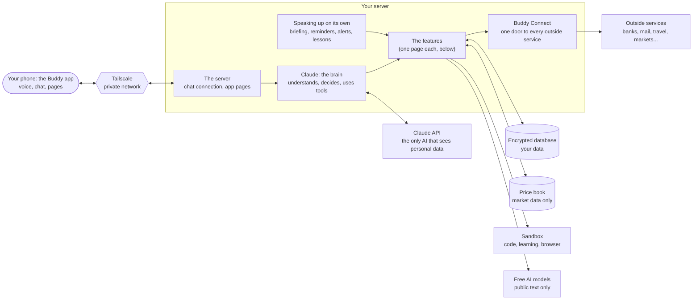
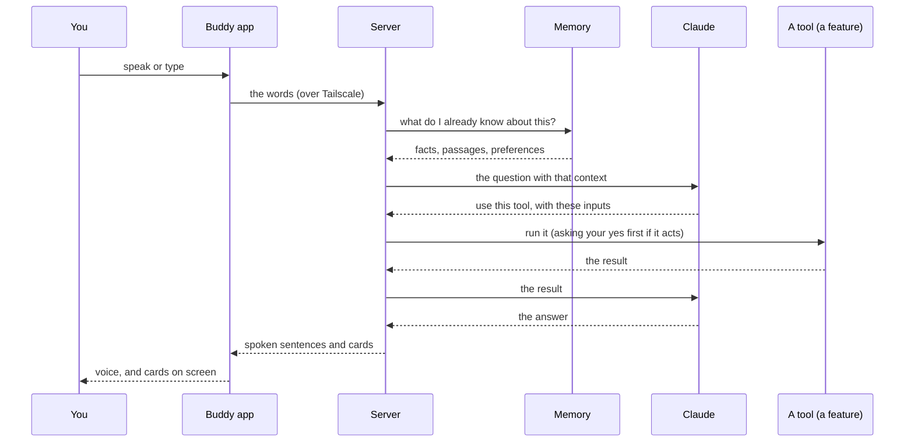
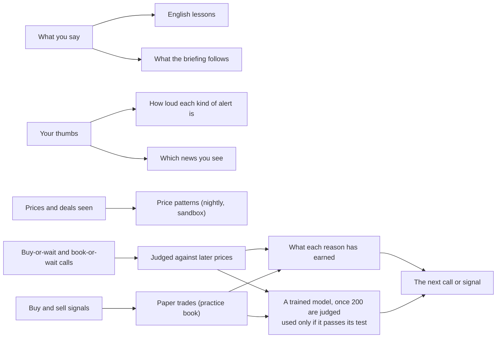

# Buddy: architecture and features

Generated from the code by `python -m buddy.codedocs_features docs/architecture`. Each feature page takes its
technical design from the descriptions kept in the modules themselves, so the pages match the code they were
generated from. Regenerate after changing the code.

## The whole system

## A question, end to end

## What learns from what

## Rules the design keeps

- Buddy never pays, books, transfers, submits, cancels, buys or trades by itself: every action needs your yes.
- Your personal data goes only to Claude, never to a free model; outside services get the least they need.
- Keys are entered at a hidden prompt on the server, never in chat, and are kept out of logs and prompts.
- Your data lives in an encrypted database on your server; market data is kept apart in the price book.
- Every prediction is written down when made and judged later, and says how much it has been right.

## The features

| Feature | What it does | Modules |
|---|---|---|
| [Claude: the brain](01-claude.md) | Understands you, decides what to do, picks the cheapest Claude model that does the job well, thinks from memory before calling the AI, follows your standing instructions, and asks before spending more | 12 |
| [Free AI models (Groq, Gemini, Mistral, Cerebras, GitHub Models, OpenRouter)](02-free-ai-models.md) | Do general work for free, never with your personal data: translating, summarising public text, brainstorming, general code questions | 5 |
| [Buddy Connect](03-buddy-connect.md) | One catalog and one way of calling every outside service: keys, backup hosts, rate limits, the personal-data check, logging and costs | 2 |
| [Memory](04-memory.md) | What Buddy knows and remembers: facts, the conversation log and its search, the documents library, your taste and daily routine, and connecting what it knows | 9 |
| [Voice: Talk mode and Listen-in](05-voice.md) | Hearing you (Whisper on your server or Groq), knowing when you talk to Buddy, your voice match, how you pause, the words it should hear right, and Listen-in's whispers | 7 |
| [Phone calls](06-phone-calls.md) | Calls businesses for you after your yes and answers calls: Plivo, Pipecat on your server, Deepgram, Claude and ElevenLabs; your contacts and meeting proposals | 3 |
| [Speaking up on its own: briefing, reminders and alerts](07-speaking-up-on-its-own.md) | The morning briefing with news, finance and events that follows what you talk about; reminders; and alerts whose loudness is learned from your thumbs | 6 |
| [Learning: the English and investing tutors](08-learning.md) | The morning investing lesson, the morning English lesson, the evening English review and live tips, and Market school | 3 |
| [Money](09-money.md) | Bank and card feeds (read-only), bills, the money advisor and review, card choices and benefits, cancelling subscriptions; never moves money | 13 |
| [Shopping and deals](10-shopping-and-deals.md) | Your shopping profile, buy now or wait, the daily deals collector, the deals inbox, deal forecasts and watches, price history, Amazon prices and seasonal prices; never buys | 10 |
| [The price book, pattern learning and trained models](11-the-price-book-pattern-learning-and-trained-models.md) | A separate market-price database, nightly pattern learning in the sandbox, and models trained on judged calls once there is enough data | 3 |
| [Investing: signals, research and practice](12-investing.md) | Chart setups and trade ideas, Reddit and news signals, buy and sell signals with a track record, live triggers, investor checklists, fund holdings, the committee and journal, a paper portfolio and Buddy's own practice book; never trades | 13 |
| [Travel and getting around](13-travel-and-getting-around.md) | Flights and hotels with book now or wait, checking the hotel direct, saved searches, seats, transit alerts, maps, rides, weather and where you are | 12 |
| [Going out: restaurants and events](14-going-out.md) | Finding and booking a table after your yes; events and films with links to buy tickets yourself | 2 |
| [News, trends and research](15-news-trends-and-research.md) | The topics you follow with a daily digest, what's trending, searching beyond the web index, reading pages on Buddy's side, and the background research agent | 5 |
| [Email, messages and apps](16-email-messages-and-apps.md) | Gmail and other accounts sorted and summarised, marketing and notices moved out of the inbox, messages, and package tracking | 7 |
| [Home and health](17-home-and-health.md) | Your Nest thermostat, your phone's health data and Oura Ring, and your health plan with public medical sources | 4 |
| [Making and doing things](18-making-and-doing-things.md) | Diagrams, charts, images, Word, PowerPoint, PDF and Excel; data crunching in the sandbox; a real browser Buddy drives; filling forms; rich cards in the chat; background jobs | 7 |
| [Agents and skills](19-agents-and-skills.md) | Specialist agents Buddy can connect or build, and its registry of tools and skills | 3 |
| [Buddy Intelligence Platform](20-buddy-intelligence-platform.md) | A shared layer, like Buddy Connect, that collects public evidence on emerging technologies (papers, clinical studies, company filings, federal awards, code, discussion), finds which are converging across sectors and what stage each is at, and that Buddy's other features read from | 5 |
| [Security and privacy](21-security-and-privacy.md) | Who can reach Buddy, lockouts, secrets kept out of logs and prompts, the encrypted database | 5 |
| [Fixing and explaining itself](22-fixing-and-explaining-itself.md) | Reads its own code and these docs, draws its own architecture, checks its own server, and fixes itself on a branch you review | 10 |
| [Insights and costs](23-insights-and-costs.md) | What Buddy spends and how well it does, model by model and service by service, and what makes it feel slow | 4 |
| [The server and the app](24-the-server-and-the-app.md) | The one server the phone talks to: the chat connection, the app's pages and their data | 1 |

24 features, 151 server modules. The app (Kotlin) and the deploy scripts are documented by `python -m buddy.codedocs`.
